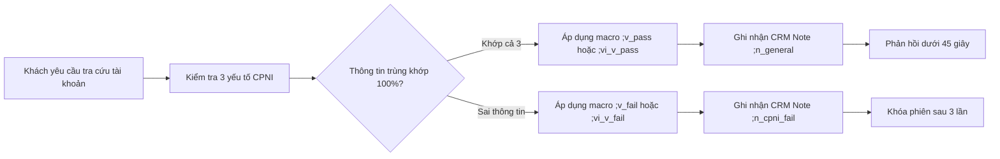
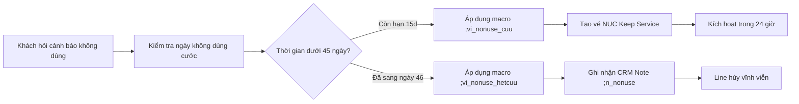
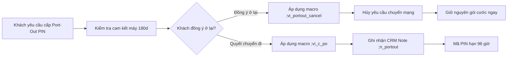
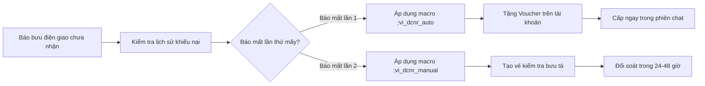
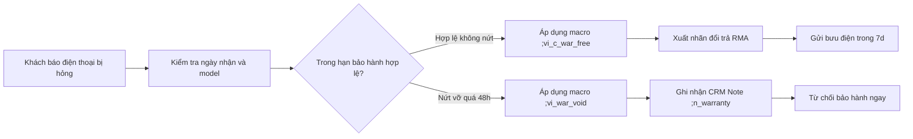
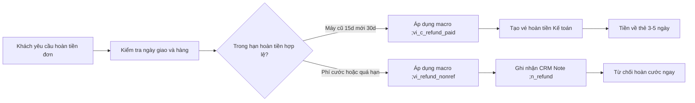

# Softel Solutions - Hệ thống Phím tắt Vận hành & Quy chuẩn Chăm sóc Khách hàng
**AirTalk Wireless & TAG Mobile - Vận hành Chương trình Trợ cấp Lifeline & ACP Liên bang**
*Phiên bản: 2026.4 (Clean Architecture & Dual English/Vietnamese)* | *Đại diện tổng đài mẫu: Martin*

---

## 1. Bảng Đối soát Thông số SLA & Bắt Lệch Chuẩn (Discrepancy Reconciliation Table)

Hệ thống phím tắt và tài liệu vận hành được kiểm toán tự động bằng công cụ `scripts/validate_snippets.py` để đảm bảo **0% độ lệch thông số** giữa thực tế tư vấn và quy định pháp lý của Ủy ban Truyền thông Liên bang (FCC) / Universal Service Administrative Company (USAC).

| Phân hệ Nghiệp vụ | Thông số Cũ / Lệch Chuẩn (Bị Phạt QA) | Thông số Kiểm toán Chuẩn (Audited Baseline) | Căn cứ Pháp lý & Rủi ro Fatal QA | Phím tắt Áp dụng (EN / VI) |
| :--- | :--- | :--- | :--- | :--- |
| **Hoàn tiền Thiết bị (Refund)** | Áp dụng cào bằng 7 ngày cho mọi đơn hàng. | • Máy cũ miễn phí: **15 ngày theo lịch** từ ngày giao.<br>• Máy mới & máy nâng cấp: **30 ngày theo lịch**.<br>• Hàng không lỗi trả lại: **7 ngày** (khách chịu cước gửi).<br>• Cước thuê bao, data nạp thêm, cước quốc tế: **Tuyệt đối không hoàn tiền**. | **Lỗi Fatal QA 25% (Hứa hẹn sai sự thật):** Báo 7 ngày cho máy mới là vi phạm hợp đồng; hứa hoàn cước viễn thông gây thất thoát tài chính. | `;c_refund_free` / `;vi_c_refund_free`<br>`;c_refund_paid` / `;vi_c_refund_paid`<br>`;y_refund_nonref` / `;vi_refund_nonref` |
| **Bảo hành Phần cứng (Warranty)** | Áp dụng 15 ngày cho toàn bộ thiết bị. | • Máy cũ miễn phí & phụ kiện: **15 ngày theo lịch**.<br>• Máy mới & máy nâng cấp: **30 ngày theo lịch**.<br>• Nứt vỡ, cấn móp ngoại quan: **Bắt buộc trong 48 giờ**.<br>• Nhãn gửi bưu điện RMA: **Có hạn 7 ngày làm việc**.<br>• Dòng máy FoxxD quá nhiệt/sập nguồn: **Gia hạn 60 ngày**. | **Lỗi Fatal QA / Thất thoát tài sản:** Báo nhận nứt vỡ sau 48h khiến công ty gánh chịu thiệt hại do người dùng; từ chối bảo hành 30 ngày của máy mới vi phạm FCC. | `;c_war_free` / `;vi_c_war_free`<br>`;c_war_paid` / `;vi_c_war_paid`<br>`;y_war_foxx` / `;vi_war_foxx`<br>`;y_war_cosmetic` / `;vi_war_cosmetic` |
| **Chuyển mạng Đi (Port-Out PIN)** | Báo mã PIN có giá trị 30 ngày. | • Mã PIN chuyển mạng (NTP PIN): **Chính xác 4 ngày (96 giờ)**.<br>• Cảnh báo bắt buộc: Mất trợ cấp Lifeline và bị phạt bồi hoàn máy MDM nếu chưa đủ 180 ngày hoạt động. | **Lỗi Fatal QA 30% (An ninh bảo mật):** Báo sai hạn PIN khiến lệnh port bị từ chối; bỏ qua cảnh báo 180 ngày làm mất quyền thu hồi thiết bị. | `;c_po` / `;vi_c_po`<br>`;y_portout_pin` / `;vi_portout_pin`<br>`;g_portout_cancel` / `;vi_portout_cancel` |
| **Không sử dụng (Lifeline Non-Usage)** | Báo mập mờ thời hạn 30 ngày hoặc 60 ngày. | • 30 ngày liên tục không dùng $\rightarrow$ Cảnh báo 15 ngày (Cure Notice).<br>• Tổng cộng: **45 ngày theo lịch**.<br>• **Ngày thứ 46**: De-enroll hủy dịch vụ, thu hồi số, khóa MDM Lost Mode. | **FCC 47 CFR § 54.405 / 54.407:** Không tuân thủ dẫn đến truy thu quỹ viễn thông công ích USAC và phạt hành chính liên bang. | `;c_nonuse_cuu` / `;vi_c_nonuse_cuu`<br>`;c_nonuse_het` / `;vi_c_nonuse_het`<br>`;y_nonuse_rule` / `;vi_nonuse_rule` |
| **Cam kết Thiết bị (MDM Subsidy)** | Báo khách bị ràng buộc cam kết 365 ngày. | • Cam kết dịch vụ thiết bị: Đúng **180 ngày hoạt động liên tục**.<br>• Chu kỳ nhận máy miễn phí: **1 máy / 365 ngày mỗi hộ**. | **Vi phạm Hợp đồng:** Nhầm lẫn giữa 180 ngày cam kết máy và chu kỳ 365 ngày nhận máy gây khiếu nại lừa đảo người tiêu dùng. | `;y_mdm_disclosure` / `;vi_mdm_disclosure`<br>`;y_byod_365d` / `;vi_byod_365d`<br>`;c_mdm_buyout` / `;vi_c_mdm_buyout` |
| **Mở khóa SIM (PUK Code)** | Không cảnh báo rủi ro số lần nhập sai. | • Nhập sai SIM PIN quá 3 lần đòi mã PUK.<br>• **Nhập sai PUK quá 10 lần**: Cháy thẻ SIM vĩnh viễn. | **Trải nghiệm khách hàng:** Khách nhập sai 10 lần làm hỏng SIM, mất liên lạc khẩn cấp 911. | `;c_puk` / `;vi_c_puk`<br>`;y_puk_warning` / `;vi_puk_warning` |
| **Đổi số Điện thoại (MDN Change)** | Cho phép đổi số vô tội vạ hoặc thu phí sai. | • **Miễn phí 2 lần trong vòng 3 chu kỳ cước**.<br>• Kể từ lần thứ 3 trở đi: Thu phí tiêu chuẩn **$25.00/lần**. | **Thất thoát doanh thu:** Đổi số không giới hạn gây cạn kiệt tài nguyên kho số viễn thông. | `;c_mdn` / `;vi_c_mdn`<br>`;y_mdn_policy` / `;vi_mdn_policy` |

---

## 2. Bộ Quy chuẩn Phòng chống Lỗi Fatal QA (QA Survival & Compliance Rules)

Chương trình đánh giá chất lượng (QA Audit) áp dụng khung điểm 100 với **3 nhóm lỗi đánh trượt trực tiếp (Fatal Failures - Điểm 0%)**:

### 2.1 Vi phạm Bảo mật CPNI (Fatal 0% - Trừ toàn bộ điểm ca trực)
1. **Xác thực 3 yếu tố trước khi tiết lộ thông tin:** Tuyệt đối không cung cấp số điện thoại, số dư, đơn hàng, tracking hay thông số kỹ thuật nếu khách chưa vượt qua: **Họ tên đầy đủ**, **Ngày sinh (DOB)**, và **4 số cuối SSN**.
2. **Nghiêm cấm "Coaching" (Gợi ý đáp án):** Không được gợi ý khi khách đoán mò (ví dụ: *"Có phải tên anh bắt đầu bằng chữ T?"*, *"Có phải sinh năm 1982 không?"*). Khi sai, chỉ dùng macro `;v_fail` hoặc `;vi_v_fail`.
3. **Quy tắc Người gọi hộ (Third-Party Callers):** Vợ/chồng/con gọi hộ chỉ được hỗ trợ nếu **chính chủ tài khoản có mặt trên máy**, tự vượt qua 3 yếu tố CPNI và nói lời ủy quyền trực tiếp.
4. **Vệ sinh dữ liệu CRM:** Tuyệt đối **không đính kèm ảnh CCCD/Bằng lái xe vào CRM Activity Notes**. Chỉ lưu mã Ticket ID hoặc Chat Session ID đã mã hóa.

### 2.2 Cam kết Sai Sự thật & Vi phạm SLA (Fatal 0% - False Promise)
1. **Quy tắc Vàng về Cam kết 180 Ngày (Slide 138 - Cực kỳ quan trọng):**
   * **TUYỆT ĐỐI KHÔNG ĐƯỢC CHỦ ĐỘNG NHẮC ĐẾN CAM KẾT 180 NGÀY KHI:** Khách đang hỏi chuyển mạng ra (Transfer-Out), hoặc khách đang dính cảnh báo Non-Usage.
   * **CHỈ ĐƯỢC PHÉP NHẮC ĐẾN CAM KẾT 180 NGÀY KHI:** Khách chất vấn tại sao máy iPhone bị khóa sau khi hủy mạng, hoặc khi khách chủ động hỏi phương án mua đứt hợp đồng (Buyout).
2. **Quy chuẩn Bảo hành Nứt vỡ 48 Giờ:** Không bao giờ chấp nhận bảo hành cho máy nứt màn hình/cấn móp nếu khách báo sau 48 giờ kể từ lúc bưu điện phát hàng.
3. **Quy chuẩn Hoàn tiền Viễn thông:** Không bao giờ hứa hoàn lại tiền cước gọi, tiền mua thêm data 4G/5G đã kích hoạt.

### 2.3 Ứng xử Chuyên nghiệp & Ranh giới Giao tiếp
1. **Quy trình Ngắt kết nối 2 Lần Cảnh báo:** Nghiêm cấm tự ý đóng chat khi khách đang nói. Phải dùng `;warn_profane` (hoặc `;vi_warn_profane`) cảnh báo trước, nếu tiếp tục vi phạm mới được dùng `;disconnect_profane` (hoặc `;vi_disconnect`).
2. **Đồng cảm trước, Chính sách sau:** Khi khách bức xúc, câu đầu tiên bắt buộc phải là xoa dịu (Red Zone: `;r_deescalate` hoặc `;vi_deescalate`) trước khi nêu ranh giới quy định (Yellow Zone).

---

## 3. Bộ Quy tắc Bảo mật Thông tin Nội bộ & Chống Rò rỉ Dữ liệu (Anti-Leak Policy)

Để bảo vệ bí mật kinh doanh và tránh bị khách hàng khiếu nại lên FCC/BBB, nhân viên phải tuân thủ nghiêm ngặt các quy tắc an toàn thông tin sau:

### 3.1 Chuyển đổi Thuật ngữ Nội bộ sang Ngôn ngữ Khách hàng
| Thuật ngữ Nội bộ / Kỹ thuật ngầm | Rủi ro nếu để lộ cho Khách | Cách Diễn đạt Chuẩn mực với Khách hàng | Macro Chuẩn |
| :--- | :--- | :--- | :--- |
| **`BYOD cheat`** (Slide 85) | Khách kiện nhà mạng vu khống lừa đảo, khiếu nại lên FCC. | *"Chính sách công ty quy định mỗi hộ gia đình được tặng 1 máy miễn phí mỗi 365 ngày. Do nhà mình đã nhận máy trong năm qua, đơn này được cấp SIM BYOD để dùng cước miễn phí."* | `;c_byod_policy`<br>`;vi_c_byod_365d` |
| **`Hết cứu`** (Slide 59-61) | Thiếu chuyên nghiệp, gây hoảng loạn và tranh cãi tiêu cực. | *"Đường truyền đã chạm mốc Ngày 46 không phát sinh cước và đã bị de-enroll hủy theo quy định bắt buộc của chính phủ liên bang (USAC). Số đã được thu hồi về kho quốc gia."* | `;c_nonuse_het`<br>`;vi_c_nonuse_het` |
| **`Cứu được`** (Slide 62-65) | Khiến khách ỷ lại, không chịu thực hiện phát sinh cước. | *"Tài khoản của quý khách vẫn đang trong thời hạn ân hạn 15 ngày. Em đã ghi nhận sự đồng thuận giữ dịch vụ và tạo vé bảo vệ, quý khách vui lòng gọi/SMS ngay để giữ số."* | `;c_nonuse_cuu`<br>`;vi_c_nonuse_cuu` |
| **`Blacklisted - Hard Block`** (Slide 71) | Khách kích động tranh cãi về lý do bị liệt vào danh sách cấm. | **TUYỆT ĐỐI KHÔNG GIẢI THÍCH VỀ NON-USAGE.** Hướng dẫn khách liên hệ đường dây hỗ trợ chuyên biệt của pháp chế. | Chỉ trao đổi nội bộ |

### 3.2 Ẩn danh Nhân sự & Phân quyền Hàng đợi
* **Không cung cấp tên/email cá nhân:** Tuyệt đối không để lộ danh tính cá nhân của nhân sự kho vận hay kế toán.
* **Thay thế chức danh chuẩn:**
  * Thay thế tên cá nhân bưu chính bằng: **Bộ phận Giám sát Giao nhận & Gian lận (Logistics & Fraud Audit Team)**.
  * Thay thế tên quản lý kho bằng: **Trưởng Bộ phận Điều phối Kho vận (Warehouse Operations Lead)**.
  * Hàng đợi khiếu nại chuyển qua hệ thống Ticket nội bộ được mã hóa.

---

## 4. Sơ đồ Quy trình Vận hành Chuẩn (Chuẩn hóa 6 Bước - Tối đa 8 từ/Node)

Toàn bộ 6 sơ đồ vận hành cốt lõi được vẽ lại theo đúng một khuôn mẫu duy nhất:
`Trigger` $\rightarrow$ `Kiểm tra trên CRM` $\rightarrow$ `Quyết định` $\rightarrow$ `Macro áp dụng` $\rightarrow$ `Tạo Ticket` $\rightarrow$ `Cam kết SLA`
*(Mỗi node đảm bảo cô đọng, súc tích, không vượt quá 8 từ).*

### 4.1 Quy trình Xác thực CPNI & Bảo mật Tài khoản


### 4.2 Quy trình Vòng đời Thu hồi & Cứu Line Non-Usage


### 4.3 Quy trình Cấp PIN Chuyển mạng Đi & Quản lý Cam kết MDM


### 4.4 Quy trình Khiếu nại Giao hàng Thất lạc (DCNR)


### 4.5 Quy trình Đổi trả & Bảo hành Phần cứng Thiết bị


### 4.6 Quy trình Hoàn tiền & Hủy Giao dịch Đơn hàng


---

## 5. Cơ cấu Tổ chức Thư mục & Phân hệ Phím tắt (Repository Structure)

Hệ thống được thiết kế theo nguyên tắc **Clean Architecture**: Độc lập, phân tách tầng rõ ràng, triệt tiêu 100% code trùng lặp (DRY).

```
e:\softel\
├── README.md                           # Tài liệu vận hành master chuẩn hóa bằng Tiếng Việt
├── unikey_macro.txt                    # Bảng gõ tắt 288 mục cho Unikey & EVKey (Dual EN/VI)
├── .gitignore                          # Loại trừ các file binary nội bộ (.pdf, .docx, .png)
│
├── cheatsheet/                         # Cẩm nang tra cứu nghiệp vụ chuyên sâu
│   ├── MASTER_POLICY_MATRIX.md         # Bảng ma trận chính sách chuẩn hóa 8 phân hệ
│   ├── SOFTEL_INTERNAL_SOP_DEEP_DIVE.md# Phân tích kỹ thuật chi tiết 57 SOP nội bộ
│   ├── QA_SURVIVAL_PLAYBOOK.md         # Sổ tay sinh tồn QA, rubric 100 điểm & kịch bản de-escalation
│   ├── RAPID_LOOKUP_CTRL_F.md          # Từ điển tra cứu nhanh và phím tắt định tuyến
│   └── CONCURRENCY_WORKFLOW.md         # Quy trình xử lý đồng thời 3-5 phiên chat
│
├── espanso/                            # Cấu hình phần mềm Espanso Text Expander
│   ├── config/
│   │   └── default.yml                 # Cấu hình engine clipboard và phím tắt hệ thống
│   ├── archive/                        # Lưu trữ an toàn các file match cũ bị trùng lặp
│   └── match/                          # Tầng Match tách biệt theo Domain (288 Phím tắt)
│       ├── 00_core_system.yml          # Lời chào, giữ máy, chốt ca, ranh giới thô tục (15 snippets)
│       ├── 01_cpni_fraud.yml           # Xác thực CPNI 3 yếu tố, phòng chống gian lận (12 snippets)
│       ├── 02_application_order.yml    # Giấy tờ duyệt hồ sơ, CA Maximus, chính sách BYOD 365d (14 snippets)
│       ├── 03_transfer_nonusage.yml    # Transfer 10m, cứu line Non-usage, giới hạn SNU (16 snippets)
│       ├── 04_logistics_shipment.yml   # Giao nhận, DCNR đền voucher, LIT, RTS cấm gửi lần 3 (19 snippets)
│       ├── 05_hardware_warranty.yml    # Bảo hành 15d/30d/48h/60d Foxx, Hoàn tiền, Khóa MDM (21 snippets)
│       ├── 06_network_telecom.yml      # Port-in/out, PUK 10 lần cháy SIM, Voicemail, Đổi số (19 snippets)
│       ├── 07_retention_loyalty.yml    # Giữ chân Trade-in, tặng Data 2GB, Loyalty 3 tháng (9 snippets)
│       ├── 08_account_maintenance.yml  # Đổi địa chỉ Mailing vs Service, khóa cấm đổi bang (7 snippets)
│       ├── 09_speed_combos.yml         # Tổ hợp Lego 3-Zone (Red + Yellow + Green) phản xạ nhanh (20 snippets)
│       ├── 10_crm_notes.yml            # Mẫu biểu ghi chú nội bộ CRM Activity Notes (11 snippets)
│       └── 11_vietnamese_qr.yml        # Toàn bộ phản hồi chuẩn mực bằng Tiếng Việt (;vi_) (125 snippets)
│
└── scripts/                            # Bộ công cụ tự động hóa và kiểm toán hệ thống
    ├── validate_snippets.py            # Kiểm toán cú pháp, bắt lệch SLA, bắt lỗi QA & lộ nội bộ
    ├── export_unikey.py                # Chuyển đổi toàn bộ YAML sang bảng mã unikey_macro.txt
    └── sync_espanso.py                 # Đồng bộ tự động các file match vào %APPDATA%\espanso
```

---

## 6. Hướng dẫn Vận hành, Kiểm toán & Triển khai

### 6.1 Kiểm toán Toàn diện bằng Script
Trước khi đưa vào ca trực, chạy script kiểm tra chất lượng để đảm bảo không có bất kỳ lỗi lệch SLA, lỗi QA hay rò rỉ nội bộ nào:
```powershell
python scripts/validate_snippets.py
```
*Kết quả đạt chuẩn: 0 lỗi trùng lặp, 0 lỗi lệch thông số SLA, 0 lỗi rò rỉ thông tin nội bộ.*

### 6.2 Đồng bộ vào Ứng dụng Espanso
Đồng bộ toàn bộ các module phím tắt vào thư mục cấu hình Espanso trên hệ thống Windows:
```powershell
python scripts/sync_espanso.py
```

### 6.3 Xuất file Macro cho Unikey / EVKey
Xuất toàn bộ 288 phím tắt (cả tiếng Anh và tiếng Việt) sang file `unikey_macro.txt`:
```powershell
python scripts/export_unikey.py
```
*Cách nạp vào Unikey:* Mở bảng điều khiển Unikey $\rightarrow$ **Mở rộng** $\rightarrow$ Tích chọn **Bật tính năng gõ tắt** $\rightarrow$ Chọn **Bảng gõ tắt** $\rightarrow$ Sao chép hoặc chọn file `unikey_macro.txt`.
