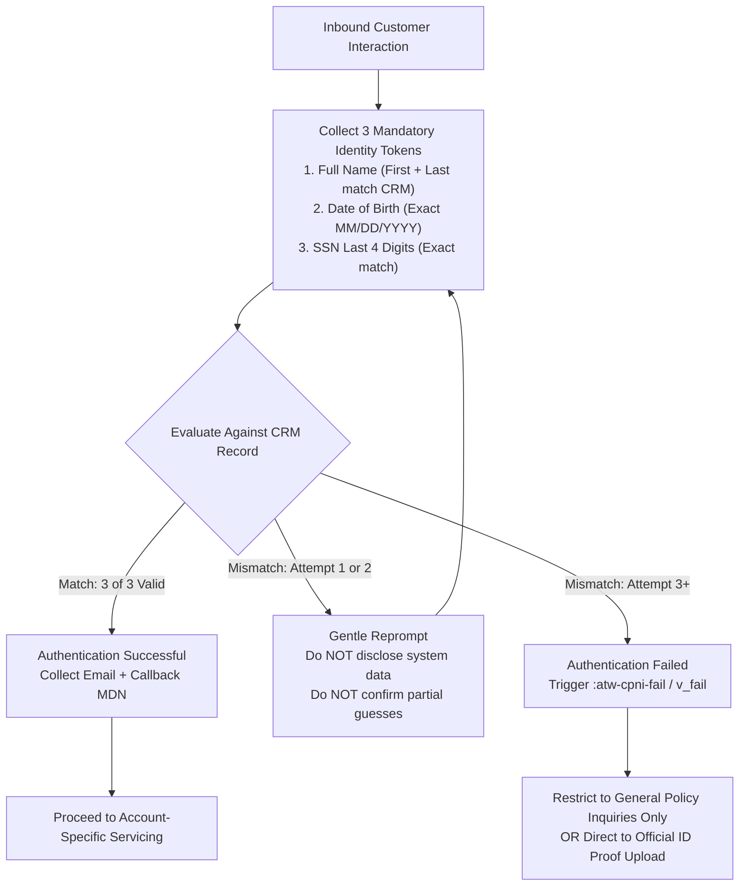
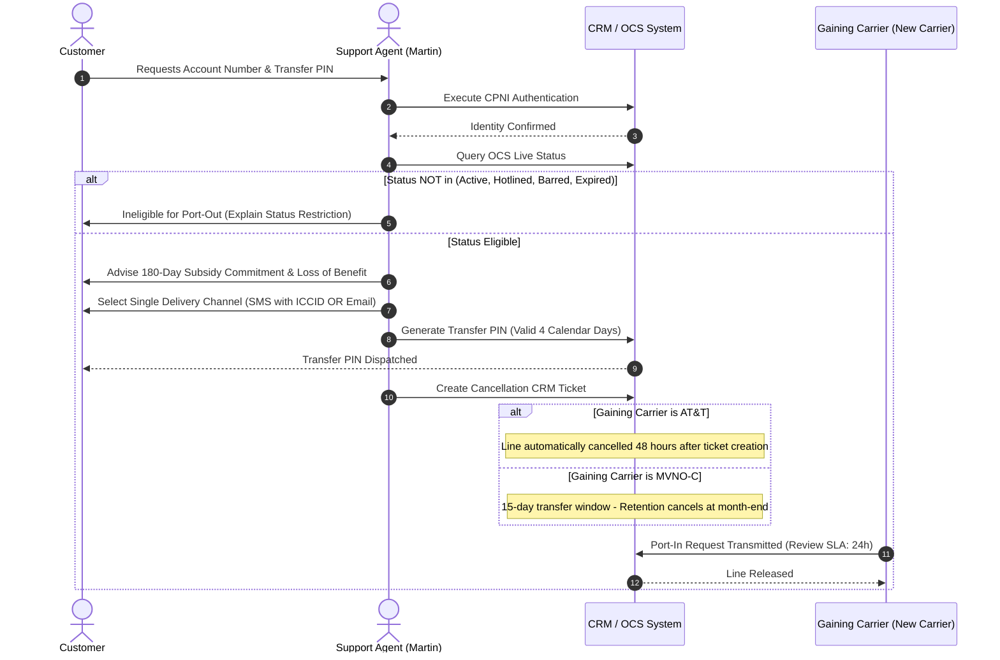
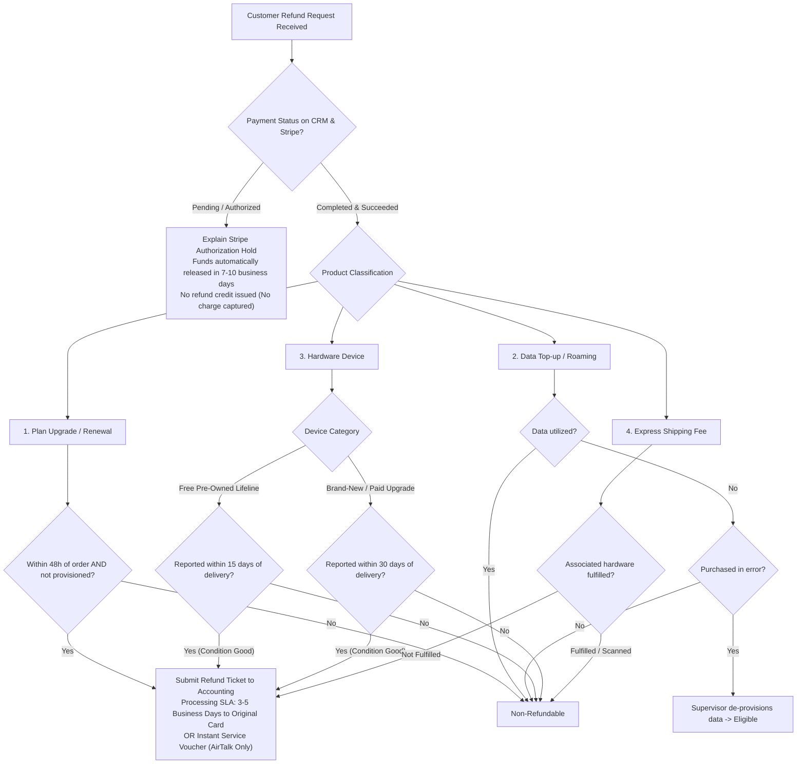
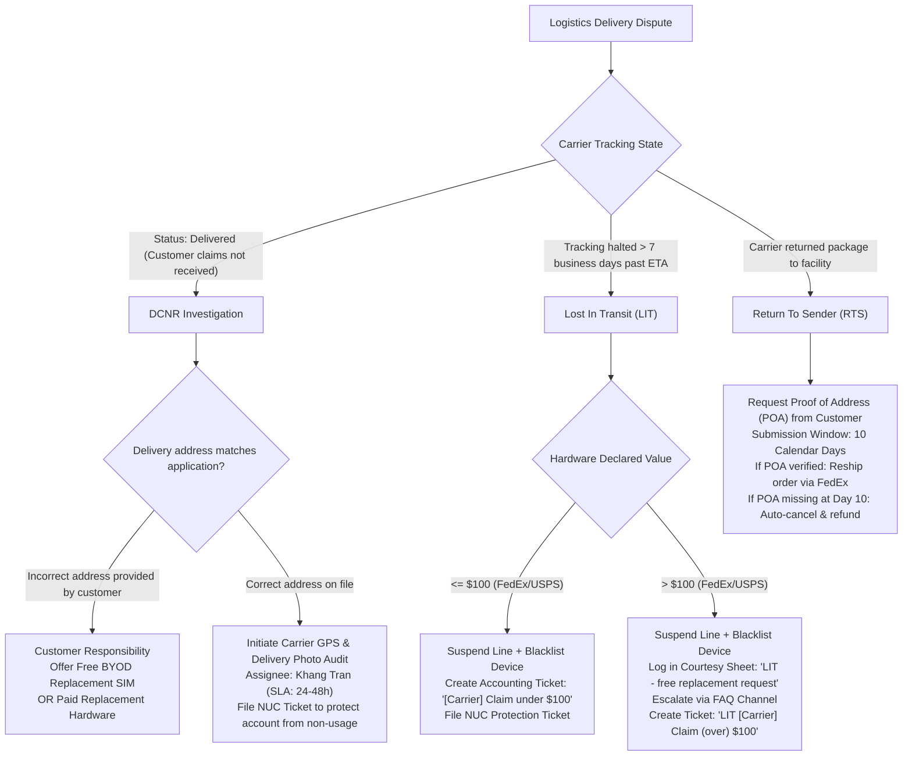
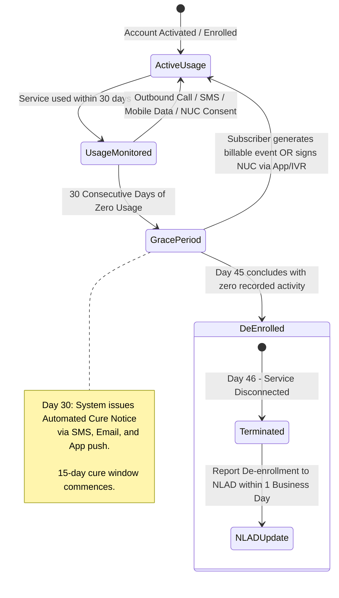
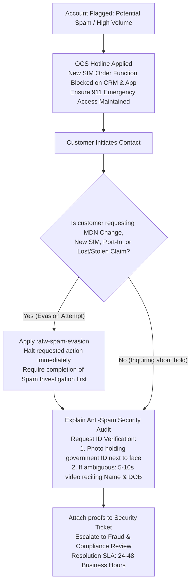

# Softel Solutions - Customer Support Operations & Text Expansion System

**AirTalk Wireless & TAG Mobile - Lifeline & Affordable Connectivity Program (ACP) Operations**


---


## 1. System Overview & Operational Context


This repository houses the configuration files, operational reference matrices, and automation tools supporting Tier 1 Customer Support Representatives (CSR) and Chat Agents at Softel Solutions. The system supports two Eligible Telecommunications Carrier (ETC) brands: **AirTalk Wireless** and **TAG Mobile**.


Operating in the federal telecommunications domain requires compliance with strict statutory and regulatory mandates established by the Federal Communications Commission (FCC) and the Universal Service Administrative Company (USAC). Agents handle high-concurrency inbound interactions across multiple platforms (LiveChat, internal CRM portals, ticketing queues) under rigorous Quality Assurance (QA) auditing standards.


### 1.1 Core Objectives

- **Zero Fatal QA Errors:** Enforce standardized responses containing mandatory statutory disclosures, accurate service-level agreements (SLA), and Customer Proprietary Network Information (CPNI) safeguards.

- **Cognitive Load Reduction:** Eliminate reliance on memory for complex, multi-tiered policies across 57+ Standard Operating Procedures (SOPs).

- **Consistent Empathy & De-escalation:** Standardize initial interaction protocols to de-escalate hostile contacts before presenting policy constraints.

- **Dynamic Field Injection:** Replace static text placeholders with interactive dynamic forms (`ticket_id`, `port_out_pin`, `puk`) to eliminate placeholder leakage.


---


## 2. Architectural Framework: The 3-Zone Modular Engine


The response architecture organizes all customer communications into three decoupled layers. This structure enables either single-block deployment or full multi-zone composition depending on customer emotional state and conversation progress.


```

+-----------------------------------------------------------------------------------+

|                            3-ZONE MODULAR ARCHITECTURE                             |

+-----------------------------------------------------------------------------------+

|  [RED LAYER: Empathy & De-escalation]                                             |

|  - Validates customer frustration, downtime, or logistics disruption              |

|  - Strictly avoids policy justification or technical defense                      |

+-----------------------------------------------------------------------------------+

                                          |

                                          v

+-----------------------------------------------------------------------------------+

|  [YELLOW LAYER: Statutory Boundaries & Policy Constraints]                        |

|  - States FCC/USAC guidelines, company terms, and technical limitations           |

|  - Delivers exact timeframes (15d/30d/48h/180d) without false promises            |

+-----------------------------------------------------------------------------------+

                                          |

                                          v

+-----------------------------------------------------------------------------------+

|  [GREEN LAYER: Actionable Resolution & SLA Commitment]                            |

|  - Executes troubleshooting steps or creates tracked CRM escalation tickets       |

|  - Commits to verifiable follow-up timeframes (24-48 business hours)              |

+-----------------------------------------------------------------------------------+

```


---


## 3. Repository Directory Structure


```

e:\softel\

├── .gitignore                          # Excludes internal PDF/DOCX binaries from tracking

├── README.md                           # Master system documentation and operational guide

├── unikey_macro.txt                    # 163-entry macro definition file (Clean Architecture) for Unikey / EVKey

│

├── cheatsheet/                         # Operational reference documentation

│   ├── MASTER_POLICY_MATRIX.md         # Definitive policy matrix covering 8 core domains

│   ├── SOFTEL_INTERNAL_SOP_DEEP_DIVE.md# Granular technical breakdown of all 57 internal SOPs

│   ├── QA_SURVIVAL_PLAYBOOK.md         # Compliance handbook, fatal error rubrics & de-escalation

│   ├── RAPID_LOOKUP_CTRL_F.md          # 3-step triage guide and keyword search dictionary

│   └── CONCURRENCY_WORKFLOW.md         # Execution playbook for managing 3-5 concurrent sessions

│

├── espanso/                            # Espanso text expander configuration suite (Clean Architecture & DRY)

│   ├── config/

│   │   └── default.yml                 # Global Espanso settings (clipboard engine, hotkeys)

│   ├── archive/                        # Archived legacy/monolithic configuration files

│   └── match/                          # Domain-Driven Decoupled Match Layer (163 Standardized Snippets)

│       ├── 00_core_system.yml          # System greetings, hold updates, keep-alive & boundary enforcement (;)

│       ├── 01_cpni_fraud.yml           # CPNI 3-token authentication, fraud defense & vishing flags (;)

│       ├── 02_application_order.yml    # Enrollment proofs, 925/CA approval flows, BYOD cheat & order change (;)

│       ├── 03_transfer_nonusage.yml    # Lifeline transfers (10m rule), Non-Usage (Cứu/Hết cứu), SNU orders (;)

│       ├── 04_logistics_shipment.yml   # Shipping stages, carriers, DCNR (Auto/Manual), LIT, RTS & Hot Rush (;)

│       ├── 05_hardware_warranty.yml    # Warranty (15d/30d/48h/60d Foxx), Refund, Blacklist & MDM 180-day lock (;)

│       ├── 06_network_telecom.yml      # Port-in, Port-out PIN 4d, PUK 10-attempt, Voicemail, MDN change, APN (;)

│       ├── 07_retention_loyalty.yml    # Retention levers (Trade-in, Voucher, Courtesy data), Loyalty program (;)

│       ├── 08_account_maintenance.yml  # Address updates (Mailing vs Service with proof), State lock, Logins (;)

│       ├── 09_speed_combos.yml         # Pre-assembled 3-Zone full-turn speed responses (;)

│       └── 10_crm_notes.yml            # Interactive standardized CRM Activity Notes templates (;)

│

└── scripts/                            # Operational validation and deployment utilities

    ├── validate_snippets.py            # AST/YAML validation, collision check, integrity audit

    ├── export_unikey.py                # Generates unikey_macro.txt from YAML match files

    └── sync_espanso.py                 # Synchronizes workspace matches to %APPDATA%\espanso

```


---


## 4. Operational Decision Workflows


### 4.1 CPNI Account Verification Flowchart

Federal law requires authentication before disclosing any account-specific details or executing provisioning changes.





---


### 4.2 Port-Out Validation & Release Lifecycle

Chẩn đoán điều kiện chuyển mạng giữ số theo SOP_Port-Out V2.1.





---


### 4.3 Equipment Return & Refund Eligibility Tree

Hệ thống phân luồng 7 nhánh sản phẩm theo SOP_Refund V3.1.





---


### 4.4 Logistics Exception Handling (DCNR, LIT, RTS)

Quy trình xử lý sự cố giao nhận theo DCNR V3.1 và LIT V2.1.





---


### 4.5 FCC / USAC Lifeline 45-Day Non-Usage Lifecycle

Quy trình tuân thủ quy định sử dụng dịch vụ Lifeline theo Non-Usage Guideline V1.1.





---


### 4.6 Spam Investigation & Anti-Evasion Defense

Quy trình phong tỏa điều tra theo SOP_Spam Handling V2.2.





---


## 5. Comprehensive Trigger Taxonomy


The system provides two interoperable trigger families:

1. Master `:atw-` Namespace: Standardized 3-Zone structured snippets, dynamic forms, and complete multi-zone turns.

2. High-Speed `;` Namespace: Rapid single-action macros optimized for peak concurrency.


### 5.1 Master `:atw-` Trigger Suite


| Trigger | Zone / Type | Functional Scope & Regulatory Anchor | Dynamic Fields |

| :--- | :--- | :--- | :--- |

| `:atw-hi` | Base System | Professional greeting identifying Martin as representative. | None |

| `:atw-cpni-ask` | Verification | Full statutory CPNI request (Name, DOB, SSN4). | None |

| `:atw-cpni-pass` | Verification | Post-authentication confirmation and transition to servicing. | None |

| `:atw-cpni-fail` | Verification | Strict refusal to disclose data following authentication failure. | None |

| `:atw-hold-check` | Workflow | 45-60 second hold maintenance update to reset ART timer. | None |

| `:atw-wrapup` | QA Defense | Mandatory closing confirmation prior to session termination. | None |

| `:atw-crm-note` | Audit Log | Formatted ticket note structure for CRM record maintenance. | `[[chat_id]]`, `[[reason]]`, `[[action]]`, `[[outcome]]` |

| `:atw-deescalate` | Empathy | High-severity de-escalation taking personal ownership. | None |

| `:atw-warn-profanity`| Boundary | First formal notice regarding respectful communication. | None |

| `:atw-disconnect` | Termination | Orderly disconnection following repeated abusive conduct. | None |

| `:atw-refund-red` | Red Zone | Empathy for unexpected billing or refund disputes. | None |

| `:atw-refund-ylw` | Yellow Zone | Accurate refund terms (15d pre-owned, 30d paid, 7d non-defective).| None |

| `:atw-refund-grn` | Green Zone | Formal submission of refund ticket to Accounting. | `[[ticket_id]]` |

| `:atw-refund-combo` | Full Combo | Complete 3-Zone refund handling turn. | `[[ticket_id]]` |

| `:atw-war-red` | Red Zone | Empathy for equipment malfunction and downtime. | None |

| `:atw-war-ylw` | Yellow Zone | Warranty bounds (15d free, 30d upgrade, 48h physical damage). | None |

| `:atw-war-grn` | Green Zone | Prepaid return label generation (7 business days postmark). | `[[ticket_id]]` |

| `:atw-war-combo` | Full Combo | Complete 3-Zone hardware warranty turn. | `[[ticket_id]]` |

| `:atw-po-red` | Red Zone | Professional handling of carrier transfer intent. | None |

| `:atw-po-ylw` | Yellow Zone | 4-day PIN validity and 180-day subsidy commitment notice. | None |

| `:atw-po-grn` | Green Zone | Credential release and new carrier instructions. | `[[port_out_pin]]` |

| `:atw-po-combo` | Full Combo | Complete 3-Zone port-out disclosure and release turn. | `[[port_out_pin]]` |

| `:atw-nonuse-red` | Red Zone | De-escalation for automated disconnection notices. | None |

| `:atw-nonuse-ylw` | Yellow Zone | Statutory 30+15=45d Lifeline usage rule and NLAD reporting. | None |

| `:atw-nonuse-grn` | Green Zone | Step-by-step guidance to generate an immediate billable event. | None |

| `:atw-nonuse-combo`| Full Combo | Complete 3-Zone Lifeline compliance resolution turn. | None |

| `:atw-rush-red` | Red Zone | Empathy for order fulfillment and shipping delays. | None |

| `:atw-rush-ylw` | Yellow Zone | Out-of-stock and supply chain constraint explanation. | None |

| `:atw-rush-grn` | Green Zone | Hot Rush priority ticket escalation to warehouse. | `[[ticket_id]]` |

| `:atw-rush-combo` | Full Combo | Complete 3-Zone fulfillment delay turn. | `[[ticket_id]]` |

| `:atw-lost-red` | Red Zone | Empathy for stolen equipment and security concerns. | None |

| `:atw-lost-ylw` | Yellow Zone | Customer liability bounds and 48-hour delivery loss rule. | None |

| `:atw-lost-grn` | Green Zone | Immediate security suspension and IMEI blacklist execution. | None |

| `:atw-lost-combo` | Full Combo | Complete 3-Zone lost/stolen hardware resolution turn. | None |

| `:atw-rts-red` | Red Zone | Apology for carrier delivery failure and return. | None |

| `:atw-rts-ylw` | Yellow Zone | 10-calendar-day Proof of Address requirement. | None |

| `:atw-rts-grn` | Green Zone | Address re-verification ticket creation and upload guidance. | None |

| `:atw-rts-combo` | Full Combo | Complete 3-Zone RTS resolution turn. | None |

| `:atw-winback-red` | Red Zone | Appreciation for customer relationship upon transfer cancel. | None |

| `:atw-winback-ylw` | Yellow Zone | Explanation of 180-day hardware commitment preservation. | None |

| `:atw-winback-grn` | Green Zone | Cancellation of port-out request and PIN revocation. | None |

| `:atw-winback-combo`| Full Combo | Complete 3-Zone winback retention turn. | None |

| `:atw-fraud-red` | Red Zone | Urgent response to unauthorized benefit transfers (slamming).| None |

| `:atw-fraud-ylw` | Yellow Zone | Statement on door-to-door sales policy & USAC reporting. | None |

| `:atw-fraud-grn` | Green Zone | Reverse transfer form dispatch & USAC hotline guidance. | None |

| `:atw-fraud-combo` | Full Combo | Complete 3-Zone slamming dispute turn. | None |

| `:atw-loyalty-red` | Red Zone | Customer appreciation acknowledgment. | None |

| `:atw-loyalty-ylw` | Yellow Zone | Program mechanics (2 pts standard, 5 pts Tribal, $5-$25 referral).| None |

| `:atw-loyalty-grn` | Green Zone | Portal redemption guidance for data top-ups and Amazon cards.| None |

| `:atw-loyalty-combo`| Full Combo | Complete 3-Zone rewards explanation turn. | None |

| `:atw-ild-red` | Red Zone | Inbound response to international calling inquiries. | None |

| `:atw-ild-ylw` | Yellow Zone | International roaming ban & non-refundable ILD terms. | None |

| `:atw-ild-grn` | Green Zone | Instructions for purchasing Pay-As-You-Go ILD bundles. | None |

| `:atw-ild-combo` | Full Combo | Complete 3-Zone international calling turn. | None |

| `:atw-vm-red` | Red Zone | Empathy for voicemail access disruption. | None |

| `:atw-vm-ylw` | Yellow Zone | Explanation of carrier provisioning synchronization. | None |

| `:atw-vm-grn` | Green Zone | Carrier password reset to last 4 digits of MDN. | None |

| `:atw-vm-combo` | Full Combo | Complete 3-Zone voicemail setup and reset turn. | None |

| `:atw-spam-evasion`| Anti-Evasion| Rejection of changes while under Spam Investigation. | None |


---


### 5.2 High-Speed Operational Trigger Suite (`;` Namespace)


| Trigger | Category | Operational Function |

| :--- | :--- | :--- |

| `;hi` | Greeting | General customer service greeting identifying Martin. |

| `;hi_airtalk` | Greeting | AirTalk Wireless branded greeting. |

| `;hi_tag` | Greeting | TAG Mobile branded greeting. |

| `;v_cpni` | Verification | Full CPNI request prompt. |

| `;v_pass` | Verification | Authentication pass confirmation. |

| `;v_fail` | Verification | Authentication failure statement (restricts account access). |

| `;v_contact` | Verification | Collects email and backup phone number. |

| `;v_imei` | Verification | Requests 15-digit device IMEI with `*#06#` guidance. |

| `;v_iccid` | Verification | Requests 20-digit SIM card ICCID (`89...`). |

| `;v_id_photo` | Verification | Requests clear selfie holding government photo ID. |

| `;v_id_video` | Verification | Requests 5-10 second verification video reciting Name & DOB. |

| `;h_check` | Hold | 1-2 minute system investigation hold statement. |

| `;h_still` | Hold | Reassurance hold statement during extended research. |

| `;h_lead` | Hold | Hold statement while consulting Tier 2 / Supervisor. |

| `;wrap` | Closing | Standard QA closing question. |

| `;bye` | Closing | Professional session departure statement. |

| `;r_deescalate` | Red Zone | General de-escalation acknowledging customer stress. |

| `;r_warning` | Boundary | Professional profanity warning. |

| `;r_disconnect` | Termination | Formal disconnect notification due to abusive conduct. |

| `;y_po_pin` | Yellow Zone | Port-out PIN 4-day lifespan constraint. |

| `;y_refund_7d` | Yellow Zone | 7-day hardware return notice. |

| `;y_war_15d` | Yellow Zone | 15-day free phone warranty terms. |

| `;y_nonuse_rule` | Yellow Zone | 30+15=45-day Lifeline non-usage regulation. |

| `;y_byod_365` | Yellow Zone | 365-day free hardware eligibility interval constraint. |

| `;y_mdm_buyout` | Yellow Zone | Remaining Device Subsidy settlement rule for MDM devices. |

| `;y_stripe_hold` | Yellow Zone | Stripe authorization hold drop-off explanation (7-10 days). |

| `;g_hotrush` | Green Zone | Urgent Hot Rush escalation for tickets exceeding 48h SLA. |

| `;g_po_give` | Green Zone | Issues Port-Out PIN and Account Number with instructions. |

| `;g_po_cancel` | Green Zone | Cancels port-out, revokes PIN, and logs Winback record. |

| `;g_dcnr_ticket` | Green Zone | Submits DCNR investigation ticket to Khang Tran (SLA 24-48h). |

| `;g_lit_reship` | Green Zone | Dispatches replacement for tracking halted > 7 business days. |

| `;g_nuc_protect` | Green Zone | Logs NUC protection record to prevent non-usage de-enrollment. |

| `;g_sim_unlock_step`| Green Zone | Guides customer to clear SIM Port-Protection via portal. |

| `;g_voicemail` | Green Zone | Resets voicemail passcode to last 4 digits of MDN. |

| `;g_ild_toggle` | Green Zone | Confirms provisioning update for international calling. |

| `;c_dcnr` | Full Combo | Complete turn for package marked delivered but missing. |

| `;c_lit` | Full Combo | Complete turn for shipment stalled in transit. |

| `;c_oos` | Full Combo | Complete turn offering equivalent in-stock hardware replacement.|

| `;c_stolen` | Full Combo | Complete turn executing line suspend and IMEI blacklisting. |

| `;c_po` | Full Combo | Complete turn providing Port-Out PIN with 180-day warning. |

| `;c_cancel` | Full Combo | Complete Tier 1 retention attempt outlining loss of subsidy. |

| `;c_nonuse` | Full Combo | Complete turn for curing imminent 45-day de-enrollment notice. |

| `;c_spam` | Full Combo | Complete turn outlining identity submission for spam clearance.|

| `;c_stripe_auth` | Full Combo | Complete turn resolving complaints regarding bank authorization holds.|


---


## 6. Installation, Configuration & Synchronization


### 6.1 Espanso Deployment on Windows


1. **Install Espanso via Windows Package Manager:**

   ```powershell

   winget install Espanso.Espanso -e --accept-source-agreements --accept-package-agreements

   ```

2. **Synchronize Workspace Configuration:**

   Run the automated synchronization utility to copy all YAML matches and settings into `%APPDATA%\espanso`:

   ```powershell

   cd e:\softel

   python scripts\sync_espanso.py

   ```

3. **Initialize the Espanso Process:**

   Launch Espanso from the Start Menu or via PowerShell:

   ```powershell

   Start-Process "C:\Users\PHAT\AppData\Local\Programs\Espanso\espansod.exe" -ArgumentList "launcher"

   ```

   *Verify that the Espanso icon appears in the Windows System Tray.*

4. **Trigger Testing:**

   Open any text editor (Notepad, browser chat window) and input `:atw-hi`. The text will expand automatically to Martin's standard greeting.


---


### 6.2 Unikey / EVKey Macro Fallback


For locked-down workstation environments prohibiting third-party background daemons:


1. Locate the generated macro export file at `e:\softel\unikey_macro.txt`.

2. Open the **Unikey** control panel.

3. Select **Mở rộng** (Expand) -> check **Bật tính năng gõ tắt** (Enable Macro).

4. Click **Bảng gõ tắt...** (Macro Table) -> import or paste the contents of `unikey_macro.txt`.

5. Save changes. Typing any trigger followed by `Space` will execute macro expansion.


---


### 6.3 Automated Validation & Verification Suite


Before pushing updates to the repository, execute the snippet validator:

```powershell

python scripts\validate_snippets.py

```


Expected standard output:

```text

============================================================

SOFTEL CHAT AGENT - ANTI-GRAVITY SNIPPET AUDIT

============================================================

[*] airtalk_tag_master.yml     :  62 snippets found

[*] base_system.yml            :  16 snippets found

[*] combos_speed.yml           :  16 snippets found

[*] green_solution.yml         :  28 snippets found

[*] red_empathy.yml            :  13 snippets found

[*] verification_cpni.yml      :  11 snippets found

[*] yellow_policy.yml          :  28 snippets found

------------------------------------------------------------

Tổng số file match:     7

Tổng số phím tắt:       174

Số lỗi / trùng lặp:     0

============================================================

>>> KIỂM TRA THÀNH CÔNG: Toàn bộ phím tắt Anti-Gravity đều chuẩn xác, không bị trùng lặp!

```


---


## 7. Quality Assurance (QA) Standards & Audit Rules


### 7.1 Fatal Error Matrix (Immediate 0% Assessment Score)


| Regulatory / Policy Domain | Fatal Audit Breach (Auto-Fail) | Enforced Snippet Safeguard |

| :--- | :--- | :--- |

| **CPNI Compliance** | Disclosing account details, balances, addresses, or PINs prior to verifying Full Name, DOB, and SSN4. | `:atw-cpni-ask`<br>`:atw-cpni-fail` |

| **Commitment Accuracy** | Quoting incorrect hardware warranty intervals (e.g., claiming 30 days for free standard phones or 7 days cào bằng). | `:atw-war-ylw`<br>`:atw-refund-ylw` |

| **Subsidy Disclosure** | Informing customers that device subsidy requires 365 days instead of the contractual 180 continuous active days. | `:atw-po-ylw`<br>`:atw-winback-ylw` |

| **Financial Commitments** | Promising immediate card refunds without Accounting review or claiming data/ILD charges are refundable. | `:atw-refund-ylw`<br>`:atw-ild-ylw` |

| **Porting Regulations** | Quoting Transfer PIN validity as 30 days instead of statutory 4 calendar days. | `:atw-po-ylw`<br>`;y_po_pin` |

| **Conduct & Termination** | Disconnecting an active chat session without issuing a formal respectful warning regarding language. | `:atw-warn-profanity`<br>`:atw-disconnect` |


---


### 7.2 Service-Level Agreements & Turnaround Targets


| Operational Event | Standard Turnaround Time (TAT) | Primary Ticket Queue / Assignee |

| :--- | :--- | :--- |

| **First Response Time (FRT)** | < 30 seconds from session assignment | Inbound Frontline CSR |

| **Average Response Time (ART)**| < 60 seconds across all message turns | Inbound Frontline CSR |

| **Hot Rush Fulfillment** | 24 to 48 business hours to carrier scan | Logistics / Cuong Nguyen |

| **DCNR Carrier Audit** | 24 to 48 business hours to delivery GPS log | Logistics / Khang Tran |

| **Lost In Transit Claim** | 24 to 48 business hours to claim filing | Accounting / Khang Tran |

| **Refund Card Credit** | 3 to 5 business days from approval | Accounting Department |

| **RTS Address Verification** | 10 calendar days customer submission window | Review Team |

| **Spam Security Audit** | 24 to 48 business hours from ID submission | Fraud & Compliance Review |

| **Port-In Inbound Review** | 24 business hours from gaining carrier request | Porting Operations Queue |

