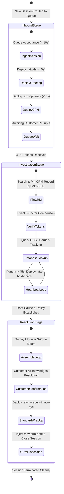

# OPERATIONAL STANDARD FOR CONCURRENT CHAT SESSION MANAGEMENT
**High-Throughput Multi-Platform Operations & Context-Isolation Architecture**
*Document ID: OPS-STD-CNC-2026-V2 | Classification: Tier 1 Operations Engineering*
*Authorized Role: Tier 1 Customer Support Representative (Agent: Martin)*

---

## 1. Concurrency Engineering Principles in Federal Telecom Support

Tier 1 Customer Support Representatives (CSR) at Softel Solutions operate in a high-density, multi-threaded communication environment. Representatives are required to handle between **3 and 5 simultaneous customer interactions** across external web portals (LiveChat) and internal CRM ticketing consoles while maintaining strict regulatory compliance under Federal Communications Commission (FCC) Customer Proprietary Network Information (CPNI) statutes.

### 1.1 The Operational Gravity Trap
Manual text input under high concurrency creates severe operational failure modes:
1. **Cross-Session CPNI Contamination:** Accidentally dispatching Customer A's Transfer PIN or PUK code to Customer B's chat console—a catastrophic federal privacy breach resulting in termination and carrier audit penalties.
2. **Response Latency Penalties (ART Exceedance):** Failure to maintain periodic session contact within 90 seconds triggers automated platform latency flags and negative Quality Assurance (QA) scoring.
3. **Cognitive Fatigue & Policy Drift:** Attempting to memorize shifting parameters across 57+ SOPs leads to inaccurate commitments (e.g., confusing the 180-day subsidy lock with the 365-day free device enrollment rule).

### 1.2 Performance Metric Benchmarks

| Performance Metric | Operational Definition | Target Threshold | Compliance Violation Limit |
| :--- | :--- | :--- | :--- |
| **First Response Time (FRT)** | Elapsed duration from inbound queue assignment to representative greeting. | **<= 20 Seconds** | > 60 Seconds |
| **Average Response Time (ART)** | Mean interval between customer transmission and representative response. | **<= 45 Seconds** | > 90 Seconds |
| **Average Handle Time (AHT)** | Total session duration from acceptance to CRM dispositioning. | **8 to 12 Minutes** | > 18 Minutes (Unflagged) |
| **CPNI Cross-Contamination** | Transmission of subscriber data to an unauthenticated party. | **0.00% (Zero Tolerance)** | 1 Incident = Audit Failure |

---

## 2. Multi-Session Pipeline Architecture: The Conveyor Belt Engine

To decouple operational latency from typing speed, all concurrent interactions are categorized into three discrete pipeline stages. Representatives cycle through open sessions sequentially rather than attempting to resolve interactions in parallel.

---

## 3. Detailed Operational Pipeline Specifications

### 3.1 Stage 1: Inbound Triage Pipeline (Elapsed Time: 0 to 30 Seconds)
- **Primary Objective:** Protect the First Response Time (FRT) metric and initiate federal CPNI authentication without cognitive delay.
- **Protocol:**
  1. Accept session immediately upon audio/visual alert.
  2. Deploy greeting and Tier 1 authentication request using modular expansion:
     - Keystroke: `:atw-hi` followed by `:atw-cpni-ask` (or shorthand `;hi` + `;v_cpni`).
  3. Total keystroke duration must not exceed **3 seconds**.
  4. Immediately cycle window focus to the next open session in the queue. Do not wait for customer typing indicators.

### 3.2 Stage 2: Database Traversal & Session Heartbeat (Elapsed Time: 30 to 180 Seconds)
- **Primary Objective:** Complete back-office CRM, OCS, and shipping diagnostics while actively resetting platform response timers.
- **Protocol:**
  1. Once customer furnishes PII, navigate to the assigned CRM window.
  2. Execute exact token matching (Legal Name, DOB, SSN4).
  3. If diagnostics require more than 45 seconds of system processing:
     - Deploy heartbeat macro: `:atw-hold-check` (or `;h_check`).
     - Output: *"I am currently reviewing your account details in our system. Please bear with me for about 1 to 2 minutes, and I will be right back with an update!"*
  4. The 45-second heartbeat resets the platform ART timer and reassures the customer that the session is actively monitored.

### 3.3 Stage 3: Modular Lego Assembly & Session Closure (Elapsed Time: 180+ Seconds)
- **Primary Objective:** Deliver a policy-compliant resolution, verify customer satisfaction, and execute audit-proof CRM logging.
- **Protocol:**
  1. Deploy either a dynamic 3-Zone Lego combo (e.g., `:atw-po-combo`, `:atw-rush-combo`) or individual Zone components:
     - `[RED Empathy]` -> `[YELLOW Policy]` -> `[GREEN Solution]`
  2. Confirm resolution completeness:
     - Keystroke: `:atw-wrapup` (or `;wrapup`).
  3. Upon customer farewell, deploy formal closing:
     - Keystroke: `:atw-bye` (or `;bye`).
  4. Immediately populate CRM Activity Log:
     - Keystroke: `:atw-crm-note` (or `;crm_note`). Fill out Contact Reason, Action Taken, and Ticket ID.

---

## 4. Context-Isolation & Data Contamination Prevention

In high-concurrency environments handling up to 5 concurrent sessions, the risk of data cross-contamination is critical. Representatives must enforce the following isolation rules:

### 4.1 The Single-Tab CRM Pinning Standard
- Every active chat session must have exactly **one dedicated browser tab or CRM sub-window pinned** to that specific subscriber.
- Representatives must never toggle multiple subscriber profiles within a single browser tab during concurrent operations.
- Pinned tabs must be arranged across the workspace in an order that mirrors the chat console sequence (Left to Right).

### 4.2 The "Double-Look" Pre-Transmission Verification
Before transmitting any message containing sensitive data (Transfer PINs, PUK codes, tracking links, order numbers):
1. **Look 1:** Check the subscriber legal name on the chat interface window header.
2. **Look 2:** Check the subscriber legal name on the active CRM record header.
3. Only when both strings match identically is the representative permitted to press `Enter` or click `Send`.

### 4.3 Clipboard Sanitization Protocol
- **Prohibition:** Representatives are strictly barred from copying raw subscriber PII, PINs, or credentials to the general operating system clipboard.
- **Enforcement:** All dynamic variables must be injected using Espanso interactive form fields (`[[port_out_pin]]`, `[[ticket_id]]`, `[[puk]]`). The interactive form prompts for input and directly synthesizes the output block, preventing clipboard residue from bleeding into adjacent chat sessions.

---

## 5. Algorithmic Queue Cycling & Time-Sliced Processing

When managing 5 concurrent sessions simultaneously, representatives must operate under a time-sliced round-robin schedule. The table below illustrates the standard 90-second operational cycle:

| Time Slot (Sec) | Active Window | Pipeline Stage | Operational Keystroke / Action |
| :--- | :--- | :--- | :--- |
| **00 - 15** | Chat 1 (Inbound) | Stage 1 (Triage) | `:atw-hi` + `:atw-cpni-ask` (Session placed in waiting state) |
| **15 - 30** | Chat 2 (Processing) | Stage 2 (Heartbeat) | Inspect CRM -> `:atw-hold-check` (Timer reset to 0) |
| **30 - 45** | Chat 3 (Resolution) | Stage 3 (Closing) | `:atw-po-combo` (PIN dispatched) -> `:atw-wrapup` |
| **45 - 60** | Chat 4 (Processing) | Stage 2 (Diagnostic) | OCS network check -> `:atw-hold-tool` |
| **60 - 75** | Chat 5 (Inbound) | Stage 1 (Triage) | `:atw-hi` + `:atw-cpni-ask` (Session placed in waiting state) |
| **75 - 90** | Chat 1 (Customer Replied) | Stage 2 (Authentication) | Compare PII against CRM -> `:atw-cpni-pass` |

> [!NOTE]
> By cycling through sessions in 15-second slices, no individual customer experiences an idle interval exceeding 75 seconds, ensuring total compliance with the 90-second ART ceiling.

---

## 6. High-Stress Concurrency Exception Scenarios

### 6.1 Simultaneous Inbound Flooding
When 3 or more inbound chats arrive within the same 5-second window:
1. Immediately execute `:atw-hi` across all inbound tabs sequentially (takes < 6 seconds total).
2. Follow immediately with `:atw-cpni-ask` across all inbound tabs.
3. This satisfies FRT across all lines simultaneously and shifts the latency clock onto the customer response interval.

### 6.2 Hostile Customer Interruptions During Complex Diagnostics
If an abusive or panicked customer interrupts while the representative is actively diagnosing another subscriber's complex logistics claim:
1. Do not break concentration to compose manual explanations.
2. Immediately fire `:atw-deescalate` or `:atw-warn-profanity` to establish emotional de-escalation or professional boundaries.
3. Return to complete the primary diagnostic before returning to address the de-escalated session.
