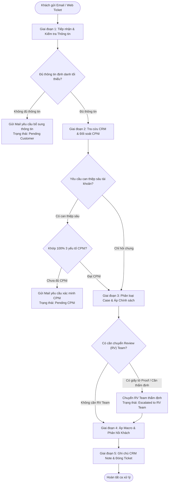
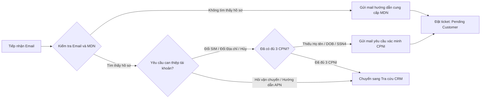
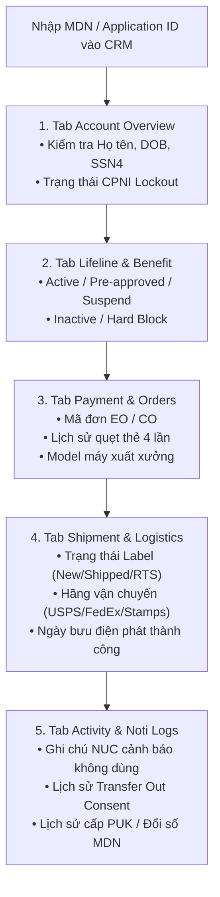
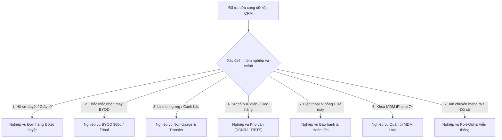

# SỔ TAY VẬN HÀNH XỬ LÝ EMAIL & TICKET KHÁCH HÀNG (MASTER EMAIL/TICKET PLAYBOOK)
**Quy trình Phân loại, Xác thực CPNI, Tra cứu CRM, Phối hợp Review Team & Đóng Ca Chuẩn**
*Mã tài liệu: SOP-EMAIL-MASTER-2026-V1 | Phân loại: Sổ tay Tác nghiệp Toàn diện*
*Áp dụng: Bộ phận Email / Web Ticket / Contact Us (Thương hiệu AirTalk Wireless & TAG Mobile)*

---

## 1. Bức Tranh Tổng Thể: Tư Duy Logic 5 Giai Đoạn (The 5-Stage Mindset)

Mọi thư điện tử (Email / Contact Us Ticket) từ khách hàng gửi về hệ thống đều phải đi qua **phễu sàng lọc chuẩn hóa 5 giai đoạn** để đảm bảo không vi phạm bảo mật CPNI, không hứa hẹn sai SLA, không làm lộ bí mật nội bộ và giải quyết triệt để vấn đề ngay từ phản hồi đầu tiên (FCR - First Contact Resolution).



---

## 2. GIAI ĐOẠN 1: Tiếp nhận Mail & Kiểm tra Tính Đầy đủ của Thông tin (Intake & Triage)

Khi mở một email/ticket mới trên hệ thống, nhân viên **tuyệt đối không vội vàng trả lời ngay** mà phải đối soát danh mục thông tin đầu vào:

### 2.1 Bộ Tiêu chuẩn Đánh giá Thông tin (Information Checklist)
* **Thông tin Định danh (Identity Tokens):**
  1. Số điện thoại AirTalk / TAG Mobile (MDN) hoặc Mã đơn hàng (Application ID / Order ID).
  2. Địa chỉ Email của người gửi (kiểm tra có trùng với email đăng ký tài khoản không).
  3. Họ và tên người liên hệ.
* **Nội dung Yêu cầu (Customer Inquiry):** Khách muốn gì? (Hỏi đơn hàng, đổi địa chỉ, bảo hành máy hỏng, cứu line không dùng, xin mã chuyển mạng...).
* **Tài liệu Đính kèm (Attachments):** Có đính kèm ảnh CCCD/Bằng lái xe, hóa đơn điện nước hay ảnh chụp thiết bị hỏng không?

---

### 2.2 Sơ đồ Rẽ nhánh Xử lý Thiếu Thông tin (Insufficient Information Flow)



* **HÀNH ĐỘNG KHI THIẾU THÔNG TIN:**
  * **Trường hợp 1 (Không có số điện thoại MDN hay Mã đơn hàng):**
    * *Thao tác:* Không thể tra cứu được CRM. Tuyệt đối không phán đoán bừa bãi.
    * *Phản hồi:* Gửi email phản hồi theo mẫu `;vi_v_cpni` hoặc `;v_cpni`, hướng dẫn khách cung cấp: Số điện thoại AirTalk, Mã đơn đăng ký và Họ tên đầy đủ.
    * *Trạng thái Ticket:* Chuyển sang `Pending Customer` (Hạn phản hồi khách: 48 giờ).
  * **Trường hợp 2 (Khách yêu cầu đổi địa chỉ cư trú / chuyển cước nhưng KHÔNG đính kèm giấy tờ chứng minh):**
    * *Thao tác:* Xác định đây là nghiệp vụ bắt buộc có Proof.
    * *Phản hồi:* Gửi email hướng dẫn gửi bổ sung hóa đơn điện nước/hợp đồng thuê nhà cùng bang, hoặc dẫn link tự tải lên web `airtalkwireless.com/upload-proof`.

---

## 3. GIAI ĐOẠN 2: Tra cứu Toàn diện trên CRM (CRM Master Audit Checklist)

Một khi email đã có đủ thông tin định danh (MDN hoặc Application ID), nhân viên mở đồng thời màn hình CRM và kiểm tra lần lượt **5 vị trí bắt buộc** sau:



### Bảng Kiểm Tra CRM Chi Tiết Từng Vị Trí:
| Vị trí trên CRM | Nhân viên cần kiểm tra những gì? | Dấu hiệu nhận biết Case nghiệp vụ |
| :--- | :--- | :--- |
| **Tab 1: Account Overview** | • Đối soát Họ tên, Ngày sinh (DOB), 4 số cuối SSN.<br>• Kiểm tra cờ *SIM Port Protection* có đang bật không.<br>• Kiểm tra có cờ *Fraud Flag* hay cảnh báo mạo danh không. | • Khớp 100% $\rightarrow$ Đạt CPNI.<br>• Sai lệch $\rightarrow$ Phải chặn không tiết lộ thông tin.<br>• Có cờ gian lận $\rightarrow$ Chuyển bộ phận Pháp chế / An ninh. |
| **Tab 2: Lifeline & Benefit** | • Trạng thái: *Active*, *Pre-approved (Maximus)*, *Suspend*, *Inactive*.<br>• Kiểm tra có bị cờ `"Blacklisted - Hard Block"` không. | • *Pre-approved:* Chờ duyệt bang CA (7 ngày).<br>• *Suspend:* Bị tranh chấp trợ cấp $\rightarrow$ Cần gửi TA.<br>• *Hard Block:* **CẤM** giải thích về Non-usage (Slide 71). |
| **Tab 3: Payment & Orders** | • Loại đơn: Đơn đăng ký mới (EO) hay Đơn nâng cấp/mua thêm (CO).<br>• Trạng thái thanh toán thẻ: Thành công hay Thất bại 4 lần (4 Invoices failed).<br>• Model máy: Máy khách chọn ban đầu vs Máy thực tế xuất kho. | • Thất bại 4 lần $\rightarrow$ Đơn tự hạ về BYOD Basic Plan.<br>• Chọn iPhone nhưng xuất A67L $\rightarrow$ Rớt điều kiện Tribal Land.<br>• Có đơn `CO-SNU` $\rightarrow$ Đơn SNU **cấm bảo hành, cấm claim LIT**. |
| **Tab 4: Shipment & Logistics** | • Mã vận đơn Tracking Number và Đơn vị vận chuyển (USPS, FedEx, Stamps).<br>• Trạng thái bưu điện: *In Transit*, *Delivered*, *Return to Sender (RTS)*.<br>• Ngày giờ phát hàng thành công (Delivered Date timestamp). | • Gửi qua Stamps: Không có tracking, phải đợi 7–14 ngày.<br>• Bưu điện báo Delivered nhưng khách bảo chưa nhận $\rightarrow$ Case DCNR.<br>• Tracking đứng yên quá 7 ngày $\rightarrow$ Case LIT (Mất hàng).<br>• Delivered date quá 48h $\rightarrow$ Từ chối bảo hành nứt vỡ. |
| **Tab 5: Activity Log** | • Ghi chú: `"Denied to TRANSFER-LIFELINE"` (xem timestamp trong vòng 10 phút?).<br>• Ghi chú: Cảnh báo Non-Usage ngày 30, 35, 45, 46.<br>• Lịch sử đổi số điện thoại MDN (đã đổi mấy lần trong 3 kỳ cước?). | • Trong 10 phút Transfer out $\rightarrow$ Còn cơ hội cứu line.<br>• Quá 45 ngày Non-usage $\rightarrow$ Line đã hủy về USAC.<br>• Đổi số lần thứ 3 $\rightarrow$ Phải thu phí $25. |

---

## 4. GIAI ĐOẠN 3: Phân Loại Case, Đối Soát Policy & Điểm Chặn Review Team

Đây là giai đoạn cốt lõi: Xác định chính xác khách thuộc tình huống nào, kiểm tra xem có cần phối hợp với **Review (RV) Team** hay các bộ phận liên quan không.



---

### 4.1 Chi Tiết Các Tình Huống, Điểm Chặn Review Team & Macro Áp Dụng:

#### Tình huống 1: Hồ sơ Treo Duyệt & Khách gửi Ảnh Giấy tờ qua Email
* **Kiểm tra CRM:** Xem lý do từ chối hồ sơ (Identity, Eligibility, Address Proof).
* **ĐIỂM CHẶN REVIEW TEAM (BẮT BUỘC):**
  * **CÓ!** Vì khách gửi ảnh giấy tờ qua email, CSR không có thẩm quyền tự ấn duyệt.
  * *Hành động CSR:* Tải ảnh giấy tờ từ email $\rightarrow$ Chuyển tiếp vào hàng đợi của **Review Team (RV Team)** kèm mã Application ID $\rightarrow$ **Xóa ngay lập tức file ảnh trên máy tính CSR để bảo vệ CPNI**.
* **Macro phản hồi khách:** `;g_app_upload_rv` (hoặc `;vi_app_upload_rv`).
* **SLA phản hồi:** RV Team xử lý trong **24–48 giờ làm việc**.

#### Tình huống 2: Khách thắc mắc: "Tại sao tôi nhận được SIM BYOD thay vì điện thoại mới?"
* **Kiểm tra CRM:**
  * Mở tab *Enrollment Log* và tìm từ khóa lịch sử tài khoản.
  * Kiểm tra xem địa chỉ/SSN của khách đã nhận máy trợ cấp nào trong vòng 365 ngày qua chưa.
* **ĐIỂM CHẶN REVIEW TEAM:** **KHÔNG**. Đây là chính sách tự động của hệ thống.
* **Quy tắc bảo mật nội bộ (Mục 3):** **TUYỆT ĐỐI KHÔNG DÙNG TỪ "CHEAT" HOẶC "GIAN LẬN"**.
* **Chính sách:** Giải thích mỗi hộ gia đình chỉ được tặng 1 máy miễn phí mỗi 365 ngày. Do đã nhận máy trong năm qua, đơn chuyển sang SIM BYOD để không bị ngắt cước gọi miễn phí.
* **Macro phản hồi khách:** `;c_byod_policy` (hoặc `;vi_c_byod_365d`).

#### Tình huống 3: Khách thắc mắc: "Tại sao tôi chọn iPhone mà lại nhận máy A67L / Verde?"
* **Kiểm tra CRM:** Kiểm tra địa chỉ đăng ký có thuộc vùng đất bộ tộc (Tribal Land: Oklahoma, Arizona, Alaska...) được liên bang công nhận không.
* **ĐIỂM CHẶN REVIEW TEAM:** **KHÔNG**.
* **Chính sách:** Do hệ thống xác minh liên bang không chứng minh được nơi ở thuộc vùng Tribal, đơn hàng tự động điều chỉnh về dòng máy tiêu chuẩn.
* **Macro phản hồi khách:** `;y_tribal_fail` (hoặc `;vi_tribal_fail`).

#### Tình huống 4: Khách phản ánh nhận được cảnh báo Non-Usage (Không dùng cước)
* **Kiểm tra CRM:** Kiểm tra số ngày không phát sinh cước trên tab *Activity Log*.
* **Rẽ nhánh:**
  * **Nhánh A (Ngày 31–45): CÒN CỨU ĐƯỢC.**
    * *Thao tác:* Khách gửi mail đồng ý giữ dịch vụ $\rightarrow$ Ghi nhận "Keep Service Consent" $\rightarrow$ Tạo vé **NUC Ticket** $\rightarrow$ Nhắc khách thực hiện ngay 1 cuộc gọi hoặc gửi 1 tin nhắn bằng sóng SIM.
    * *Macro:* `;c_nonuse_cuu` (hoặc `;vi_c_nonuse_cuu`).
  * **Nhánh B (Đã sang Ngày 46): HẾT CỨU.**
    * *Thao tác:* Line đã bị USAC de-enroll, số đã thu hồi. Giải thích nhã nhặn luật liên bang và hướng dẫn nộp đơn mới.
    * *Macro:* `;c_nonuse_het` (hoặc `;vi_c_nonuse_het`).
* **ĐIỂM CHẶN REVIEW TEAM:** **KHÔNG**. (Chỉ tạo vé NUC cho hệ thống giữ line).

#### Tình huống 5: Khách báo: "Bưu điện báo Delivered nhưng tôi chưa nhận được kiện hàng" (DCNR)
* **Kiểm tra CRM:**
  * Kiểm tra tab *Shipment* xem Delivered date là ngày nào.
  * Kiểm tra lịch sử tài khoản: Khách báo mất kiện hàng này là **lần 1** hay **lần 2**?
* **ĐIỂM CHẶN REVIEW TEAM & PHÒNG BAN:**
  * **Báo mất lần 1 (Auto Flow):** **KHÔNG CẦN CHUYỂN**. CSR tự đối soát địa chỉ trùng khớp $\rightarrow$ Tặng voucher mua thiết bị thay thế (\$10 SIM, \$30 máy free, \$70 CA/Tribal) $\rightarrow$ Macro `;c_dcnr_auto` (hoặc `;vi_c_dcnr`).
  * **Báo mất lần 2 (Manual Flow):** **BẮT BUỘC PHẢI CHUYỂN!** Chuyển vé sang **Supervisor & Bộ phận Giám sát Giao nhận (Logistics & Fraud Audit Team)** để soi tọa độ GPS quét bưu tá $\rightarrow$ Macro `;vi_dcnr_manual`.
* **Trường hợp SIM gửi Stamps.com:** Bắt buộc khách phải chờ đủ **7–14 ngày làm việc** trước khi được báo mất.

#### Tình huống 6: Kiện hàng bị bưu điện trả về kho (Return To Sender - RTS)
* **Kiểm tra CRM:** Kiểm tra kiện hàng bị hoàn về lần thứ mấy.
* **Rẽ nhánh:**
  * **RTS lần 1:** Yêu cầu khách gửi xác nhận lại địa chỉ cư trú đầy đủ trong 10 ngày để kho xuất gửi lại miễn phí qua FedEx Ground $\rightarrow$ Macro `;vi_rts_rules`.
  * **RTS lần 2 (QUY TẮC SẮT):** **CẤM GỬI LẠI LẦN 3 MIỄN PHÍ**. Khách muốn nhận phải trả phí bưu điện (\$6.99 thường, \$9.99 hỏa tốc) và phải có Supervisor duyệt $\rightarrow$ Macro `;vi_rts_no2nd`.
* **ĐIỂM CHẶN REVIEW TEAM:** Nếu khách cập nhật địa chỉ Service Address mới $\rightarrow$ **CẦN CHUYỂN RV TEAM DUYỆT PROOF ĐỊA CHỈ TRƯỚC KHI XUẤT KHO**.

#### Tình huống 7: Đơn hàng quá 14 ngày làm việc chưa có Tracking Number (Chậm trễ giao hàng)
* **Kiểm tra CRM:** Kiểm tra ngày duyệt hồ sơ (Approved date) và trạng thái đơn hàng.
* **ĐIỂM CHẶN KHO VẬN (BẮT BUỘC):**
  * Đủ điều kiện tạo vé **Hot Rush Ticket**:
    1. Quá 14 ngày làm việc từ ngày duyệt mà chưa có tracking.
    2. Đã có tracking nhưng trạng thái "NEW" bị treo quá 7 ngày làm việc.
    3. Khách mua máy nâng cấp có trả tiền và đang bức xúc.
  * *Hành động CSR:* Tạo ticket loại `Hot Rush - High Priority Fulfillment` chuyển thẳng cho **Trưởng Bộ phận Điều phối Kho vận (Warehouse Operations Lead)** $\rightarrow$ SLA xuất hàng trong **24–48 giờ làm việc**.
* **Macro phản hồi khách:** `;c_hotrush` (hoặc `;vi_c_hotrush`).

#### Tình huống 8: Khách yêu cầu Bảo hành Thiết bị hỏng (Warranty Claim)
* **Kiểm tra CRM:** Kiểm tra *Delivered Date* trên CRM để tính số ngày.
* **Rẽ nhánh Thẩm định:**
  * **Lỗi cơ năng / phần cứng:**
    * Máy cũ: Trong vòng **15 ngày theo lịch** $\rightarrow$ Đủ điều kiện.
    * Máy mới: Trong vòng **30 ngày theo lịch** $\rightarrow$ Đủ điều kiện.
    * Máy FoxxD nóng máy/sập nguồn: Trong vòng **60 ngày theo lịch** $\rightarrow$ Đủ điều kiện.
    * *Thao tác:* Xuất mã RMA và gửi nhãn bưu điện miễn phí (USPS Return Label có hạn 7 ngày làm việc) qua email khách $\rightarrow$ Macro `;c_war_free` hoặc `;vi_c_war_free`.
  * **Lỗi nứt vỡ ngoại quan, cấn móp, rơi nước:**
    * Báo trong vòng **48 giờ** từ lúc giao $\rightarrow$ Chấp nhận hỗ trợ đổi máy.
    * Báo **SAU 48 giờ** $\rightarrow$ **TỪ CHỐI BẢO HÀNH** do lỗi người dùng $\rightarrow$ Macro `;vi_war_void`.
* **ĐIỂM CHẶN REVIEW TEAM:** Nếu có nghi vấn gian lận tráo máy $\rightarrow$ Chuyển bộ phận Thẩm định Phần cứng (Hardware Audit).

#### Tình huống 9: Khách yêu cầu Cấp Mã PIN Chuyển mạng (Port-Out PIN)
* **Kiểm tra CRM:**
  * BẮT BUỘC đối soát 100% 3 yếu tố CPNI.
  * Kiểm tra máy có cài MDM không và ngày kích hoạt máy đã đủ 180 ngày chưa.
* **Quy chuẩn Giao tiếp:** Thực hiện kịch bản níu giữ (Retention). Nếu khách vẫn quyết chuyển đi:
  * Cung cấp Account # và Transfer PIN.
  * Cảnh báo thời hạn PIN: **Chính xác 4 ngày (96 giờ)**.
  * Cảnh báo mất trợ cấp Lifeline và truy thu phí thiết bị nếu chưa đủ 180 ngày.
* **Macro phản hồi khách:** `;c_po` (hoặc `;vi_c_po`).

#### Tình huống 10: Khách yêu cầu Cập nhật Địa chỉ (Address Change)
* **Kiểm tra CRM & Rẽ nhánh:**
  * **Địa chỉ nhận thư (Mailing Address):** Cùng bang $\rightarrow$ CSR tự cập nhật trên CRM ngay, **KHÔNG CẦN GIẤY TỜ PROOF** $\rightarrow$ Macro `;vi_addr_mailing`.
  * **Địa chỉ cư trú (Service Address):**
    * BẮT BUỘC khách phải gửi hóa đơn điện nước/hợp đồng thuê nhà cùng bang.
    * **ĐIỂM CHẶN REVIEW TEAM:** Chuyển giấy tờ cho **Review Team (RV Team)** duyệt trước. Sau khi RV Team duyệt hợp lệ, CSR mới cập nhật trên CRM $\rightarrow$ Macro `;vi_addr_service`.
  * **Khác bang (Different State):** **CẤM ĐỔI BANG TRÊN LINE ACTIVE**. Bắt buộc hướng dẫn khách hủy line cũ và nộp đơn mới tại bang mới $\rightarrow$ Macro `;vi_addr_state`.

---

## 5. Bảng Ma Trận Phối Hợp Liên Phòng Ban (Inter-Department Escalation Matrix)

| Bộ phận Tiếp nhận | Khi nào CSR bắt buộc phải chuyển giao? | Mẫu Ticket CRM cần tạo | SLA Xử lý Cam kết |
| :--- | :--- | :--- | :--- |
| **Review Team (RV Team)** | • Khách nộp bổ sung giấy tờ tùy thân (ID) hoặc giấy tờ trợ cấp.<br>• Khách yêu cầu đổi địa chỉ cư trú Service Address (có kèm hóa đơn).<br>• Mở khóa tài khoản bị nghi vấn trùng lặp hồ sơ. | Ticket loại: `Document Review / Proof Verification` | **24–48 giờ làm việc** |
| **Warehouse Operations Lead** | • Đơn hàng trễ quá 14 ngày làm việc chưa có tracking.<br>• Mã tracking bị kẹt trạng thái "NEW" quá 7 ngày làm việc.<br>• Đơn hàng đổi máy OOS hết hàng cần chỉ định model thay thế. | Ticket loại: `Hot Rush - High Priority Fulfillment` | **24–48 giờ làm việc** |
| **Logistics & Fraud Audit Team** | • Khách khiếu nại DCNR mất hàng lần thứ hai.<br>• Kiện hàng thất lạc bưu điện LIT giá trị cao (> $100).<br>• Phát hiện đường dây lừa đảo gom SIM / gian lận cướp máy. | Ticket loại: `Carrier GPS Investigation / Fraud Audit` | **48–72 giờ làm việc** |
| **Accounting Queue (Phòng Kế toán)** | • Yêu cầu hoàn tiền thiết bị trong hạn 15d/30d.<br>• Đối soát khiếu nại trừ tiền thẻ tín dụng sai (Stripe disputes).<br>• Xuất link thanh toán mua đứt cam kết thiết bị (MDM Buyout). | Ticket loại: `Refund Processing / MDM Buyout` | **3–5 ngày làm việc** |
| **Tier 2 Technical Support** | • Lỗi thẻ SIM kẹt sóng OCS/HLR không gọi được 911.<br>• Máy iPhone MDM bị lỗi mờ nút Wi-Fi sau khi đã Hard Reset.<br>• Cấp mã PUK trường hợp đặc biệt không hiển thị trên OCS. | Ticket loại: `Tier 2 Network Provisioning` | **24 giờ làm việc** |

---

## 6. GIAI ĐOẠN 4 & 5: Soạn Mail Phản Hồi, Áp Macro & Đóng Ticket Chuẩn QA

Sau khi đã hoàn tất tra cứu CRM và xác định điểm phối hợp, nhân viên tiến hành soạn email phản hồi:

### 6.1 Quy trình Soạn Mail 4 Bước (Response Assembly):
1. **Lời chào mở đầu:** Dùng `;hi` hoặc `;vi_hi` theo đúng thương hiệu (AirTalk hoặc TAG Mobile).
2. **Nội dung trọng tâm:**
   * Triển khai bộ Lego 3-Zone: [Đồng cảm Red Zone] $\rightarrow$ [Chính sách Yellow Zone] $\rightarrow$ [Giải pháp Green Zone].
   * Hoặc sử dụng các phím tắt Speed Combos hoàn chỉnh: `;c_...` (tiếng Anh) hoặc `;vi_c_...` (tiếng Việt).
3. **Kiểm tra Biến động (Placeholders):** Điền chính xác các biến dạng `[[ticket_id]]`, `[[tracking_number]]`, `[[transfer_pin]]`, `[[new_mdn]]`. **Tuyệt đối không để sót dấu ngoặc vuông `[[...]]` gửi cho khách**.
4. **Lời chốt ca:** Sử dụng `;wrapup` / `;bye` hoặc `;vi_wrapup` / `;vi_bye`.

---

### 6.2 Ghi chú Bắt buộc trên CRM (CRM Activity Logging Mandate):
Ngay sau khi gửi email, nhân viên **bắt buộc phải ghi chú ngay vào Activity Log của tài khoản** theo đúng mẫu quy chuẩn (sử dụng phím tắt `;n_...`):

* **Mẫu Ghi chú Xử lý Email Chung (Macro `;n_general`):**
  ```text
  [CSR: Martin] [Ticket ID: TK-892147]
  - Channel: Email Inbound Support
  - Reason / Inquiry: Customer inquiring about shipment delay
  - CPNI Verification: Passed (Name, DOB, SSN4 verified)
  - Action Taken: Verified order approved >14bd with no tracking; created Hot Rush Ticket to Warehouse Lead
  - Outcome / SLA: Target warehouse dispatch within 24-48 business hours; email notification dispatched to customer
  ```

* **Mẫu Ghi chú Trượt CPNI (Macro `;n_cpni_fail`):**
  ```text
  [CSR: Martin] [Ticket ID: TK-892150]
  - Channel: Email Inbound Support
  - Reason / Inquiry: Port-Out Transfer PIN Request
  - CPNI Verification: FAILED (DOB and SSN4 mismatch)
  - Action Taken: No account credentials or PIN disclosed; dispatched secure CPNI reprompt email with ID upload portal link
  - Outcome: Ticket set to Pending Customer per FCC 47 CFR § 64.2001-2011
  ```

---

### 6.3 Bảng Quy Chuẩn Trạng Thái Đóng Ticket (Ticket Disposition Matrix):
| Tình trạng Sau khi Phản hồi Email | Trạng thái Ticket Cần Đặt | Thời hạn Theo dõi (Follow-up SLA) |
| :--- | :--- | :--- |
| **Đã giải quyết xong trọn vẹn (FCR):** Đã cấp PIN, đã hướng dẫn APN, đã giải thích chính sách 365d. | **Closed / Solved** | Không (Khách có thể mở lại nếu reply trong 48h). |
| **Đang chờ khách phản hồi:** Chờ bổ sung CPNI, chờ gửi ảnh hóa đơn địa chỉ. | **Pending Customer** | **48 giờ** (Sau 48h hệ thống tự động gửi nhắc lần 2). |
| **Đã chuyển sang Review Team (RV Team):** Chờ duyệt CCCD hoặc duyệt Proof địa chỉ. | **On-Hold (Escalated to RV)** | **24–48 giờ làm việc**. |
| **Đã tạo vé Hot Rush sang Kho vận:** Chờ xuất kho ưu tiên. | **On-Hold (Pending Warehouse)** | **24–48 giờ làm việc**. |
| **Đã chuyển sang Kế toán:** Chờ hoàn tiền thẻ hoặc bưu điện. | **On-Hold (Pending Accounting)** | **3–5 ngày làm việc**. |
