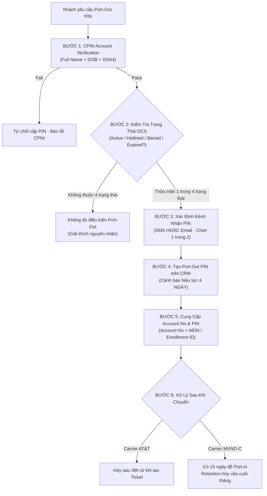

# BẢNG MA TRẬN NGHIỆP VỤ CỐT LÕI - SOFTEL SOLUTION
*(AirTalk Wireless & TAG Mobile - Lifeline / ACP / MVNO Ecosystem)*
*Dành riêng cho Chat Agent: Tra Cứu Siêu Tốc - Chuẩn Xác Policy - 100 Điểm QA*

---

## MỤC LỤC
1. [Trụ Cột 1: CPNI Account Verification & An Ninh Tài Khoản](#1-trụ-cột-1-cpni-account-verification--an-ninh-tài-khoản)
2. [Trụ Cột 2: Logistics, Fulfillment & Vận Chuyển (DCNR, LIT, RTS)](#2-trụ-cột-2-logistics-fulfillment--vận-chuyển-dcnr-lit-rts)
3. [Trụ Cột 3: Vòng Đời Thiết Bị & SIM (BYOD, eSIM, PUK, Bảo Hành, Blacklist)](#3-trụ-cột-3-vòng-đời-thiết-bị--sim-byod-esim-puk-bảo-hành-blacklist)
4. [Trụ Cột 4: Quản Lý Thuê Bao, MDN & Dịch Vụ Mạng](#4-trụ-cột-4-quản-lý-thuê-bao-mdn--dịch-vụ-mạng)
5. [Trụ Cột 5: Tuân Thủ Pháp Lý & Lifeline Lifecycle (Non-Usage, Recertify)](#5-trụ-cột-5-tuân-thủ-pháp-lý--lifeline-lifecycle-non-usage-recertify)
6. [Trụ Cột 6: Quy Trình Port-Out (Chuyển Mạng Giữ Số Ra Ngoài)](#6-trụ-cột-6-quy-trình-port-out-chuyển-mạng-giữ-số-ra-ngoài)
7. [Trụ Cột 7: Cancellation (Hủy Dịch Vụ - Tier 1) & Refund (Hoàn Tiền)](#7-trụ-cột-7-cancellation-hủy-dịch-vụ---tier-1--refund-hoàn-tiền)

---

## 1. TRỤ CỘT 1: CPNI ACCOUNT VERIFICATION & AN NINH TÀI KHOẢN

### 1.1. Quy Định CPNI Bắt Buộc (Policy_Account Verification V1.1)
Trước khi cung cấp **bất kỳ thông tin cụ thể nào về tài khoản (Account-Specific Information)** như số dư, lịch sử cước, địa chỉ, IMEI, mã PIN, CSR **BẮT BUỘC** phải xác minh thành công 3 yếu tố nhận diện CPNI:

| Yếu Tố Xác Minh | Yêu Cầu Đối Chiếu CRM | Ngoại Lệ Được Chấp Nhận | Trường Hợp KHÔNG Được Chấp Nhận |
| :--- | :--- | :--- | :--- |
| **1. Full Name (Họ và Tên)** | First Name và Last Name phải khớp đúng với hồ sơ trên CRM. | • Bỏ qua Middle Name (có hay không đều được). • Dấu gạch nối: *Anne-Marie* vs *Anne Marie*. • Dấu câu: *O'Brien* vs *OBrien*. • Hậu tố: *Jr., Sr., II, III* nếu First + Last khớp. | • Sai khác First Name hoặc Last Name. • Tên người thân, vợ/chồng (trừ khi có ủy quyền hợp pháp Authorized User trên CRM). |
| **2. Date of Birth (DOB)** | Định dạng chuẩn: `MM/DD/YYYY`. Phải khớp chính xác 100% với CRM. | Không có ngoại lệ. | Sai ngày, sai tháng, sai năm sinh. |
| **3. SSN4 (4 số cuối SSN)** | 4 chữ số cuối cùng của số An sinh Xã hội khớp chính xác CRM. | Trường hợp hồ sơ dùng Tribal ID / Alternate ID theo quy định USAC. | Không khớp 4 chữ số cuối. |
| **Thông tin liên hệ bổ sung** | Thu thập Email Address & Callback Phone Number (MDN hoặc số thay thế). | Dùng để bảo vệ khi chat gián đoạn. | Bỏ qua bước thu thập thông tin liên hệ. |

### 1.2. Phân Luồng Xử Lý Sau Xác Minh (Verification Handling)
- **Pass Verification:** Tiếp tục hỗ trợ toàn bộ yêu cầu của khách hàng.
- **Fail Verification (Sai 1-2 lần):** 
  - CSR lịch sự thông báo thông tin chưa khớp, cho khách kiểm tra lại.
  - *Tuyệt đối không tiết lộ thông tin đúng trên CRM cho khách (ví dụ: "Anh sinh ngày 15 phải không?" -> VI PHẠM NẶNG).*
  - Nếu vẫn sai: **Dừng cung cấp thông tin tài khoản**, chỉ giải thích quy định chung (General Policy) hoặc hướng dẫn khách gửi ID Proof qua cổng hỗ trợ.
- **Nghi ngờ gian lận / Identity Theft:** Khách hàng báo bị đánh cắp danh tính hoặc người chat không phải chủ tài khoản -> Áp dụng ngay quy trình *Identity Theft Guideline*, khóa thao tác và gắn cờ cảnh báo trên CRM.

### 1.3. Điều Tra Spam (SOP_Spam Handling V2.2)
- Khi MDN bị hệ thống khóa do nghi ngờ Spam / Service Misuse (tin nhắn hàng loạt, robocall).
- **Quy tắc điều tra:**
  1. CSR kiểm tra **Usage Detail trong 30 ngày gần nhất** (tần suất, đích đến, thời điểm).
  2. Yêu cầu khách cung cấp **ID Proof:** Ảnh chụp cầm giấy tờ tùy thân hợp lệ sát mặt (rõ mặt và rõ chữ).
  3. Nếu ảnh chụp không rõ ràng: Yêu cầu **Video 5–10 giây** quay rõ mặt, cầm ID và đọc to rõ Họ tên + Ngày sinh.
  4. CSR **KHÔNG tự ý phán quyết** hay mở khóa trực tiếp, mà tạo Ticket chuyển Fraud / Review Team thẩm định trong 24–48 giờ.

---

## 2. TRỤ CỘT 2: LOGISTICS, FULFILLMENT & VẬN CHUYỂN (DCNR, LIT, RTS)

### 2.1. Ma Trận Xử Lý Sự Cố Giao Hàng

| Sự Cố Logistics | Định Nghĩa Nghiệp Vụ | Dấu Hiệu Nhận Biết Trên Hệ Thống | Giải Pháp & Quy Trình CSR Thực Hiện | SLA / Thời Gian Xử Lý |
| :--- | :--- | :--- | :--- | :--- |
| **DCNR (Delivered Claimed Not Received)** | Khách khiếu nại không nhận được hàng dù đơn vị vận chuyển (FedEx/Amazon) đã báo **Delivered**. | • Trạng thái đơn hàng: `Delivered`. • Khách khẳng định kiểm tra hộp thư/cửa nhà không có. | 1. Hướng dẫn khách kiểm tra quanh nhà, người thân, hộp thư. 2. Kiểm tra địa chỉ giao hàng và ảnh chụp giao hàng (Proof of Delivery). 3. Tạo **CRM Shipment Ticket** (Assignee: Khang Tran). 4. Đề xuất Voucher hoặc làm thủ tục gửi máy thay thế theo chính sách. | Phản hồi rà soát vận chuyển: **24 – 48 giờ làm việc**. |
| **LIT (Lost In Transit)** | Bưu kiện bị thất lạc trong quá trình vận chuyển giữa kho và khách hàng. | • Tracking dừng cập nhật quá thời hạn dự kiến (7+ ngày không có scan mới). • Carrier ghi nhận thất lạc hoặc trả hàng hỏng. | 1. Xác nhận trạng thái vận chuyển trên cổng FedEx/Amazon. 2. Đơn thiết bị trị giá > $100 hoặc > $50: Tạo Accounting Ticket thẩm định bảo hiểm vận chuyển. 3. Tạo đơn gửi lại máy thay thế hoặc hoàn tiền theo loại đơn hàng. | Xử lý thẩm định nội bộ: **24 – 48 giờ làm việc**. |
| **RTS (Return To Sender)** | Kiện hàng bị bưu điện trả ngược về kho của Softel do không giao được. | • Tracking ghi: `Undeliverable as Addressed`, `Vacant`, `Return to Sender`. | 1. Xác minh lại địa chỉ cư trú của khách. 2. Nếu khách đổi địa chỉ: Hướng dẫn cập nhật địa chỉ chuẩn Lifeline. 3. Khi hàng đã scan nhập kho: Tạo Ticket yêu cầu Reship (giao lại). | Giao lại sau khi nhập kho: **3 – 5 ngày làm việc**. |
| **Delayed Fulfillment** | Đơn hàng đã đặt nhưng chậm trễ khâu đóng gói xuất kho. | • Quá SLA chuẩn (thường > 3 ngày làm việc) chưa có mã Tracking. | 1. Kiểm tra tồn kho (OOS). 2. Tạo **Delayed Fulfillment Ticket** chuyển Kho/Logistics (Cuong Nguyen). | Phản hồi tiến độ trong **24 giờ**. |
| **Out of Stock (OOS)** | Model máy khách chọn hoặc trúng thưởng đã hết hàng trong kho. | • Trạng thái tồn kho = 0. | 1. Đề xuất đổi sang model tương đương hoặc cao cấp hơn (Upgrade). 2. Đề xuất chờ đợt nhập hàng tiếp theo. 3. Hoàn tiền khoản chênh lệch (nếu khách có trả phí upgrade). | Đổi model xử lý ngay trong ca chat. |
| **Hot Rush Ticket** | Đơn hàng khẩn cấp cần ưu tiên xuất kho hỏa tốc. | • Áp dụng cho ca khiếu nại nghiêm trọng, khách VIP, lỗi vận hành nội bộ. | Tạo **Hot Rush Ticket** theo mẫu quy định để kho ưu tiên xuất ngay trong ngày. | Xuất kho trong **24 giờ**. |

---

## 3. TRỤ CỘT 3: VÒNG ĐỜI THIẾT BỊ & SIM (BYOD, eSIM, PUK, BẢO HÀNH, BLACKLIST)

### 3.1. Chính Sách Bảo Hành & Đổi Trả (Warranty Replacement V1.2)
- **Thời hạn bảo hành:**
  - **Free Standard Lifeline Phone:** Bảo hành giới hạn **15 ngày** kể từ ngày giao hàng thành công (Delivery Date).
  - **Upgrade / Purchased Phone:** Bảo hành theo tiêu chuẩn nhà sản xuất / quy định đơn hàng (thường 30 ngày).
- **Phạm vi bảo hành hợp lệ:**
  - Lỗi vật liệu hoặc tay nghề sản xuất.
  - Lỗi phần mềm hệ thống, máy tự khởi động lại, đơ lag không khắc phục được.
  - Lỗi camera, micro, loa trong, loa ngoài.
  - Phím cứng không phản hồi (Nguồn, Âm lượng).
  - Màn hình bị điểm chết (Dead pixels), sọc màn hình tự nhiên.
- **Phạm vi TỪ CHỐI bảo hành (Out of Warranty):**
  - Rơi vỡ, nứt màn hình, cấn móp vỏ máy do ngoại lực.
  - Ngấm nước, ẩm ướt chân sạc, rỉ sét linh kiện.
  - Tự ý can thiệp phần cứng, bẻ khóa bootloader, sửa chữa tại cửa hàng ngoài.
- **Quy trình đổi trả:**
  1. Yêu cầu khách cung cấp **IMEI** và mô tả/hình ảnh lỗi.
  2. Tạo **Return Label** (Nhãn đổi trả có giá trị trong **07 ngày** để khách gửi máy về kho).
  3. Khi nhận được máy lỗi tại kho, tiến hành xuất máy thay thế.

### 3.2. Bậc Thang Đổi Máy (Replacement Ladder)
Khi khách có nhu cầu đổi thiết bị, CSR phải tư vấn theo thứ tự ưu tiên:
1. **Bậc 1 - Paid Upgrade Replacement:** Tư vấn nâng cấp lên dòng máy cao cấp hơn (khách bù phí ưu đãi dành cho khách hàng hiện hữu).
2. **Bậc 2 - Standard Replacement:** Đổi máy cùng phân khúc tiêu chuẩn (nếu trong hạn bảo hành hoặc đóng phí đổi máy chuẩn).
3. **Bậc 3 - SIM Replacement / BYOD:** Nếu khách có máy sẵn ở nhà, cung cấp SIM thay thế để khách tự lắp máy của mình dùng ngay.

### 3.3. Quy Định Về SIM & eSIM
- **Physical SIM (pSIM):**
  - Nhắc nhở khách **KHÔNG tháo SIM** khỏi các dòng máy Pre-owned, A67L, A67L Gen2, Verde vì có thể gây khóa OCS hoặc mất cấu hình APN.
- **eSIM (eSIM Guideline V1.1):**
  - Áp dụng cho các dòng máy tương thích (iPhone XR trở lên, Samsung Galaxy S20+, Google Pixel 3+...).
  - Thiết bị phải kết nối Wi-Fi ổn định trước khi quét mã QR.
  - Mã QR kích hoạt được gửi qua email đã xác thực của khách hàng.
- **Mã PUK (PUK Code Guideline):**
  - Khi khách nhập sai mã PIN thẻ SIM quá 3 lần -> SIM bị khóa PUK.
  - Tra cứu mã **PUK1 / PUK2** trên CRM OCS để cấp cho khách.
  - Cảnh báo khách: **Nhập sai PUK quá 10 lần** thẻ SIM sẽ bị hỏng vĩnh viễn và bắt buộc phải mua SIM mới.

### 3.4. Blacklist & Unblacklist Thiết Bị
- **Blacklist:** Thiết bị bị báo mất cắp (Lost/Stolen) hoặc vi phạm chính sách sẽ bị chặn IMEI trên toàn bộ mạng viễn thông Mỹ. OCS chuyển sang `Hotline`.
- **Unblacklist:** Chỉ thực hiện khi chính chủ tài khoản chứng minh quyền sở hữu hợp pháp, thiết bị đã thanh toán xong cước/phí, hoặc do gỡ nhầm flag kỹ thuật.

---

## 4. TRỤ CỘT 4: QUẢN LÝ THUÊ BAO, MDN & DỊCH VỤ MẠNG

### 4.1. Đổi Số Điện Thoại (MDN Change Guideline V1.2)
- Áp dụng khi khách bị quấy rối (harassment), đổi vùng sinh sống, hoặc yêu cầu đổi số ngẫu nhiên.
- **Quy tắc:**
  - Số điện thoại cũ sau khi đổi sẽ **không thể khôi phục lại**.
  - Kiểm tra phí đổi số (nếu có quy định phí đổi số dịch vụ) và giới hạn chu kỳ (thường 1 lần / chu kỳ).
  - Đồng bộ lại hệ thống OCS và hướng dẫn khách khởi động lại máy để nhận số mới.

### 4.2. Cập Nhật Địa Chỉ Cư Trú (Address Update)
- Chương trình trợ cấp Lifeline/ACP quy định mỗi hộ gia đình chỉ được hưởng 1 gói trợ cấp tại một địa chỉ cư trú hợp pháp.
- **Địa chỉ Service Address KHÔNG được là Hộp thư P.O. Box**.
- CSR đối chiếu thông tin -> Tạo yêu cầu cập nhật địa chỉ -> Review Team phê duyệt theo cơ sở dữ liệu USPS.

### 4.3. Dịch Vụ Quốc Tế (ILD & Roaming)
- **ILD (International Long Distance):**
  - Hướng dẫn danh sách các quốc gia được gọi miễn phí theo gói AirTalk.
  - Thao tác bật/tắt tính năng ILD trên CRM khi khách yêu cầu kiểm soát cước.
- **International Roaming:**
  - Hướng dẫn cài đặt mạng khi ra nước ngoài (bật Data Roaming, chọn đúng APN).
  - Kiểm tra gói cước chuyển vùng quốc tế còn hạn sử dụng.

---

## 5. TRỤ CỘT 5: TUÂN THỦ PHÁP LÝ & LIFELINE LIFECYCLE (NON-USAGE, RECERTIFY)

### 5.1. Quy Định Non-Usage 30 + 15 = 45 Ngày (Sống Còn!)
Theo quy định nghiêm ngặt của Ủy ban Truyền thông Liên bang (FCC) và USAC cho chương trình Lifeline:
- Khách hàng được trợ cấp phải phát sinh cước/hoạt động tối thiểu **1 lần trong vòng 30 ngày liên tục**.
- **Hành động được tính là Active Usage:**
  1. Thực hiện cuộc gọi đi (hoặc trả lời cuộc gọi đến từ bên ngoài).
  2. Gửi một tin nhắn SMS.
  3. Sử dụng dữ liệu di động (Data transaction ngoài Wi-Fi).
  4. Mua thêm gói data hoặc nạp tiền tài khoản.
  5. Xác nhận **NUC (Non-Usage Consent)** trên Ứng dụng AirTalk hoặc qua tổng đài IVR (áp dụng cho TAG).
- **Mốc thời gian xử lý Non-Usage:**
  - **Ngày 30:** Nếu không có hoạt động, hệ thống gửi cảnh báo qua App, SMS và Email. Kích hoạt thời gian ân hạn **15 ngày**.
  - **Từ ngày 31 đến 45:** Khách hàng có thể thực hiện 1 trong các hành động trên để hủy trạng thái Non-usage.
  - **Ngày 46:** Nếu vẫn không có phản hồi, hệ thống **tự động De-enroll (Hủy trợ cấp và ngắt số vĩnh viễn)**.
- **Lưu ý CSR:** Nếu khách bị gián đoạn do máy hỏng hoặc bưu kiện giao chậm dẫn đến Non-Usage, CSR phải tạo NUC Ticket hoặc hỗ trợ ghi nhận ngay để tránh khách bị hủy oan.

### 5.2. Tái Xác Thực Hàng Năm (Recertify Lifeline)
- Khách hàng phải tái xác thực điều kiện thu nhập/trợ cấp hàng năm qua hệ thống National Verifier (USAC).
- Thời gian tái xác thực là **60 ngày** trước ngày hết hạn.
- Nếu khách bị de-enroll do trượt recertify (`De-enroll CXs Due to Fail Recertify`): Hướng dẫn khách truy cập `checklifeline.org` hoặc nộp lại hồ sơ mới trên website AirTalk/TAG.

---

## 6. TRỤ CỘT 6: QUY TRÌNH PORT-OUT (CHUYỂN MẠNG GIỮ SỐ RA NGOÀI)

*(SOP_Port-Out_AirTalk & TAG_V2.1 - Active Oct 2026)*

### 6.1. Các Quy Tắc Sống Còn Của Port-Out
1. **Rule 03 - Trạng thái OCS đủ điều kiện:** MDN phải đang ở 1 trong 4 trạng thái: **Active, Hotlined, Barred, Expired**.
2. **Rule 08 - Kênh gửi PIN độc quyền:** CSR chỉ được gửi mã PIN qua **SMS HOẶC Email**, **TUYỆT ĐỐI KHÔNG GỬI ĐỒNG THỜI CẢ HAI** trong một lần xử lý để tránh sinh lệch mã xác thực.
3. **Rule 09 - Thời hạn mã PIN:** Mã Port-out PIN chỉ có giá trị trong **4 ngày** kể từ thời điểm tạo. Số tài khoản (Account Number) không đổi. Quá 4 ngày khách phải liên hệ xin mã mới.
4. **Rule 02 - Quy tắc một nhà mạng:** Tại một thời điểm chỉ có 1 yêu cầu chuyển mạng được xử lý. Nếu yêu cầu cũ bị treo, khách phải hủy yêu cầu cũ trước khi gửi yêu cầu sang mạng khác.
5. **Rule 10 - Thời gian rà soát:** Hệ thống xem xét trong vòng **24 giờ** sau khi nhà mạng mới đẩy lệnh Port.

---

## 7. TRỤ CỘT 7: CANCELLATION (HỦY DỊCH VỤ - TIER 1) & REFUND (HOÀN TIỀN)

### 7.1. Quy Trình Tiếp Nhận Hủy Dịch Vụ - CSR Tuyến 1 (Tier 1 SOP V1.1)
CSR Tuyến 1 **KHÔNG ĐƯỢC TỰ Ý HỦY TRỰC TIẾP** tài khoản trên hệ thống, mà phải thực hiện nghiêm ngặt 5 bước:
1. **Bước 1: CPNI Account Verification** (Bắt buộc xác thực danh tính).
2. **Bước 2: Confirm Intent** (Xác định rõ ý định: Hủy hẳn, Chuyển mạng, hay Hủy vì bức xúc sự cố).
3. **Bước 3: Probe Reason** (Khai thác nguyên nhân gốc rễ: lỗi sóng, máy hỏng, không còn nhu cầu, chuyển nhà...).
4. **Bước 4: Retention Pitch (Giữ Chân Khách Hàng):**
   - Đưa ra giải pháp thay thế: đổi SIM, đổi máy, hỗ trợ kỹ thuật, gói cước ưu đãi.
   - **Risk Disclosure:** Cảnh báo khách sẽ mất số điện thoại vĩnh viễn và mất quyền lợi trợ cấp Lifeline miễn phí hàng tháng của Chính phủ.
5. **Bước 5: Escalation (Chuyển Cấp):**
   - Nếu khách kiên quyết hủy sau khi đã giải thích rủi ro: Tạo/Cập nhật **Cancellation CRM Ticket**, ghi chi tiết lý do và lịch sử tư vấn vào **Activity Log**, sau đó chuyển tiếp cho **Tier 2 (Retention / Cancellation Review)** xử lý.

### 7.2. Quy Định Hoàn Tiền (SOP Refund V3.1 - Active Oct 2026)
- **Quy tắc 7 ngày (Rule 1):** Đối với đơn hàng đã giao thành công (`Delivered`), khách hàng chỉ có tối đa **07 ngày thường** kể từ ngày giao hàng để yêu cầu hoàn trả.
- **Điều kiện kích hoạt (Rule 2):**
  - Trạng thái thanh toán trên CRM: `Completed`.
  - Trạng thái Stripe: `Success / Succeeded`.
  - *(Nếu tiền chưa vào hoặc pending -> Không tiến hành refund).*
- **Hình thức hoàn tiền (Rule 6):**
  - **Phương thức thanh toán ban đầu (Mặc định):** Tiền hoàn về thẻ đã thanh toán trong vòng **3–5 ngày làm việc** (tùy ngân hàng có thể mất 5–7 ngày).
  - **Refund by Voucher (Chỉ áp dụng AirTalk):** Áp dụng khi lỗi thuộc về công ty/hệ thống và khách hàng đồng ý nhận Voucher. Giá trị Voucher không vượt quá số tiền giao dịch. Khi đã phát hành Voucher thì không hoàn tiền mặt.
- **Top-up Data & Roaming (Rule 11):** Nếu đã kích hoạt gói và phát sinh lưu lượng data, công ty **không hỗ trợ hoàn tiền** cho phần dung lượng đã sử dụng.
