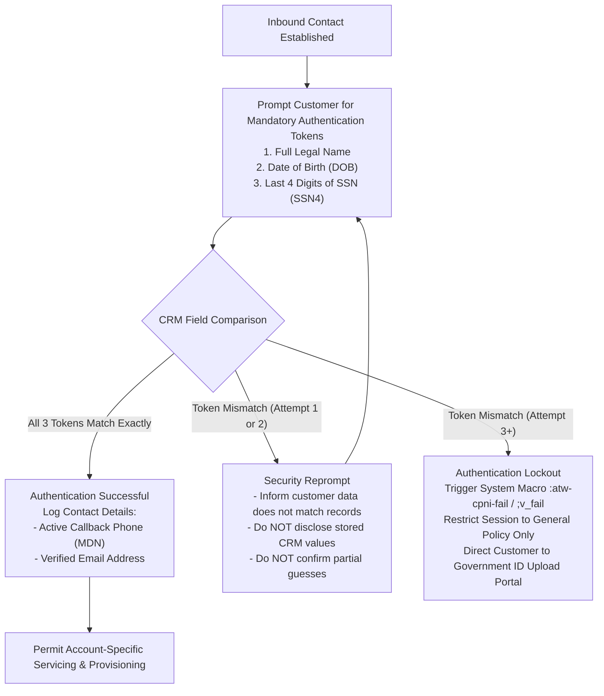
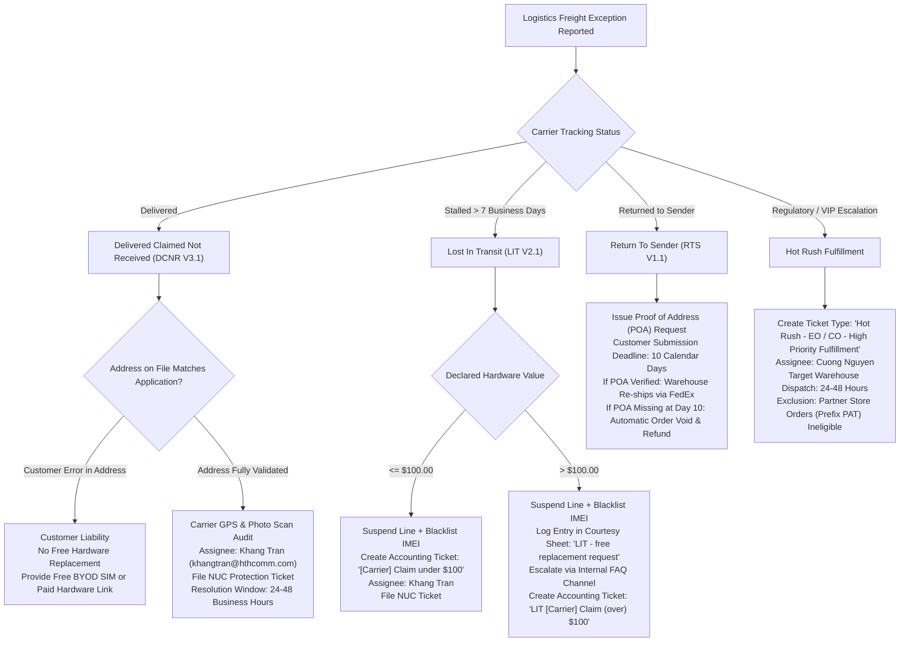
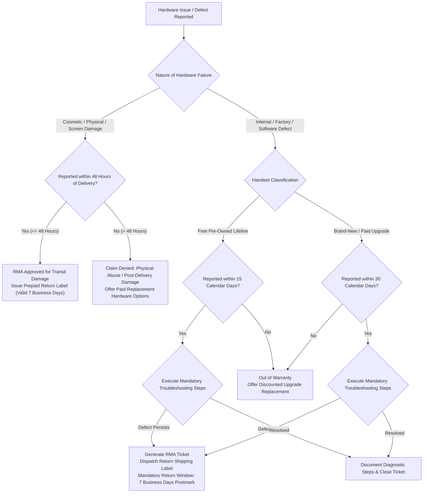
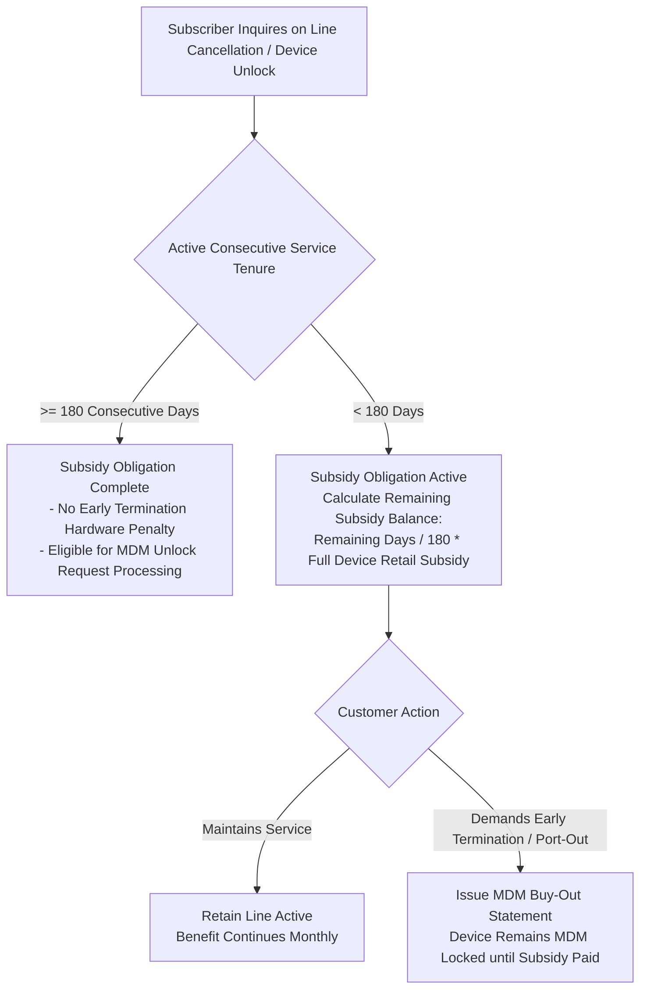
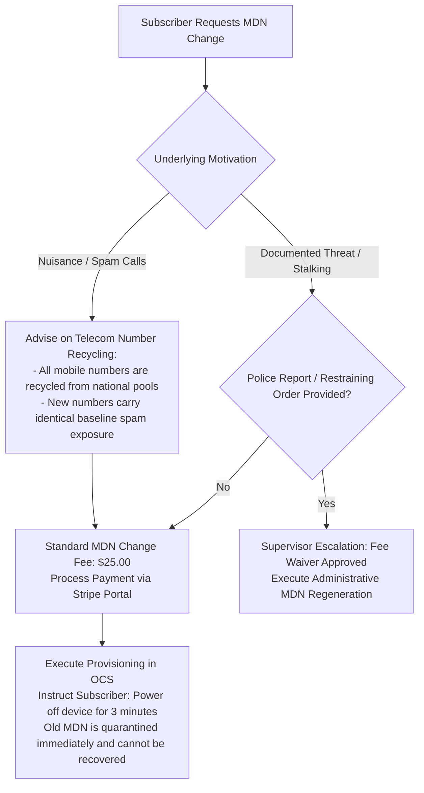
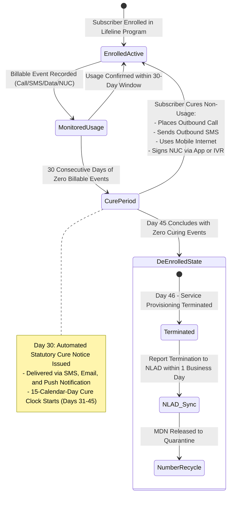
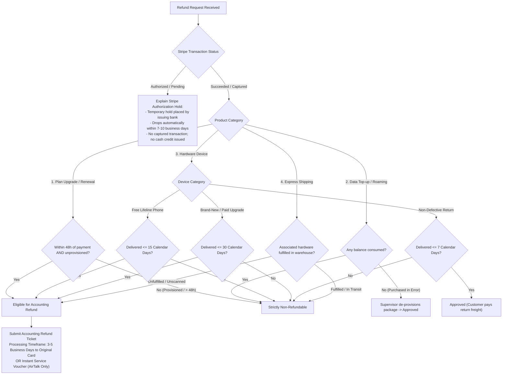

# STANDARD OPERATING PROCEDURE & REGULATORY POLICY SPECIFICATION
**AirTalk Wireless & TAG Mobile - Lifeline, ACP, and MVNO Ecosystem Operations**
*Document ID: SOP-POL-MAT-2026-V4 | Classification: Technical Operations Manual*
*Authorized Role: Tier 1 Customer Support Representative (Agent: Martin)*

---

## 1. Document Control & Audit Reconciliation

This specification establishes the authoritative operational parameters, regulatory compliance rules, and service-level agreements (SLAs) governing all customer support interactions across AirTalk Wireless and TAG Mobile. All parameters documented herein supersede obsolete training materials and align directly with audited Federal Communications Commission (FCC) and Universal Service Administrative Company (USAC) statutory requirements.

### 1.1 Discrepancy Reconciliation & Fatal Error Protection Table

| Operational Domain | Obsolete / Non-Compliant Parameter | Audited SOP Baseline Parameter | Regulatory Authority / QA Fatal Impact |
| :--- | :--- | :--- | :--- |
| **Refund Eligibility** | Blanket 7-day rule applied indiscriminately across all transactions. | • Free Pre-Owned Lifeline Handsets: Return window is **15 calendar days** from carrier delivery date.<br>• Brand-New & Paid Upgrade Handsets: Return window is **30 calendar days** from delivery.<br>• Non-Defective Hardware: Return window is **7 calendar days** (customer responsible for return freight).<br>• Monthly Recurring Charges, Data Add-ons, and ILD Top-ups: **Strictly non-refundable**. | **Fatal QA (25% Deduction - False Promise):** Misquoting the 30-day window for paid hardware violates consumer terms; promising refunds on exhausted telecom units incurs direct financial chargebacks. |
| **Hardware Warranty** | Uniform 15-day warranty applied to all device categories. | • Free Pre-Owned Devices & Included Accessories: **15 calendar days** limited warranty.<br>• Brand-New & Paid Upgrade Devices: **30 calendar days** limited warranty.<br>• Cosmetic, Transit, or Physical Damage: **Strictly 48 hours** from carrier delivery timestamp.<br>• Return Merchandise Authorization (RMA) Shipping Label: Valid for **7 business days** to postmark. | **Fatal QA / Loss Control:** Failure to enforce the 48-hour cosmetic damage window forces the carrier to absorb customer-induced damage; refusing valid 30-day paid claims triggers FCC complaints. |
| **Device Subsidy Commitment** | Claiming customer is bound by a 365-day service obligation. | • Hardware Subsidy Service Commitment: Exactly **180 consecutive active days**.<br>• Free Device Application Interval: One government-subsidized device per household every **365 days**. | **Contractual Breach:** Misrepresenting 180-day subsidy lock as 365 days creates regulatory exposure under federal truth-in-billing rules. |
| **Port-Out Validation** | Transfer PIN issued with 30-day validity and without contractual disclosure. | • Transfer PIN Lifetime: Exactly **4 calendar days** (96 hours).<br>• Mandatory Warning: Loss of monthly federal subsidy and assessment of non-commitment hardware fees if 180-day active threshold is unmet. | **Fatal QA (30% Deduction - Security):** Erroneous validity claims lead to failed ports; omitting subsidy warnings forfeits company hardware recovery rights. |
| **Lifeline Non-Usage** | Vague 30-day or 60-day de-enrollment timelines. | • 30 consecutive days zero billable usage triggers automated Cure Notice.<br>• 15 calendar days cure window (Days 31 through 45).<br>• Day 46: Service de-enrollment and National Lifeline Accountability Database (NLAD) de-registration executed within **1 business day**. | **FCC 47 CFR § 54.405 / 54.407:** Non-compliance results in federal audit sanctions and forfeiture of USAC universal service reimbursement. |

---

## 2. Customer Proprietary Network Information (CPNI) & Account Security

In accordance with 47 U.S.C. § 222 and FCC CPNI regulations (47 CFR §§ 64.2001–64.2011), representatives are prohibited from disclosing call detail records, billing data, hardware identifiers, or executing provisioning changes without completing Tier 1 multi-factor authentication.

### 2.1 CPNI Multi-Factor Authentication Workflow



### 2.2 Operational Rules for CPNI Compliance
1. **Name Matching Criteria:** First Name and Last Name must match CRM records identically. Middle names are optional. Suffixes (*Jr., Sr., II, III, IV*) are non-blocking if primary name matches. Hyphenated and apostrophized names (*Smith-Jones*, *O'Connor*) are evaluated disregarding punctuation.
2. **Date of Birth:** Must match the recorded date in `MM/DD/YYYY` format with zero tolerance for discrepancies.
3. **SSN Verification:** Must match the final 4 digits of the subscriber's Social Security Number on file with USAC/NLAD.
4. **Data Hygiene in Notes:** Under federal privacy mandates, representatives must **never upload, paste, or attach government identity documents directly into CRM Activity Notes**. Notes must reference only the secure Ticket ID or Chat Session ID containing the encrypted asset.
5. **SIM Port-Protection Protocol:** Triggered automatically when an incorrect verification token is entered 3 consecutive times during replacement SIM or transfer requests. Unlocking requires subscriber authentication via the authenticated web portal (`Account > My SIM > SIM - Port Unlock`).

---

## 3. Logistics, Fulfillment, and Freight Disruption Protocols

Customer shipments are fulfilled through commercial carriers (FedEx, USPS). Freight disruptions must be categorized and processed strictly according to documented carrier claim matrices.

### 3.1 Logistics Claim Routing Decision Tree



### 3.2 Detailed Operational Parameters
- **DCNR NUC Safeguard:** Every DCNR ticket must include an associated Non-Usage Code (NUC) escalation ticket to prevent automated federal de-enrollment while the logistics audit is underway.
- **LIT Filing Thresholds:** Hardware shipments valued under \$100 are settled internally through standard accounting claims. Shipments exceeding \$100 require administrative approval via the Courtesy Replacement Log before replacement inventory can be released.
- **RTS Retention Period:** Packages marked *Insufficient Address*, *Undeliverable as Addressed*, or *Refused* are staged at the fulfillment center for exactly 10 calendar days awaiting verified utility bills or state ID proof.

---

## 4. Hardware Lifecycle, Warranty Protocols, and Device Subsidies

### 4.1 Hardware Return & Warranty Evaluation Lifecycle



### 4.2 Device Subsidy & 180-Day Commitment Governance



### 4.3 SIM PUK Protocol & Permanent Lockout
- **PUK Trigger:** Three consecutive incorrect PIN attempts lock the SIM card, prompting for PUK1.
- **PUK Retrieval:** Representatives must locate PUK1/PUK2 codes within the OCS CRM Subscriber Management tab.
- **Terminal Lockout Rule:** Ten consecutive incorrect PUK entries result in irreversible microchip invalidation. The subscriber must be advised that the SIM card is permanently destroyed and requires a paid or courtesy replacement SIM order.

---

## 5. Subscriber Line Management, MDN Changes, and Network Services

### 5.1 Mobile Directory Number (MDN) Change Protocol



### 5.2 Network Feature Specifications
1. **International Long Distance (ILD):**
   - Unlimited dialing to 80 designated international destinations.
   - Monthly allowance of \$10.00 for non-unlimited destinations.
   - Accounts exhibiting zero ILD usage across a consecutive 6 to 12-month period have the NETIP international routing suspended automatically to mitigate carrier toll fraud. Representatives may re-provision ILD upon verified subscriber request.
   - Pay-as-You-Go ILD credits are strictly non-refundable once activated.
2. **International Roaming:**
   - AirTalk Wireless and TAG Mobile services are restricted strictly to domestic United States towers (including Puerto Rico and US Virgin Islands).
   - International roaming outside domestic borders is technically barred and cannot be enabled.
3. **Voicemail Configuration:**
   - Default PIN is provisioned as the last 4 digits of the subscriber's MDN.
   - Initialization sequence: Press and hold key `1` on the handset dialer, enter temporary PIN, establish personalized greeting.
   - PIN resets are executed directly in CRM by resetting the mailbox credentials to default.
4. **eSIM Provisioning:**
   - Active Wi-Fi connection is mandatory during QR profile download.
   - Diagnostic protocol for `Unable to Continue Cellular Configuration`: Delete corrupted cellular profile, verify IMEI compatibility, regenerate activation QR voucher.

---

## 6. Statutory Compliance & Lifeline Lifecycle Management

### 6.1 Federal 45-Day Non-Usage Enforcement (FCC 47 CFR § 54.405 / § 54.407)



### 6.2 Annual Recertification Failure Remediation
When a subscriber is de-enrolled by USAC for failure to complete annual recertification, representatives must:
1. Verify the subscriber still retains possession of their provisioned hardware.
2. Generate an authenticated, personalized **Re-apply Link** directly through CRM.
3. If the subscriber requires retention of their previous MDN, initiate an IT support ticket prior to new enrollment approval to prevent number recycling.

---

## 7. Port-Out Management & OCS Provisioning Controls

### 7.1 Port-Out Request Sequence & Safety Controls

```mermaid
sequenceDiagram
    autonumber
    actor CX as Subscriber
    actor CSR as Support Agent (Martin)
    participant CRM as CRM / OCS Database
    participant GC as Gaining Carrier

    CX->>CSR: Demands Port-Out Credentials (Account Number & PIN)
    CSR->>CRM: Execute 3-Factor CPNI Verification
    CRM-->>CSR: Verification Validated
    CSR->>CRM: Inspect OCS Live Status
    alt Status NOT in (Active, Hotlined, Barred, Expired)
        CSR->>CX: Port-Out Ineligible: Account must be in valid OCS operating status
    else Status Qualified
        CSR->>CX: Disclose 180-Day Subsidy Commitment Penalty & Loss of Federal Benefit
        CSR->>CX: Designate Delivery Channel (SMS with ICCID verification OR Email)
        Note over CSR,CX: Delivery permitted to ONE channel only to prevent code race conditions
        CSR->>CRM: Generate Transfer PIN (Expires in exactly 4 Calendar Days)
        CRM-->>CX: Transfer PIN Dispatched
        CSR->>CRM: Create Cancellation Ticket
        alt Gaining Carrier is AT&T
            Note over CRM: Account terminates automatically 48 hours post-ticket creation
        else Gaining Carrier is MVNO-C
            Note over CRM: 15-day transfer window granted; month-end batch termination
        end
        GC->>CRM: Submit Inter-Carrier Port Request
        CRM-->>GC: Line Released
    end
```

---

## 8. Financial Disputes, Stripe Settlements, and Service Cancellation

### 8.1 Product-Specific Refund Evaluation Matrix



### 8.2 Tier 1 Cancellation & Retention Standards
1. Representatives must probe for root-cause dissatisfaction (coverage, hardware, billing).
2. Mandate disclosure of forfeiture of government-subsidized benefits and permanent loss of MDN.
3. Tier 1 representatives are **strictly barred from performing direct line cancellations on OCS**. All unresolved cancellation intents must be transitioned via CRM Ticket to Tier 2 Cancellation Review.

---

## 9. Advanced Fraud Scenarios & Security Operations

### 9.1 Anti-Spam Investigation & Anti-Evasion Defense
Under SOP_Spam Handling V2.2, accounts placed under active Spam Investigation are subject to immediate account hardening:
- **Restriction Scope:** Automated blocks on New SIM orders, MDN changes, port-ins, and replacement dispatches.
- **Evasion Detection:** If a subscriber facing spam flags attempts to bypass investigation by filing lost/stolen claims, DCNR claims, or requesting line re-numbering, representatives must immediately apply trigger `:atw-spam-evasion` and halt all subsidiary workflows.
- **Mandatory Identity Proof:** Subscriber must furnish a high-resolution photograph holding government ID adjacent to face, or an unedited 5 to 10-second video reciting full legal name and date of birth.

### 9.2 Unauthorized Transfer (Slamming) Defense
- **Slamming Definition:** Fraudulent transfer of a subscriber's federal Lifeline benefit to an unauthorized third-party provider without explicit consent.
- **Field Representative Warning:** AirTalk Wireless does not deploy door-to-door sales agents.
- **Remediation Protocol:** Provide the subscriber with the **Reverse Transfer Consent Form**, submit an expedited re-enrollment request, and direct the subscriber to file a formal complaint with the USAC Fraud Hotline at **1-800-234-9473**.

---

## 10. Operational SLA Quick Reference Table

| Operational Action | Governing SOP Reference | Standard SLA / Timeline | Assigned Department / Contact |
| :--- | :--- | :--- | :--- |
| **CPNI Authentication Lockout** | Account Verification V1.2 | Immediate upon 3rd failed attempt | Tier 1 CSR (Martin) / Self-Service Portal |
| **DCNR Freight Investigation** | DCNR Handling V3.1 | 24 to 48 Business Hours | Khang Tran (`khangtran@hthcomm.com`) |
| **LIT Carrier Claim Settlement** | Lost In Transit V2.1 | 24 to 48 Business Hours | Khang Tran (`khangtran@hthcomm.com`) |
| **RTS Proof of Address Window** | Return To Sender V1.1 | 10 Calendar Days maximum | Fulfillment Review Team |
| **Hot Rush Warehouse Dispatch** | Hot Rush Fulfillment SOP | 24 to 48 Hours to Carrier Scan | Cuong Nguyen (Fulfillment Lead) |
| **Hardware RMA Label Validity** | Warranty Replacement V1.2 | 7 Business Days to postmark | Reverse Logistics Team |
| **Cosmetic Damage Filing Window** | Warranty Replacement V1.2 | Strictly 48 Hours from delivery | Tier 1 CSR (Martin) |
| **Port-Out PIN Validity Window** | Port-Out SOP V2.1 | Exactly 4 Calendar Days (96 Hours) | Automated OCS Integration Engine |
| **Stripe Authorization Hold Release** | Refund Handling V3.1 | 7 to 10 Business Days | Customer Issuing Financial Institution |
| **Approved Refund Settlement** | Refund Handling V3.1 | 3 to 5 Business Days | Accounting / Merchant Processing |
| **Lifeline Non-Usage Cure Period** | Non-Usage Guideline V1.1 | 15 Calendar Days (Days 31-45) | Automated USAC Compliance Daemon |
| **NLAD De-enrollment Notification** | Non-Usage Guideline V1.1 | Within 1 Business Day of Day 46 | Compliance Operations / USAC Interface |
