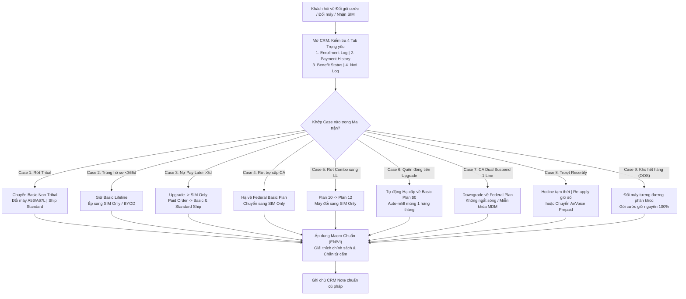
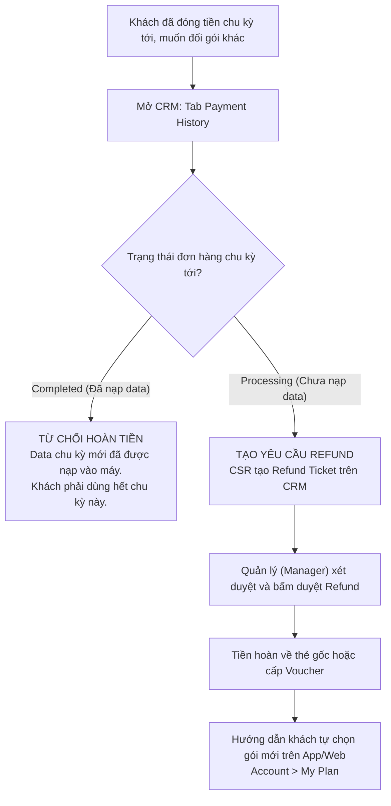

# CẨM NANG TOÀN DIỆN: CƠ CHẾ CHUYỂN ĐỔI GÓI CƯỚC & THAY ĐỔI ĐƠN HÀNG THEO TỪNG CASE NGHIỆP VỤ
**Bản đồ Đối soát Chi tiết, Cơ chế Hệ thống Tự động & Hướng dẫn Thao tác CSR (Không Cần Tự Nhớ)**
*Mã tài liệu: SOP-PLAN-ORDER-CONVERSION-2026-V1 | Phân loại: Sổ tay Tác nghiệp Chuyên sâu*
*Nguồn trích xuất: ST Training Slide (Slides 20-55, 76-99, 130), Upgrade Plans CSR Guide, Customer Orders Change SOP, Transfer Benefit Guidelines, Recertification De-enroll SOP*

---

## 1. Nguyên Tắc Cốt Lõi: "Không Ai Phải Tự Nhớ - Đối Soát Theo Ma Trận"

Trong quá trình tiếp nhận hồ sơ (Enrollment), sử dụng dịch vụ và gia hạn chu kỳ, đơn hàng hoặc gói cước của khách hàng thường xuyên bị **hệ thống tự động thay đổi (System Adjustment)** hoặc do **Review (RV) Team can thiệp kỹ thuật**.

Nguyên nhân bắt nguồn từ sự giao thoa phức tạp giữa:
1. **Quy định pháp lý của chính phủ (FCC / USAC / NLAD):** Quy chuẩn xét duyệt trợ cấp Liên bang.
2. **Quy định khắt khe của bang (California LifeLine / Maximus):** Thẩm định độc lập 2 tầng quyền lợi.
3. **Chính sách tài trợ thiết bị của công ty (AirTalk / TAG Mobile):** Giới hạn 1 máy miễn phí mỗi 365 ngày; hợp đồng cam kết thiết bị 180 ngày.
4. **Trạng thái cổng thanh toán (Stripe / SureTax / Pay Later):** Thất bại trừ thẻ sau các mốc thông báo.

> [!IMPORTANT]
> **Nhân viên CSR tuyệt đối không suy đoán theo cảm tính hay "tự nhớ trong đầu".**
> Khi khách hàng thắc mắc *"Tại sao tôi chọn iPhone mà lại nhận máy A67L?"*, *"Tại sao tôi chỉ nhận được SIM mà không có máy?"*, hoặc *"Tại sao gói cước của tôi bị hạ cấp?"*, CSR phải mở CRM và đối chiếu theo **Bảng Ma Trận 10 Case Chuẩn** dưới đây.



---

## 2. Bảng Ma Trận Tổng Hợp 10 Case Chuyển Đổi Gói Cước & Thiết Bị (Master Conversion Matrix)

| Case | Tình Huống Kích Hoạt | Gói Ban Đầu $\to$ Gói Mới | Thiết Bị Ban Đầu $\to$ Mới | Vận Chuyển | Cơ Chế Xử Lý | Trọng Tâm Giao Tiếp (CẤM LỖI QA) | Macro Áp Dụng |
| :---: | :--- | :--- | :--- | :--- | :--- | :--- | :--- |
| **1** | **Rớt điều kiện Trợ cấp Bộ tộc (Tribal Fail)** | Tribal Plan $\to$ **Lifeline Basic Plan** | Máy Tribal (iPhone...) $\to$ **Máy cơ bản (A56/A67L/Backup)** | Chuyển về **Standard Shipping** | Review Team bấm *"Change phone A56"* & *"Change plan & shipping"* | Giải thích địa chỉ không nằm trong vùng đất bộ tộc do liên bang công nhận. Giới thiệu mua máy ưu đãi. | `;y_tribal_fail`<br>`;vi_tribal_fail` |
| **2** | **Đăng ký lại trong vòng 365 ngày** | Lifeline Basic (Giữ nguyên) | Máy miễn phí $\to$ **Wireless Service Only (SIM card)** | Giữ nguyên loại ship | Review Team bấm *"Change phone BYOD"* | **CẤM NÓI "BYOD cheat"**! Giải thích chính sách công ty: 1 máy miễn phí/365 ngày. Máy do công ty tài trợ, không phải chính phủ. | `;y_byod_365d`<br>`;vi_byod_365d`<br>`;g_byod_explain` |
| **3** | **Quá 3 ngày không trả Pay Later** | Nâng cấp trả phí $\to$ **Lifeline Basic Plan** | Máy nâng cấp $\to$ **Wireless Service Only (SIM card)** | Chuyển về **Standard Shipping** | Hệ thống gửi 3 thông báo, sau ngày 3 tự động ép đổi sang SIM | **CẤM NÓI "Re-offer option"**! Bảo khách kích hoạt SIM rồi vào trang cá nhân mua máy giá ưu đãi cho thuê bao hiện hữu. | `;y_paylater_fail`<br>`;vi_paylater_fail`<br>`;y_pay_fail` |
| **4** | **Thất bại trợ cấp California (Maximus Deny)** | CA Lifeline 12GB $\to$ **Federal Basic Plan** | Máy chọn theo CA $\to$ **BYOD (SIM Only)** | Standard Shipping | Review Team chuyển hồ sơ sang nhánh Federal khi hết 7 ngày pre-approved | Hồ sơ trợ cấp bang không được Maximus duyệt; giữ gói liên bang Federal Basic để duy trì liên lạc miễn phí. | `;y_ca_fail`<br>`;vi_ca_fail` |
| **5** | **Đăng ký Combo nhưng chỉ duyệt Lifeline** | Combo Plan (ID 10) $\to$ **Lifeline Basic (ID 12)** | Máy Combo $\to$ **BYOD (SIM Only)** | Standard Shipping | Review Team cập nhật Enrollment Type sang Lifeline only | Giải thích chương trình ACP đã kết thúc hoặc không khớp điều kiện Combo; bảo toàn quyền lợi Lifeline. | `;y_byod_365d`<br>`;vi_byod_365d` |
| **6** | **Nâng cấp gói tự nguyện nhưng không gia hạn** | Lifeline Upgrade (Plus/Premium/Unlimited) $\to$ **Basic Plan ($0)** | Không ảnh hưởng phần cứng | Không áp dụng | Hệ thống **Tự Động Hạ Cấp (Auto-Downgrade)** khi đến hạn thanh toán mà thẻ lỗi | Khách không bị mất sóng. Gói tự về Basic miễn phí, data tự nạp lại mùng 1 hàng tháng. Khách không thể tự hạ cấp trên web. | `;y_plan_downgrade`<br>`;vi_plan_downgrade` |
| **7** | **California Combo bị Suspend 1 quyền lợi** | CA Dual Plan $\to$ **Downgraded to Federal Plan** | Không ảnh hưởng phần cứng | Không áp dụng | Hệ thống tự hạ cấp tạm thời trong 48h - 30 ngày | Line Federal vẫn Active nên khách vẫn dùng được; **Không bị khóa MDM** (ngoại lệ MDM). Hướng dẫn ký TA nếu muốn khôi phục CA. | `;y_ca_dual_suspend`<br>`;vi_ca_dual_suspend` |
| **8** | **Trượt tái chứng nhận hàng năm (Fail Recertify)** | Lifeline Active $\to$ **Hotline / Transition $\to$ Inactive** | Không thu hồi phần cứng | Không áp dụng | USAC de-enroll; AirTalk giữ sóng tạm thời để hỗ trợ | Nếu giữ PII: Hướng dẫn Re-apply, CSR tạo ticket Tech giữ số cũ. Nếu mất điều kiện: Mời chuyển **AirVoice Prepaid** (chặn mua Topup/Plan Lifeline). | `;y_recert_fail`<br>`;vi_recert_fail`<br>`;g_recert_airvoice` |
| **9** | **Thiết bị hết hàng trong kho (Out of Stock)** | Gói cước giữ nguyên 100% | Máy chọn $\to$ **Máy tương đương cùng phân khúc** | Giữ nguyên hoặc ưu tiên ship | Warehouse / Review Team đổi mã thiết bị xuất kho | Thông báo do lượng đặt hàng lớn máy bị tạm hết hàng; đổi sang máy có thông số kỹ thuật tương đương để gửi ngay. | `;y_oos`<br>`;vi_oos`<br>`;g_oos_sub` |
| **10** | **Phân biệt BYOD vs Wireless Service Only** | Basic Plan (Cả 2 đều dùng SIM) | Khách chủ động chọn vs **Hệ thống bắt buộc ép chuyển** | Tùy chọn ship vs **Bắt buộc kèm Thư giải thích** | Khách tự chọn trên web vs Hệ thống ép do nợ tiền / trùng hồ sơ / rớt điều kiện | "Wireless Service Only" luôn có thư Explanation Letter trong phong bì SIM để khách đọc lý do. | `;g_byod_explain`<br>`;vi_byod_explain` |

---

## 3. Hướng Dẫn Tác Nghiệp Chi Tiết Từng Kịch Bản (Deep-Dive 10 Scenarios)

### Case 1: Thất Bại Điều Kiện Trợ Cấp Bộ Tộc (Tribal Benefit Disqualification)
* **Bối cảnh nghiệp vụ:** Khách hàng tại các bang có vùng đất bộ tộc (như Oklahoma, Arizona, Alaska...) khi đăng ký đã chọn diện Bộ tộc (Tribal) để được hưởng gói cước cao hơn và máy ưu đãi cao cấp (ví dụ: iPhone, máy màn hình lớn).
* **Cơ chế phát hiện:** Khi hồ sơ gửi sang NLAD / Hệ thống thẩm định quốc gia, địa chỉ cư trú của khách hàng **không nằm trong ranh giới vùng đất bộ tộc được công nhận**.
* **Dấu hiệu nhận diện trên CRM:**
  * Mở **Tab Enrollment Log**: Thấy ghi chú thẩm định địa chỉ không đạt chuẩn Tribal (Failed applying as Tribal).
  * Mở **Tab Activity Log**: Có lịch sử hệ thống cập nhật phân loại quyền lợi.
* **Thao tác của Review (RV) Team:**
  * RV Team bấm nút `Change phone A56` (hoặc model backup tương đương do khách đã chọn lúc đăng ký).
  * RV Team bấm `Change plan & shipping`: Đổi gói cước về **Basic Plan** và cước vận chuyển về **Standard Shipping**.
* **Quy tắc giao tiếp cho CSR:**
  * Không tranh cãi với khách về nguồn gốc bộ tộc cá nhân.
  * Giải thích rõ: *"Chương trình trợ cấp thiết bị Bộ tộc căn cứ theo bản đồ địa giới đất bộ tộc do Cơ quan thẩm định Liên bang quy định. Do địa chỉ không nằm trong ranh giới này, đơn hàng được áp dụng theo mức trợ cấp tiêu chuẩn toàn quốc (Gói Cơ bản & Thiết bị tiêu chuẩn)."*
  * Hướng dẫn khách: Nếu muốn dùng iPhone hoặc máy cao cấp, khách có thể vào Dashboard chọn mua máy với giá trợ giá thuê bao.

---

### Case 2: Đăng Ký Lại Trong Vòng 365 Ngày (Re-apply Under 365 Days / 1 Free Phone Rule)
* **Bối cảnh nghiệp vụ:** Khách hàng nộp hồ sơ mới sau khi hủy tài khoản cũ hoặc đăng ký lại, thắc mắc gay gắt: *"Tại sao trước đây tôi được tặng điện thoại mà lần này chỉ gửi mỗi thẻ SIM?"* hoặc *"Chính phủ cho mỗi người 1 máy, tại sao ăn chặn máy của tôi?"*.
* **Bản chất chính sách:**
  * Chính phủ Liên bang (FCC/USAC) **chỉ trợ cấp cước viễn thông hàng tháng (Monthly Service Subsidy)**, **KHÔNG tài trợ thiết bị điện thoại**.
  * Thiết bị điện thoại hoàn toàn do **AirTalk Wireless tự bỏ chi phí tài trợ** để hỗ trợ khách hàng khó khăn.
  * Quy tắc tài chính công ty: **Mỗi khách hàng / mỗi hộ gia đình chỉ được nhận đúng 01 điện thoại miễn phí trong vòng 365 ngày**.
* **Dấu hiệu nhận diện trên CRM:**
  * Mở **Tab Enrollment Log**: Thấy hệ thống ghi nhận trùng lặp dữ liệu khách hàng cũ dưới 365 ngày (trước đây hiển thị log `BYOD cheat`, mã EID ví dụ: `WAT1816273613`).
  * Mở **Tab Payment History**: Cột Model Phone bị để trống hoặc đổi thành `BYOD`.
* **Thao tác của Review (RV) Team:**
  * RV Team kiểm tra ngày kích hoạt máy cũ. Nếu $< 365$ ngày, bấm nút `Change phone BYOD`.
  * Đơn hàng chuyển sang dạng **Wireless Service Only (SIM Only)**, gói cước Lifeline Basic giữ nguyên không gián đoạn.
* **Quy tắc giao tiếp SỐNG CÒN (QA Fatal Guardrail):**
  * ❌ **TUYỆT ĐỐI CẤM:** Không được dùng từ lóng nội bộ `BYOD cheat` hay nói khách hàng "gian lận", "lừa đảo".
  * ❌ **TUYỆT ĐỐI CẤM:** Không được nói *"Chính phủ chỉ cho 1 máy"*. (Chính phủ không cho máy).
  * ✔️ **GIAO TIẾP CHUẨN:** *"Theo chính sách thiết bị của công ty chúng tôi, mỗi khách hàng đủ điều kiện được hỗ trợ 01 điện thoại miễn phí trong vòng 365 ngày. Do hồ sơ của quý khách đã từng nhận thiết bị tài trợ trong vòng 1 năm qua, đơn hàng lần này được cung cấp dưới dạng Gói Dịch vụ Miễn phí kèm Thẻ SIM để quý khách duy trì quyền lợi liên lạc miễn phí ngay lập tức."*

---

### Case 3: Khách Chọn Pay Later Nhưng Không Trả Sau 3 Ngày (Pay Later Default)
* **Bối cảnh nghiệp vụ:** Khách hàng đăng ký nâng cấp máy có trả phí hoặc chọn hình thức vận chuyển hỏa tốc, chọn tính năng **Thanh toán sau (Pay Later)** trong lúc chờ Maximus/NLAD phê duyệt hồ sơ (Áp dụng cho California Enrollment V2 và Toàn quốc Enrollment V3).
* **Cơ chế đếm lùi & Thông báo tự động của hệ thống:**
  * *Thông báo 1 (Notification 1):* Gửi ngay khi khách hoàn tất checkout chọn Pay Later.
  * *Thông báo 2 (Notification 2):* Gửi sau **1 ngày** kể từ khi hồ sơ được duyệt (nếu chưa trừ được tiền).
  * *Thông báo 3 (Notification 3):* Gửi sau **2 ngày** kể từ khi hồ sơ được duyệt.
  * *Thông báo 4 (Notification 4 - Final):* Gửi sau **3 ngày** thông báo đơn hàng bị thay đổi do cổng thanh toán Stripe không capture được tiền thẻ.
* **Dấu hiệu nhận diện trên CRM:**
  * Mở **Tab Payment History**: Giao dịch trừ tiền bị `Fail` hoặc không có bản ghi capture thành công.
  * Mở **Tab Enrollment Log**: Xuất hiện log hệ thống: `[PayLater] Change Phone BYOD And Change Sim From E_SIM To PHYSICAL_SIM` (ví dụ EID: `WAT1723402196`).
* **Thao tác của Review (RV) Team & Hệ thống:**
  * **Đơn nâng cấp máy (Upgrade Phone):** RV Team chuyển máy thành **Wireless Service Only (SIM only)**.
  * **Đơn máy miễn phí / BYOD có kèm gói nâng cấp hoặc cước ship hỏa tốc:** RV Team chuyển gói cước về **Lifeline Basic Plan** và đổi hình thức ship về **Standard Shipping**.
* **Quy tắc giao tiếp SỐNG CÒN (QA Fatal Guardrail):**
  * ❌ **TUYỆT ĐỐI CẤM:** Không được dùng thuật ngữ nội bộ `Re-offer option` với khách hàng!
  * ✔️ **GIAO TIẾP CHUẨN:** Giải thích đơn hàng đã quá hạn 3 ngày thanh toán sau khi hồ sơ được phê duyệt. Hướng dẫn khách: *"Sau khi nhận được thẻ SIM và kích hoạt sóng, quý khách có thể đăng nhập vào trang cá nhân (User Dashboard) trên website airtalkwireless.com để đặt mua lại máy với mức giá ưu đãi dành cho thuê bao hiện hữu."*

---

### Case 4: Không Đạt Trợ Cấp California Lifeline (Fail to Apply CA Benefit)
* **Bối cảnh nghiệp vụ:** Khách hàng ở California nộp hồ sơ xin trợ cấp California LifeLine (gói mặc định 12GB data). Trợ cấp cấp bang này phải do cơ quan độc lập của bang là **Maximus** thẩm định.
* **Cơ chế rớt điều kiện:**
  * Khách ở trạng thái Pre-approved nhưng quá 7 ngày không nộp đủ hồ sơ chứng minh theo yêu cầu của Maximus, hoặc bị Maximus ra quyết định từ chối (Denied).
  * Tuy nhiên, quyền lợi trợ cấp cấp Liên bang (Federal Lifeline) đã được NLAD duyệt thành công.
* **Dấu hiệu nhận diện trên CRM:**
  * **CA Benefit:** `Fail to apply` / `Denied`.
  * **Federal Line:** `Active`.
  * **Tab Enrollment Log:** Ghi chú EID (ví dụ `WAT1809456765`): Pre-approved pending 7 days expired $\to$ Fail to apply CA Benefit.
* **Hành động chuyển đổi:**
  * Gói cước: Tự động chuyển từ *Lifeline Standard Plan [CA] - 12GB* sang **Lifeline Basic Plan** (gói Liên bang tiêu chuẩn).
  * Thiết bị: Chuyển đổi thành **BYOD / Wireless Service Only (SIM Only)**.
* **Quy tắc giao tiếp cho CSR:**
  * Giải thích rõ: Hồ sơ trợ cấp bổ sung của Bang California không được cơ quan thẩm định bang (Maximus) phê duyệt. Để đảm bảo khách hàng không bị mất liên lạc, hệ thống đã tự động chuyển đổi sang gói cước trợ cấp Liên bang tiêu chuẩn (Federal Basic Plan) dạng chỉ gửi SIM.

---

### Case 5: Đăng Ký Combo Nhưng Chỉ Được Duyệt Lifeline (Combo to Lifeline Only)
* **Bối cảnh nghiệp vụ:** Khách đăng ký gói Combo (Lifeline + ACP trước đây hoặc các chương trình Combo bang), nhưng một trong hai nhánh trợ cấp không đủ điều kiện (hoặc do chương trình ACP đã kết thúc theo quy định FCC).
* **Dấu hiệu nhận diện trên CRM:**
  * Mở **Tab Enrollment Log**: Xuất hiện log:
    ```json
    {"note":"Change Enrollment Type From COMBO To LIFELINE And Change Phone From Galaxy A02s To Phone BYOD And Change Plan From Id = 10 To Plan Id = 12"}
    ```
* **Hành động chuyển đổi:**
  * Gói cước: Chuyển từ Plan ID 10 (Combo Plan) sang **Plan ID 12 (Lifeline Basic Plan)**.
  * Thiết bị: Chuyển từ máy khuyến mãi Combo sang **BYOD (SIM Only)**.
* **Quy tắc giao tiếp:** Thông báo chương trình Combo không đủ điều kiện áp dụng, công ty kích hoạt ngay gói Lifeline độc lập để khách duy trì sóng.

---

### Case 6: Nâng Cấp Gói Cước Tự Nguyện & Cơ Chế Tự Động Hạ Cấp (Plan Upgrades & Auto-Downgrade)
* **Bối cảnh nghiệp vụ:** Khách hàng muốn sử dụng nhiều data hơn gói miễn phí cơ bản, tự nâng cấp trên App/Web hoặc nhờ CSR hỗ trợ qua CRM.
* **Điều kiện đủ để nâng cấp:**
  1. Là khách hàng hiện hữu của AirTalk / TAG Mobile.
  2. Quyền lợi Lifeline đang ở trạng thái Hoạt động (`Active`).
  3. Số điện thoại (MDN) đang hoạt động bình thường với nhà mạng.
* **Danh mục các gói nâng cấp có sẵn:**
  * **Lifeline Plus Plan**
  * **Lifeline Premium Plan**
  * **Lifeline Unlimited Plan**
  * Mức giá thu khách: $10, $20, $30, $35 (Đã được Quỹ Lifeline Liên bang trợ giá một phần).
* **Quy tắc chu kỳ & Kích hoạt:**
  * **Chu kỳ cước:** Đúng **30 ngày** tính từ ngày giao dịch thành công (`Ngày mua + 30 ngày`).
  * **Kích hoạt ngay lập tức (Immediate Activation):** Gói mới có hiệu lực ngay tại thời điểm thanh toán.
  * **Hủy gói cũ ngay lập tức (Deactivation of Old Plan):** Gói cũ bị vô hiệu hóa ngay và **KHÔNG hoàn lại tiền** cho phần data/ngày chưa sử dụng của gói cũ.
  * **Chỉ hỗ trợ "Change now":** Hệ thống hiện tại chỉ có lựa chọn đổi gói ngay, **KHÔNG có lựa chọn "Set next cycle"** (hẹn đổi vào chu kỳ sau).
* **CƠ CHẾ TỰ ĐỘNG HẠ CẤP (AUTO-DOWNGRADE) KHI KHÔNG GIA HẠN:**
  * Gói cơ bản ($0.00): Tự động nạp lại data vào ngày mùng 1 hàng tháng.
  * Gói nâng cấp: Cần thanh toán chu kỳ 30 ngày (qua Auto-renew hoặc đóng tay trước tối đa 5 ngày).
  * **Nếu khách quên đóng tiền hoặc trừ thẻ thất bại:** Hệ thống **TỰ ĐỘNG HẠ CẤP (Auto-downgrade) về Gói Cơ Bản Lifeline Standard Basic Plan ($0.00)**.
  * **Quyền lợi khách hàng:** Khách hàng **KHÔNG BAO GIỜ bị cắt sóng viễn thông** khi quên đóng tiền gói nâng cấp! Dịch vụ vẫn duy trì ở mức cơ bản miễn phí.
* **Lưu ý đặc thù hệ thống:**
  * Khách hàng **KHÔNG THỂ tự bấm hạ cấp (downgrade) về Basic Plan trên ứng dụng hay website**. Việc hạ cấp chỉ diễn ra tự động khi không đóng tiền, hoặc thông qua quy trình CSR hỗ trợ hoàn tiền chu kỳ sau.

---

### Case 7: California Combo Bị Tạm Ngưng 1 Chiều (CA Dual / Combo Suspend Flow)
* **Bối cảnh nghiệp vụ:** Khách hàng tại California có 2 quyền lợi song song: CA Lifeline (Maximus) và Federal Lifeline (NLAD/NV).
* **Diễn biến hệ thống (Slide 49 - 50):**
  * Nếu quyền lợi CA Lifeline bị **Suspend** (tạm ngưng do rà soát hoặc tranh chấp nhà mạng khác) nhưng Federal Lifeline vẫn **Active**:
  * Gói cước của khách hàng sẽ được hệ thống: **Downgraded to Federal plan** (hạ cấp về gói Federal cơ bản).
  * Thời hạn rà soát: 48 giờ đến 30 ngày.
* **Ngoại lệ khóa máy MDM (MDM Exception - Slide 130):**
  * Thông thường, nếu chuyển mạng (Transfer out) hoặc hủy gói trước 180 ngày thì máy iPhone MDM sẽ bị khóa Lost Mode.
  * **TUY NGOẠI LỆ:** *"California Dual/Combo plans — only one service line may be cancelled; the other remains active"* $\to$ Do line Federal vẫn đang hoạt động, thiết bị **TUYỆT ĐỐI KHÔNG BỊ KHÓA MDM**.
* **Hướng xử lý của CSR:**
  * Giải thích khách vẫn dùng được sóng bình thường theo hạn mức của gói Federal.
  * Nếu khách muốn khôi phục gói California 12GB đầy đủ, hướng dẫn khách hoàn tất thỏa thuận Transfer Agreement (TA) hoặc bổ sung hồ sơ cho Maximus.

---

### Case 8: Khách Bị De-enroll Do Trượt Tái Chứng Nhận (Fail Recertification Flow)
* **Bối cảnh nghiệp vụ:** Hàng năm, khách hàng Lifeline phải hoàn thành thủ tục Tái chứng nhận điều kiện thu nhập với USAC / Maximus / Solix. Nếu quá hạn (Recertification Deadline), cơ quan chính phủ sẽ gửi lệnh hủy đăng ký (De-enroll).
* **Chính sách hỗ trợ đặc biệt của AirTalk (Từ 16/07):**
  * AirTalk **KHÔNG ngắt sóng ngay lập tức** để tránh làm khách hàng mất liên lạc đột ngột.
  * Hệ thống chuyển trạng thái OCS sang **Hotline / Transition Period** (Duy trì tạm thời).
* **Hai nhánh xử lý của CSR:**
  * **Nhánh A - Hỗ trợ Re-apply giữ nguyên số điện thoại cũ (MDN):**
    * Áp dụng khi: Thông tin định danh cá nhân (PII) của khách hàng không thay đổi.
    * Hướng dẫn khách nộp đơn mới (Re-apply) trên website.
    * Sau khi đơn mới được chính phủ phê duyệt, CSR tạo **CRM Ticket gửi Technical Team**:
      * *Tiêu đề Ticket:* `Update MDN from old account to new account (Fail recertify)`
      * *Nội dung:* Mã EID cũ, Mã EID mới, Số điện thoại cần chuyển sang.
  * **Nhánh B - Chuyển đổi sang mạng trả trước AirVoice Prepaid:**
    * Áp dụng khi: Khách hàng không còn đủ điều kiện tham gia chương trình trợ cấp Lifeline.
    * Mời khách chuyển đổi sang mạng di động trả trước **AirVoice Prepaid** để giữ nguyên số điện thoại đang dùng.
    * **QUY TẮC KHÓA DỊCH VỤ LIFELINE:** Trong giai đoạn chuyển tiếp AirVoice, tài khoản Lifeline của khách **BỊ KHÓA TOÀN BỘ tính năng mua sắm**: Không được mua thêm Top-up Data, không được mua Gói nâng cấp (Upgrade Plans), không được đặt mua thêm SIM hay thiết bị điện thoại.

---

### Case 9: Thiết Bị Hết Hàng Trong Kho (Out of Stock - OOS Substitution)
* **Bối cảnh nghiệp vụ:** Khách hàng đặt một mẫu máy nhất định (ví dụ dòng điện thoại phổ thông cụ thể), nhưng tại thời điểm đóng hàng thì kho trung tâm hết hàng.
* **Quy chuẩn xử lý:**
  * Đơn hàng được giữ trong hàng đợi hoặc bộ phận Fulfillment đổi sang một model khác có **thông số kỹ thuật tương đương hoặc cao hơn** (Equivalent or Upgraded specifications).
  * **Gói cước viễn thông Lifeline không bị thay đổi bất kỳ thông số nào**.
* **Quy tắc giao tiếp cho CSR:**
  * Thông báo chân thành về tình trạng kho tạm thời.
  * Nếu khách đồng ý nhận máy thay thế: Xác nhận xuất kho ngay.
  * Nếu khách không đồng ý: Giữ đơn trong hàng đợi để chờ lô hàng kế tiếp.

---

### Case 10: Phân Biệt Bản Chất Giữa "BYOD" và "Wireless Service Only"
Nhiều CSR mới thường nhầm lẫn giữa hai khái niệm này vì trên bưu kiện gửi đi đều chỉ có thẻ SIM:

| Đặc Điểm | Bring Your Own Device (BYOD) | Wireless Service Only |
| :--- | :--- | :--- |
| **Bản chất** | Khách hàng **chủ động lựa chọn** dùng máy riêng của mình lúc đăng ký. | Hệ thống hoặc Review Team **bắt buộc ép chuyển** từ đơn máy về chỉ gửi SIM. |
| **Nguyên nhân kích hoạt** | Do nhu cầu cá nhân của khách hàng. | Do vi phạm chính sách: Trùng hồ sơ < 365 ngày, nợ Pay Later > 3 ngày, rớt Tribal, rớt California. |
| **Bưu kiện gửi đi** | Phong bì chứa SIM card tiêu chuẩn. | Phong bì chứa SIM card **BẮT BUỘC ĐÍNH KÈM THƯ GIẢI THÍCH (Explanation Letter)** nêu rõ lý do hệ thống chuyển đổi. |
| **Quyền mua máy sau đó** | Khách có thể mua máy bất cứ lúc nào trên web. | Khách có thể đăng nhập Dashboard để mua máy lần đầu với giá ưu đãi sau khi SIM kích hoạt thành công. |

---

## 4. Dấu Hiệu Nhận Diện Trên CRM (Tab Enrollment Log, Payment History, Noti Log)

Khi tiếp nhận ca, CSR mở hồ sơ khách hàng trên CRM và thực hiện thao tác kiểm tra 3 bước sau:

### Bước 1: Kiểm tra Tab Enrollment Log
Tìm các câu log hệ thống đặc trưng (System Log Keywords):
* `Failed applying with CA`: Rớt trợ cấp bang California $\to$ Chuyển sang Basic SIM.
* `Failed applying as Tribal`: Không đạt chuẩn địa chỉ đất bộ tộc $\to$ Chuyển sang máy A56/A67L.
* `Re-apply under 365 days` (hoặc log cũ `BYOD cheat`): Trùng máy trong vòng 1 năm $\to$ Chuyển sang BYOD.
* `[PayLater] Change Phone BYOD And Change Sim From E_SIM To PHYSICAL_SIM`: Nợ Pay Later quá 3 ngày $\to$ Chuyển sang SIM Only.
* `Change Enrollment Type From COMBO To LIFELINE`: Rớt Combo sang Lifeline thuần túy.

### Bước 2: Kiểm tra Tab Payment History
* Xem trạng thái đơn hàng của gói cước hoặc thiết bị:
  * `Processing`: Đơn hàng gia hạn chu kỳ tiếp theo đã thanh toán nhưng chưa nạp data (Điều kiện bắt buộc để hỗ trợ Refund đổi gói).
  * `Completed`: Đơn hàng đã nạp data thành công (Không được hoàn tiền).
  * `Fail` / `Declined`: Cổng thanh toán không trừ được tiền thẻ.
* Xem cột **Model phone**: Nếu trống hoặc ghi `BYOD` trong khi đơn ban đầu có tên máy $\to$ Đã bị hệ thống điều chỉnh sang SIM Only.

### Bước 3: Kiểm tra Tab Noti Log (Lịch sử gửi thông báo)
* Đối với case Pay Later: Kiểm tra xem hệ thống đã bắn đủ 3 email nhắc nợ và 1 email thông báo đổi đơn chưa.
* Đối với case Recertification: Kiểm tra ngày gửi thông báo hạn chót tái chứng nhận của USAC.

---

## 5. Quy Trình Đổi Gói Cước Khi Khách Đã Trả Tiền Chu Kỳ Tới (Refund & Plan Switch)

Nếu khách hàng đang dùng gói nâng cấp (Lifeline Plus/Premium/Unlimited), **đã thanh toán tiền cho chu kỳ 30 ngày tiếp theo**, nhưng sau đó liên hệ CSR yêu cầu đổi sang một gói cước khác:



* **Điều kiện tiên quyết:** Đơn hàng của chu kỳ mới trong Tab Payment History phải ở trạng thái `Processing`.
* **Thao tác CSR:** Tạo yêu cầu hoàn tiền $\to$ Báo Manager duyệt $\to$ Khi tiền/voucher về tài khoản, hướng dẫn khách vào mục `Account > My Plan` trên website hoặc app để tự chọn gói cước mới theo ý muốn.

---

## 6. Tiêu Chuẩn Ghi Chú Nội Bộ CRM Note Mẫu Cho Từng Case Chuyển Đổi

Khi xử lý xong ca thắc mắc về gói cước và đơn hàng, CSR phải lưu note nội bộ chuẩn xác:

* **Mẫu Case 1 (Tribal Disqualification):**
  `[EMAIL][ORDER_CHANGE][TRIBAL_FAIL] Customer inquired why phone was changed to A67L. Verified Enrollment Log: address not in NLAD Tribal boundary. Explained Tribal eligibility criteria. Guided customer to dashboard for promo upgrades. No escalation needed.`

* **Mẫu Case 2 (365-Day Free Phone Policy):**
  `[EMAIL][ORDER_CHANGE][365D_POLICY] Customer asked why only SIM card received. Audited records: previous subsidized device issued under 365 days. Explained 1 free device per 365 days policy. Customer understood. Account active on Basic Plan.`

* **Mẫu Case 3 (Pay Later Default):**
  `[EMAIL][ORDER_CHANGE][PAYLATER_DEFAULT] Customer inquired about missing upgrade phone. Verified 3 unpaid reminders sent post-approval. Order auto-converted to SIM Only per policy. Advised customer to log in to dashboard after SIM activation to re-order at subscriber rate.`

* **Mẫu Case 6 (Auto-Downgrade Plan):**
  `[EMAIL][PLAN_DOWNGRADE][NON_RENEWAL] Customer asked why plan dropped to Basic. Checked Payment History: renewal charge failed on due date. Explained 30-day upgrade cycle and auto-downgrade safeguard. Data auto-refills on 1st. Customer informed.`

* **Mẫu Case 8 (Recertification De-enroll & Re-apply):**
  `[EMAIL][RECERT_FAIL][REAPPLY] Customer de-enrolled by USAC due to passing recert deadline. PII unchanged. Guided customer to submit re-application on website. Created technical ticket to preserve phone number upon approval.`
