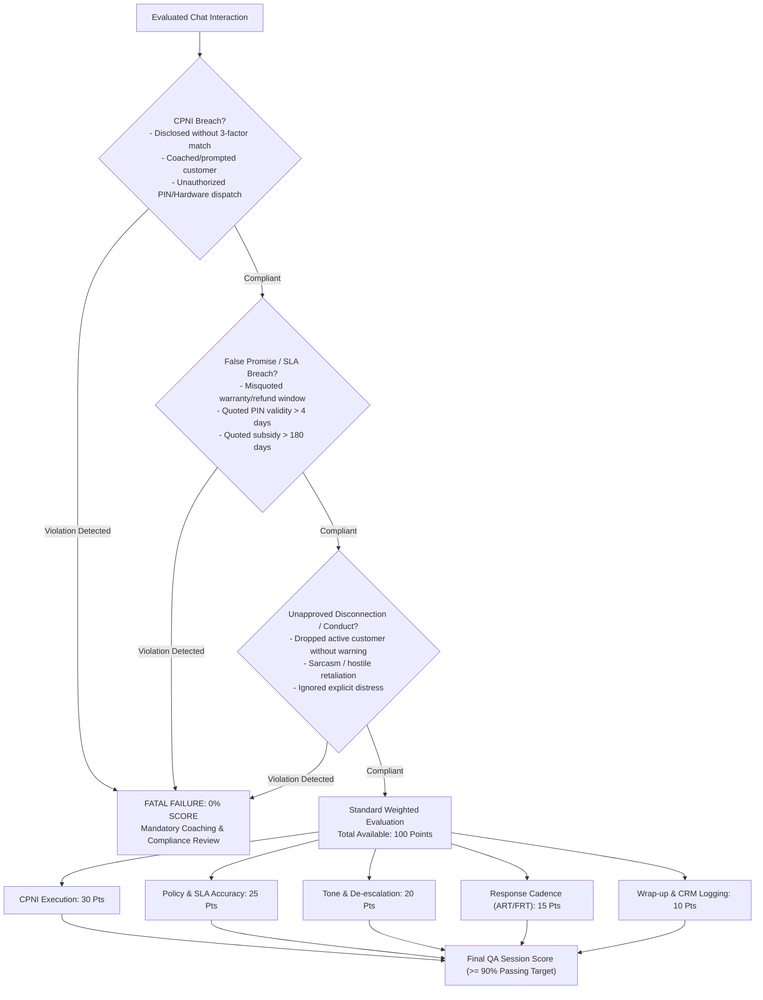

# QUALITY ASSURANCE AUDIT MANUAL & COMPLIANCE SCORING RUBRIC
**AirTalk Wireless & TAG Mobile - Multi-Platform Customer Engagement Standards**
*Document ID: QA-AUD-MAN-2026-V3 | Classification: Quality Compliance Standard*
*Authorized Role: Tier 1 Customer Support Representative (Agent: Martin)*

---

## 1. Quality Assurance Governance Framework

The Quality Assurance (QA) program at Softel Solutions enforces strict operational compliance with Federal Communications Commission (FCC) statutory mandates, Universal Service Administrative Company (USAC) guidelines, and internal operational service-level agreements (SLAs). 

In high-concurrency environments handling simultaneous LiveChat and internal CRM portal sessions, the primary objective is the total elimination of **Fatal Compliance Violations**. A single fatal error results in an immediate **0% Session Audit Score (Automatic Audit Failure)**, triggers mandatory retraining, and incurs internal compliance logging.

### 1.1 The Anti-Gravity Operational Tenets
1. **Zero Statutory Compromise:** Hardcode statutory guidelines and exact policy numbers into standardized modular expansion macros to eliminate human recall failure.
2. **Cognitive Bandwidth Conservation:** Shift repetitive keystroke input and policy calculation from active representative recall to validated dynamic snippet assemblies.
3. **Mandatory Emotional Validation:** Systematically neutralize customer distress via structured Red Zone empathy statements prior to introducing regulatory constraints or procedural resolutions.
4. **Dynamic Context Sanitization:** Automate parameter injection (`ticket_id`, `port_out_pin`, `puk`) to eliminate bracketed placeholder omissions in production communications.

---

## 2. Comprehensive 100-Point QA Audit Rubric



---

## 3. Detailed Audit Criteria & Violation Specifications

### 3.1 Domain 1: CPNI Compliance & Identity Authentication (Weight: 30% | Critical / Fatal)
- **Regulatory Foundation:** 47 U.S.C. § 222; 47 CFR Part 64, Subpart U.
- **Audit Mandates:**
  - Representative must request all 3 mandatory tokens (Full Legal Name, Date of Birth, SSN Last 4 Digits) prior to disclosing account-specific information.
  - Representative must verify that the customer's input matches CRM data 100% prior to acknowledging account existence, balances, hardware orders, or tracking details.
  - Representative must capture secondary contact data (callback MDN and email) upon successful authentication.
- **Fatal Violation Triggers (Automatic 0%):**
  - Disclosing any account-specific record (MDN, balance, order status, address) to an unauthenticated party.
  - "Coaching" or feeding correct credentials when a customer provides mismatched information (e.g., *"Does your name start with J?"* or *"Did you mean 1985?"*).
  - Generating or releasing a Port-Out Transfer PIN without passing Tier 1 authentication.
  - Uploading identity card images directly to CRM Activity Notes instead of referencing secure ticket identifiers.
- **Defensive Macro Protection:** `:atw-cpni-ask`, `:atw-cpni-pass`, `:atw-cpni-fail`.

### 3.2 Domain 2: SLA Precision & Truth-in-Billing (Weight: 25% | Critical / Fatal)
- **Regulatory Foundation:** FCC Truth-in-Billing Guidelines; Carrier Operating Contracts.
- **Audit Mandates:**
  - All procedural explanations, operational deadlines, and return windows must mirror published Standard Operating Procedures without alteration.
- **Fatal Violation Triggers (Automatic 0% - False Promise):**
  - Stating that paid or upgraded hardware has only a 15-day return window (standard is 30 calendar days).
  - Promising refunds for recurring monthly plan fees, consumed data top-ups, or provisioned ILD bundles.
  - Failing to enforce the strict 48-hour post-delivery window for reporting physical or cosmetic screen damage.
  - Advising a customer that a Port-Out PIN remains valid for 30 days (standard is strictly 4 calendar days).
  - Claiming the hardware subsidy commitment is 365 days (standard is exactly 180 consecutive active days).
  - Promising same-day warehouse dispatch without authorization from the Logistics Fulfillment Lead.
- **Defensive Macro Protection:** `:atw-refund-ylw`, `:atw-war-ylw`, `:atw-po-ylw`, `:atw-nonuse-ylw`.

### 3.3 Domain 3: Professional Conduct & De-escalation (Weight: 20% | Critical / Fatal)
- **Audit Mandates:**
  - Representatives must acknowledge customer emotional tension within the first customer-facing response following an expression of grievance.
  - Unprofessional language, combative remarks, or argumentative phrasing are strictly prohibited.
- **Fatal Violation Triggers (Automatic 0%):**
  - Disconnecting an active chat session while the customer is communicating without following the formal 2-strike warning protocol.
  - Engaging in retaliatory, condescending, or sarcastic commentary.
  - Completely ignoring reported service outages or severe fulfillment breakdowns.
- **Defensive Macro Protection:** `:atw-deescalate`, `:atw-warn-profanity`, `:atw-disconnect`.

### 3.4 Domain 4: Response Cadence & Queue Velocity (Weight: 15% | Non-Fatal Point Deduction)
- **Performance Thresholds:**
  - **First Response Time (FRT):** Target <= 20 seconds; Audit Failure Threshold > 60 seconds.
  - **Average Response Time (ART):** Target <= 45 seconds; Audit Failure Threshold > 90 seconds.
- **Audit Point Reductions:**
  - Unexplained silence exceeding 90 seconds incurs a 10-point deduction.
  - Failure to deploy periodic queue-refresh messages during prolonged database queries incurs a 5-point deduction.
- **Defensive Macro Protection:** Deploy `:atw-hold-check` every 45 to 60 seconds during back-office investigations to maintain session heartbeat.

### 3.5 Domain 5: Session Wrap-Up & CRM Documentation Hygiene (Weight: 10% | Non-Fatal Point Deduction)
- **Audit Mandates:**
  - Every closed interaction must feature a formalized closing inquiry: *"Is there anything else I may assist you with today?"*
  - CRM Activity Log must be populated immediately upon disconnection with standardized disposition tags: Contact Reason, Root Cause, Action Taken, Ticket ID reference.
- **Audit Point Reductions:**
  - Missing standardized closing statement: 5-point deduction.
  - Incomplete, missing, or inaccurate CRM Activity Note: 5-point deduction.
- **Defensive Macro Protection:** `:atw-wrapup`, `:atw-bye`, `:atw-crm-note`.

---

## 4. Professional Boundary Enforcement & Controlled Disconnection Protocol

Representatives are not required to tolerate abusive, threatening, or profane language. However, to defend against QA deductions for improper disconnection, representatives must adhere strictly to the sequential protocol outlined below.

```mermaid
sequenceDiagram
    autonumber
    actor CX as Hostile / Abusive Customer
    actor CSR as Support Agent (Martin)
    participant CRM as CRM Session Audit Log

    CX->>CSR: Transmits Profanity, Harassment, or Abuse
    Note over CSR: DO NOT retaliate or match customer tone
    CSR->>CX: Strike 1 Warning Issued (:atw-warn-profanity)<br/>"I understand your frustration; however, we maintain a respectful environment..."
    CSR->>CRM: Log Strike 1 Timestamp
    
    alt Customer Moderates Language
        CX->>CSR: Reverts to Civil Communication
        CSR->>CX: Proceed with Problem Resolution via 3-Zone Architecture
    else Customer Continues Abusive Language
        CX->>CSR: Transmits Secondary Abusive / Threatening Message
        CSR->>CX: Strike 2 Final Notice Issued (:atw-disconnect)<br/>"As professional standards have not been maintained, I am now ending this session..."
        CSR->>CRM: Tag Session: Abusive Disconnect / Harassment
        CSR->>CX: Terminate Session Connection
        CSR->>CRM: Compile Activity Note with Exact Chat Log Transcripts
    end
```

---

## 5. High-Concurrency Queue Pacing: The 3-Stage Conveyor Belt

To manage 3 to 5 concurrent sessions across LiveChat and internal CRM queues while holding ART below 45 seconds and preventing cross-account CPNI contamination, representative Martin must operate under the 3-Stage Conveyor Belt framework.

```
+-----------------------------------------------------------------------------------------+
|                                3-STAGE CONVEYOR BELT                                    |
+-----------------------------------------------------------------------------------------+
| STAGE 1: INBOUND TRIAGE (Elapsed Time: 0 - 30 Seconds)                                  |
| • Objective: Satisfy FRT target (< 20s) and execute regulatory authentication.          |
| • Actions:                                                                              |
|   1. Transmit standard greeting (:atw-hi).                                              |
|   2. Transmit mandatory CPNI challenge (:atw-cpni-ask).                                 |
|   3. Total keystroke duration: <= 3 seconds. Cycle focus to subsequent chat.            |
+-----------------------------------------------------------------------------------------+
                                            |
                                            v
+-----------------------------------------------------------------------------------------+
| STAGE 2: BACK-OFFICE INVESTIGATION (Elapsed Time: 30 - 180 Seconds)                     |
| • Objective: Investigate CRM/OCS databases while suppressing customer abandonment.      |
| • Actions:                                                                              |
|   1. Pin customer MDN / Enrollment ID in dedicated CRM tab.                             |
|   2. Deploy session heartbeat (:atw-hold-check) every 45 seconds.                       |
|   3. Verify retrieved records against customer credentials.                             |
+-----------------------------------------------------------------------------------------+
                                            |
                                            v
+-----------------------------------------------------------------------------------------+
| STAGE 3: RESOLUTION & DISPOSITION (Elapsed Time: 180+ Seconds)                          |
| • Objective: Deliver compliant 3-Zone resolution, verify closure, and record notes.     |
| • Actions:                                                                              |
|   1. Deploy modular response or pre-assembled combo (:atw-po-combo, :atw-rush-combo).   |
|   2. Confirm resolution completeness (:atw-wrapup).                                     |
|   3. Inject standardized CRM documentation template (:atw-crm-note).                    |
+-----------------------------------------------------------------------------------------+
```

---

## 6. Defensive Snippet Mapping Matrix for QA Audits

| Specific QA Audit Vulnerability | Underlying Operational Risk | Mandatory Espanso Defensive Macro | Enforced Compliance Output |
| :--- | :--- | :--- | :--- |
| **Premature Account Disclosure** | Disclosing balance or line status prior to verifying PII. | `:atw-cpni-ask`<br>`;v_cpni` | Prompts for Full Name, DOB, and SSN4 under federal CPNI mandates. |
| **Coaching Customer on PII** | Revealing partial records when customer authentication fails. | `:atw-cpni-fail`<br>`;v_fail` | Informs customer of mismatch without disclosing database values; directs to ID upload. |
| **Warranty Window Misstatement** | Quoting 15 days on a paid upgrade or missing 48h physical defect rule. | `:atw-war-ylw`<br>`;p_war` | Distinguishes 15d pre-owned vs 30d paid; explicitly enforces the 48-hour cosmetic damage limit. |
| **Refund Window Misstatement** | Promising refund on delivered goods past 7d or on telecom airtime. | `:atw-refund-ylw`<br>`;p_ref` | Enforces 15d/30d/7d hardware tiers; declares telecom charges non-refundable. |
| **Port-Out PIN SLA Misstatement** | Claiming PIN is valid for 30 days; omitting subsidy commitment. | `:atw-po-ylw`<br>`;p_po` | Enforces 4-day PIN lifetime; delivers required 180-day hardware subsidy warning. |
| **Lifeline Non-Usage Clock Error** | Misquoting de-enrollment timeline as 30 days without grace period. | `:atw-nonuse-ylw`<br>`;p_nonuse` | Cites 30-day notice + 15-day cure window (45 days total); notes 1-day NLAD de-registration. |
| **Queue Latency Penalty (ART)** | Representative exceeds 90-second response threshold. | `:atw-hold-check`<br>`;h_check` | Transmits 45-second reassurance message to refresh queue timers. |
| **Abusive Disconnection Penalty** | Disconnecting abusive session without regulatory warning. | `:atw-warn-profanity`<br>`;b_warn` | Issues formalized professional boundary warning prior to disconnection. |
| **Missing CRM Activity Record** | Incomplete audit trail following session termination. | `:atw-crm-note`<br>`;crm_note` | Generates standardized audit entry: Reason, Root Cause, Action, Ticket ID. |
