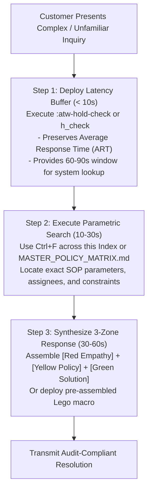

# OPERATIONAL ROUTING & TECHNICAL KEYWORD INDEX
**AirTalk Wireless & TAG Mobile - Rapid Diagnostic Triage & Cross-Reference Dictionary**
*Document ID: OPS-REF-IDX-2026-V3 | Classification: Technical Reference Index*
*Authorized Role: Tier 1 Customer Support Representative (Agent: Martin)*

---

## 1. Systematic 3-Step Triage Methodology for Complex Inquiries

When encountering edge-case inquiries, complex policy intersections, or escalated customer demands, representatives must not attempt unverified improvisations. Adhere to the standardized 3-step rapid triage workflow:

---

## 2. High-Density Operational Keyword & Routing Index

Use `Ctrl + F` to jump directly to any operational term, symptom, or system code below:

| Inbound Search Term / Customer Symptom | Underlying Regulatory Domain | Governing SOP Reference | Core Parameter / Governing Rule | Primary Espanso Trigger | Shorthand Trigger |
| :--- | :--- | :--- | :--- | :--- | :--- |
| **Account Verification / PII** | CPNI Security | Account Verification V1.2 | Full Name, DOB, SSN4 must match CRM 100%. | `:atw-cpni-ask` | `;v_cpni` |
| **Verification Failed / Guessing** | CPNI Security | Account Verification V1.2 | Discontinue account specifics; direct to ID portal. | `:atw-cpni-fail` | `;v_fail` |
| **Port-Out / Transfer PIN** | Number Portability | Port-Out SOP V2.1 | PIN valid **4 calendar days**; warn on **180d subsidy**. | `:atw-po-combo` | `;c_po` |
| **Cancel Port-Out / Stay** | Winback / Retention | Cancel Port-Out SOP | Invalidate 4-day PIN; preserve Lifeline subsidy. | `:atw-po-cancel` | `;g_po_cancel` |
| **Delivered But Missing (DCNR)** | Logistics Claim | DCNR V3.1 | Audit GPS/photo; file NUC ticket; SLA **24-48h**. | `:atw-dcnr-combo` | `;c_dcnr` |
| **Tracking Stalled (LIT)** | Logistics Claim | Lost In Transit V2.1 | Under \$100 vs Over \$100 claim; SLA **24-48h**. | `:atw-lit-combo` | `;c_lit` |
| **Package Returned (RTS)** | Logistics Claim | Return To Sender V1.1 | Require Proof of Address within **10 calendar days**. | `:atw-rts-combo` | `;c_rts` |
| **Hot Rush / Urgent Order** | Priority Fulfillment | Hot Rush SOP | Dispatch in **24-48h** (Cuong Nguyen); no PAT stores. | `:atw-rush-combo` | `;g_hotrush` |
| **Out of Stock Handset** | Inventory Operations | Out of Stock SOP | Offer equivalent replacement or re-selection link. | `:atw-oos-combo` | `;c_oos` |
| **Free Phone Warranty** | Hardware RMA | Warranty V1.2 | Warranty period is **15 calendar days** from delivery. | `:atw-war-ylw` | `;p_war` |
| **Paid Phone Warranty** | Hardware RMA | Warranty V1.2 | Warranty period is **30 calendar days** from delivery. | `:atw-war-ylw` | `;p_war` |
| **Cosmetic / Screen Cracks** | Hardware RMA | Warranty V1.2 | Must be reported within **48 hours** of delivery. | `:atw-war-ylw` | `;p_war` |
| **Return Shipping Label** | Reverse Logistics | Warranty V1.2 | Must be postmarked within **7 business days**. | `:atw-rma-label` | `;g_rma` |
| **180-Day Commitment** | Device Subsidy | Subsidy Agreement | Customer must maintain **180 active days** for subsidy. | `:atw-po-ylw` | `;p_po` |
| **365-Day Free Phone Rule** | Federal Lifeline | BYOD Guideline | One free phone per household every **365 days**. | `:atw-byod-ylw` | `;p_byod` |
| **Non-Usage De-enrollment** | USAC Compliance | Non-Usage Guideline V1.1 | 30d usage + 15d cure = **45d**; NLAD update in **1bd**. | `:atw-nonuse-ylw` | `;p_nonuse` |
| **Refund (Delivered Device)** | Financial Accounting | Refund SOP V3.1 | Pre-owned **15d**, Paid **30d**, Non-defective **7d**. | `:atw-refund-combo` | `;c_refund` |
| **Refund (Data / ILD / Plan)** | Financial Accounting | Refund SOP V3.1 | Telecom fees and activated usage are **non-refundable**. | `:atw-ref-non` | `;p_ref_non` |
| **Stripe Authorization Hold** | Merchant Processing | Refund SOP V3.1 | Pending charge drops in **7-10 business days**; no credit. | `:atw-stripe-hold` | `;p_stripe` |
| **Cancel Service (Tier 1)** | Retention Operations | Cancellation SOP V1.1 | Probe reasons, disclose risks; escalate to Tier 2. | `:atw-cancel-t1` | `;c_cancel` |
| **MDM Buy-Out / Unlock** | Hardware Operations | Cancellation SOP V1.1 | Pay remaining subsidy balance to remove MDM lock. | `:atw-mdm-buyout` | `;p_mdm` |
| **Spam Investigation Flag** | Fraud & Security | Spam Handling V2.2 | Block new SIM/MDN change; demand ID/Video proof. | `:atw-spam-evasion` | `;c_spam` |
| **Stolen Handset / Blacklist** | Fraud & Security | Lost/Stolen SOP | Immediate line suspension and IMEI national blacklist. | `:atw-stolen-combo` | `;c_stolen` |
| **Slamming / Stolen Benefit** | Regulatory Compliance | Fraud Guideline | Direct to USAC Hotline (**1-800-234-9473**); Reverse Form. | `:atw-slam-combo` | `;c_slam` |
| **PUK Code / SIM Blocked** | Network Engineering | PUK Code SOP | PUK1 on OCS; **10 incorrect entries destroy SIM**. | `:atw-puk-combo` | `;c_puk` |
| **eSIM / QR Code Setup** | Network Engineering | eSIM Guideline | Active Wi-Fi required; re-scan fresh QR profile. | `:atw-esim-combo` | `;c_esim` |
| **MDN Change / New Number** | Network Engineering | MDN Change SOP V1.2 | Standard fee is **$25.00**; warn on recycled spam. | `:atw-mdn-combo` | `;c_mdn` |
| **International Long Distance** | Network Operations | ILD Guideline | 80 countries unlimited; \$10 monthly credit on rest. | `:atw-ild-info` | `;g_ild` |
| **International Roaming** | Network Operations | Network Policy | Domestic US towers only; Roaming strictly prohibited. | `:atw-roam-no` | `;p_roam` |
| **Voicemail Setup / Reset** | Network Operations | Voicemail SOP | Default PIN is last 4 MDN digits; press & hold 1. | `:atw-vm-combo` | `;g_voicemail` |
| **Recertification De-enroll** | USAC Lifeline | Recertify SOP | Generate personalized CRM re-apply link. | `:atw-recert-combo` | `;c_recert` |
| **NLAD TRIV Identity Fail** | Enrollment Support | Application SOP | Route to Review Team for manual ID/SSN adjudication. | `:atw-triv-fail` | `;g_triv` |

---

## 3. Parametric Constraint Reference Matrix

| Metric / Parameter Code | Operational Threshold | Legal / Regulatory Basis | Non-Compliance Severity |
| :--- | :--- | :--- | :--- |
| **Free Pre-Owned Warranty** | **15 Calendar Days** from delivery | Handset Replacement Policy | Critical (Loss of warranty rights) |
| **Paid Upgrade Warranty** | **30 Calendar Days** from delivery | Handset Replacement Policy | Critical (False promise audit fail) |
| **Cosmetic Damage Window** | **Strictly 48 Hours** from delivery | Handset Replacement Policy | High (Carrier financial absorption) |
| **RMA Label Expiration** | **7 Business Days** to postmark | Reverse Logistics Standard | Medium (Warehouse RMA rejection) |
| **Device Subsidy Commitment** | **180 Consecutive Active Days** | Hardware Subsidy Agreement | Critical (Contractual misrepresentation) |
| **Free Device Interval** | **365 Calendar Days** per household | USAC / Lifeline Program Rules | High (Duplicate benefit denial) |
| **Port-Out PIN Validity** | **4 Calendar Days (96 Hours)** | Port-Out Handling V2.1 | Critical (Failed inter-carrier porting) |
| **Lifeline Inactive Notice** | **30 Consecutive Days** zero usage | FCC 47 CFR § 54.405(e)(3) | Statutory Compliance Mandate |
| **Lifeline Grace / Cure Period** | **15 Calendar Days** (Days 31-45) | FCC 47 CFR § 54.405(e)(3) | Statutory Compliance Mandate |
| **NLAD De-enrollment SLA** | **Within 1 Business Day** of Day 46 | FCC 47 CFR § 54.407(c)(2) | Federal Regulatory Violation |
| **Logistics Investigation SLA** | **24 to 48 Business Hours** | DCNR V3.1 / LIT V2.1 | Operational SLA Standard |
| **Stripe Authorization Release** | **7 to 10 Business Days** | Merchant Banking Standard | Low (Customer inquiry escalation) |
| **Merchant Refund Processing** | **3 to 5 Business Days** | Accounting Operations | Medium (Payment dispute escalation) |

---

## 4. Policy-to-Customer Translation Lexicon

When communicating statutory and procedural rules to distressed or non-technical subscribers, avoid rigid legal citations. Translate technical parameters into compliant, empathetic English using the 3-Zone architecture:

### 4.1 Equipment Return Past Standard Window
- **Non-Compliant Phrasing:** *"You are past 7 days so you are not eligible for any refund under our rules."*
- **Compliant 3-Zone Synthesis:**
  - `[RED Empathy]:` *"I completely understand you would like to return the device and receive a refund."*
  - `[YELLOW Policy]:` *"Under our standard equipment policy, return requests for pre-owned equipment must be submitted within 15 calendar days of delivery, and the evaluation window for this purchase has concluded."*
  - `[GREEN Solution]:` *"While a direct refund cannot be processed, I can gladly assist you with technical troubleshooting to ensure the handset functions properly, or review our current discounted upgrade options."*

### 4.2 Port-Out Delivery Channel Restrictions
- **Non-Compliant Phrasing:** *"I cannot give you the PIN over chat or send to both SMS and email because the system will break."*
- **Compliant 3-Zone Synthesis:**
  - `[RED Empathy]:` *"I will be more than happy to help you securely retrieve your transfer credentials right away."*
  - `[YELLOW Policy]:` *"To protect your private account security and prevent duplicate code generation, our provisioning engine delivers the Transfer PIN through one verified channel at a time."*
  - `[GREEN Solution]:` *"Would you prefer to receive your 4-day Transfer PIN via text message to your active handset upon ICCID verification, or sent directly to your registered email address on file?"*

### 4.3 Lifeline Non-Usage De-enrollment Notice
- **Non-Compliant Phrasing:** *"Your phone was cut off because you didn't use it for 45 days."*
- **Compliant 3-Zone Synthesis:**
  - `[RED Empathy]:` *"I sincerely apologize for the unexpected interruption to your wireless service."*
  - `[YELLOW Policy]:` *"Under federal Lifeline guidelines, free government-supported lines require active usage at least once every 30 days, followed by a 15-day grace period, before the national registry automatically de-enrolls the account."*
  - `[GREEN Solution]:` *"I can immediately provide you with a personalized re-enrollment link so you can re-establish your free monthly benefit and reconnect your service as quickly as possible."*
