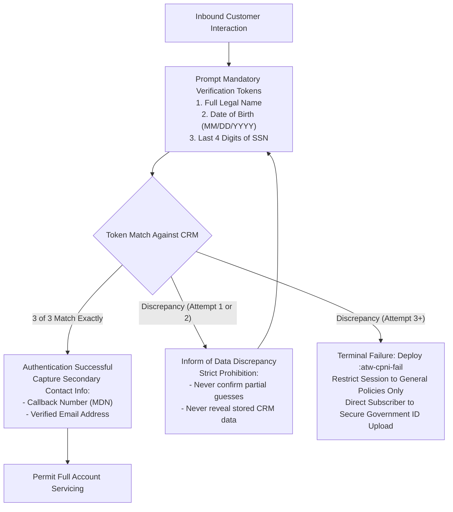
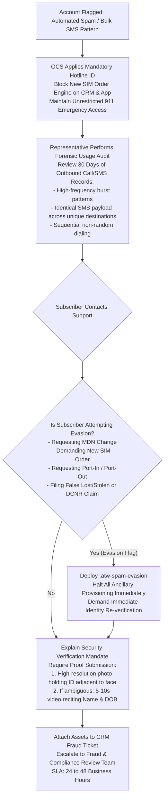
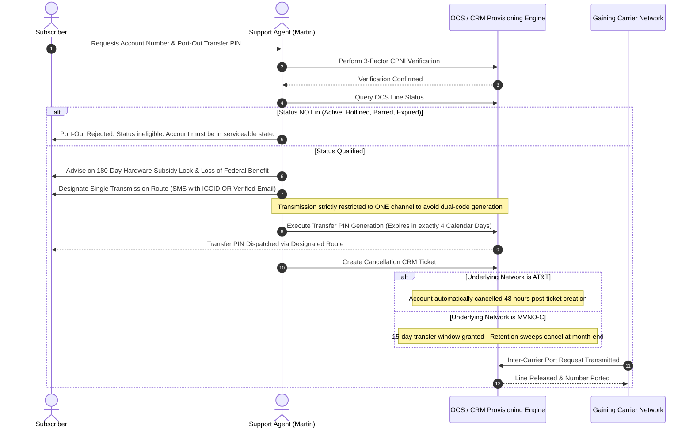
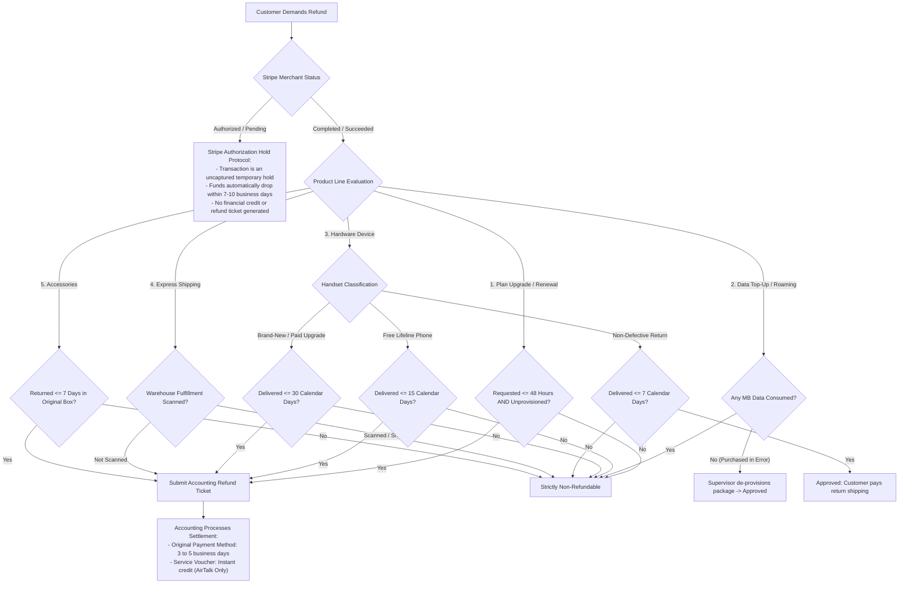
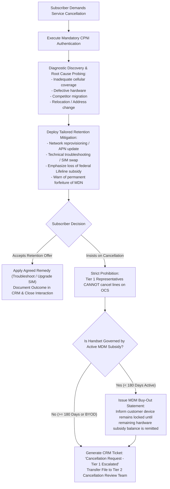
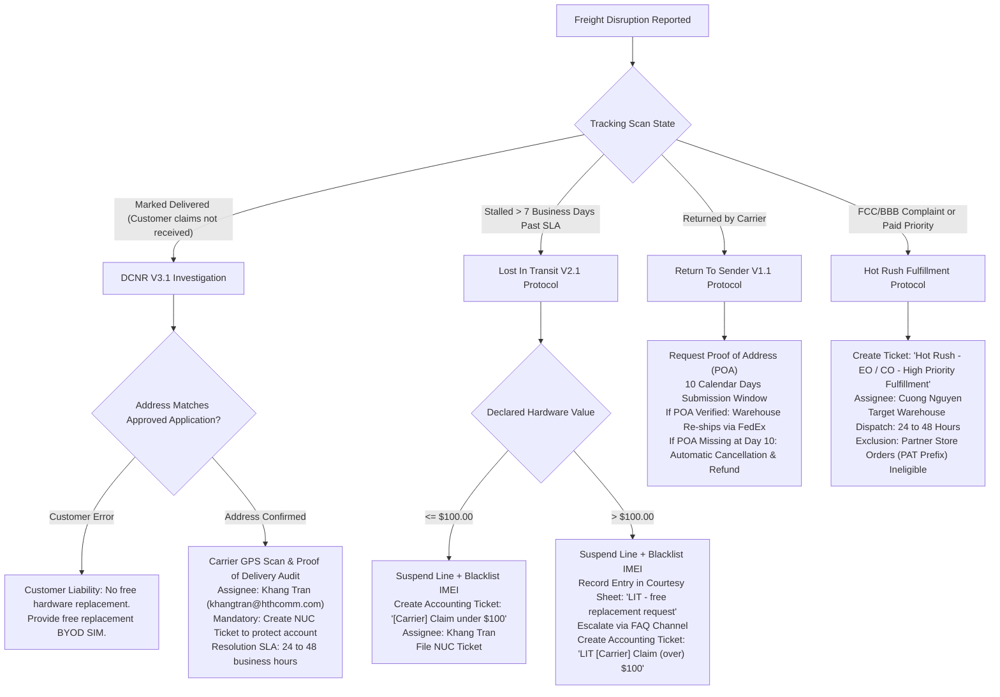
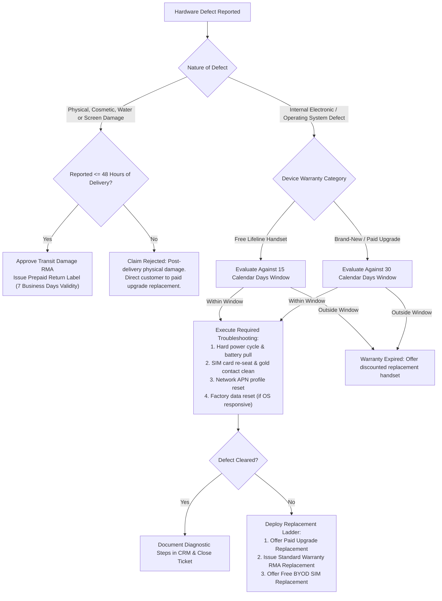
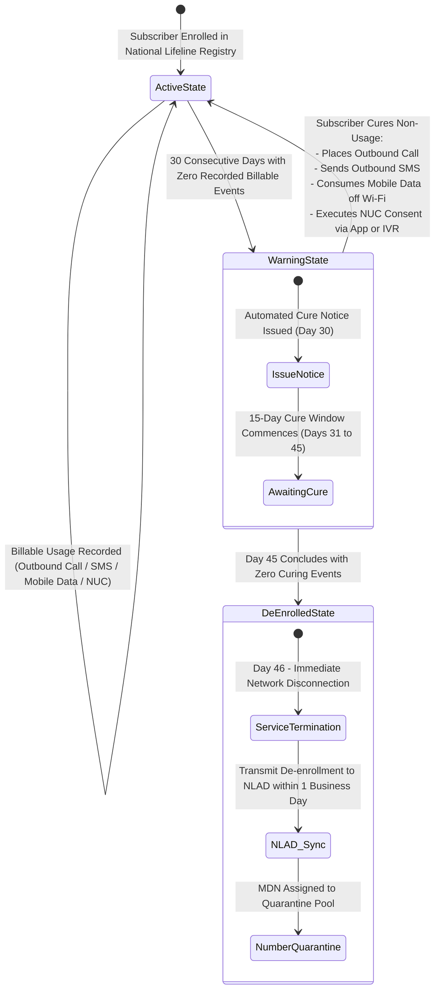
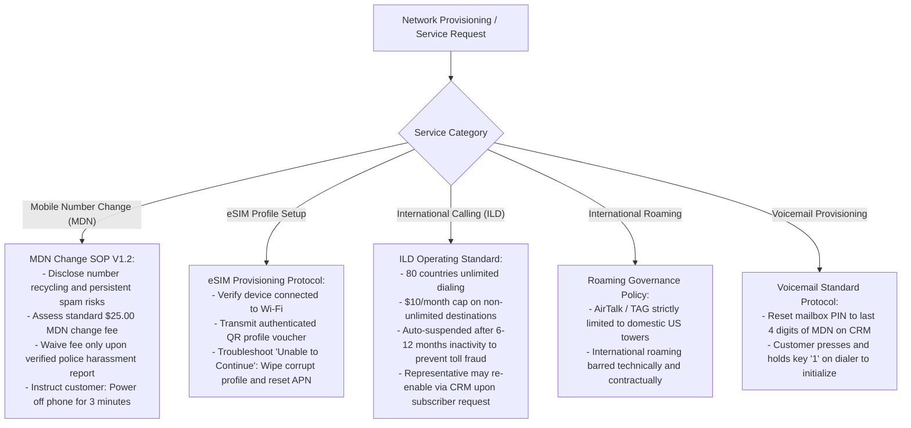

# INTERNAL OPERATIONS & SOP TECHNICAL SPECIFICATION
**AirTalk Wireless & TAG Mobile - Lifeline / ACP / MVNO Infrastructure**
*Document ID: SOP-INT-DIVE-2026-V3 | Classification: Technical Operations Manual*
*Authorized Role: Tier 1 Customer Support Representative (Agent: Martin)*
*Source Material: Reconciliation of 57 Audited Standard Operating Procedures, Regulatory Policies, and Internal Training Matrices*

---

## Document Overview & Regulatory Scope

This technical specification provides an exhaustive, granular breakdown of all operational systems, regulatory compliance frameworks, and back-office procedures governing customer service operations at Softel Solutions. All processes described are audited against Federal Communications Commission (FCC) statutory mandates, Universal Service Administrative Company (USAC) Universal Service Fund rules, National Lifeline Accountability Database (NLAD) synchronization protocols, and merchant payment security standards.

---

## Table of Contents
1. [Subsystem 1: CPNI Authentication, SIM Port-Protection & Identity Theft Security](#subsystem-1)
2. [Subsystem 2: Anti-Spam Investigation & Evasion Mitigation Architecture](#subsystem-2)
3. [Subsystem 3: Port-Out Management & Inter-Carrier Provisioning Lifecycle](#subsystem-3)
4. [Subsystem 4: Product Refund Architecture & Stripe Merchant Settlement](#subsystem-4)
5. [Subsystem 5: Subscription Cancellation, Tier 1 Retention & MDM Buy-Out Protocols](#subsystem-5)
6. [Subsystem 6: Logistics Disruption, Freight Carrier Claims & Priority Fulfillment](#subsystem-6)
7. [Subsystem 7: Hardware RMA Protocols, Warranty Governance & BYOD Rules](#subsystem-7)
8. [Subsystem 8: Statutory Lifeline Compliance, 45-Day Non-Usage & Recertification](#subsystem-8)
9. [Subsystem 9: Application Adjudication, NLAD TRIV Resolution & Order Modifications](#subsystem-9)
10. [Subsystem 10: Cellular Provisioning, MDN Migration, Voicemail & ILD/Roaming Routing](#subsystem-10)

---

## 1. Subsystem 1: CPNI Authentication, SIM Port-Protection & Identity Theft Security

### 1.1 Regulatory & Statutory Basis
- `Policy_Account Verification_AirTalk & TAG_V1.1.pdf` (Effective Oct 3, 2026)
- `SOP_Account Verification Handling_AirTalk & TAG_V1.2.pdf`
- `Identity Theft.pdf` (Version 1 - Change log May 2025)
- `SIM Port Protection - CSR only.pdf`
- Statutory Authority: 47 U.S.C. § 222; FCC 47 CFR §§ 64.2001–64.2011 (Customer Proprietary Network Information).

### 1.2 Multi-Factor Authentication Architecture
Prior to acknowledging account existence, balances, order numbers, shipping tracking, or executing line modifications, representatives must authenticate the subscriber using three mandatory identity tokens:

#### Detailed Field Matching Specifications:
- **Full Legal Name:** First Name and Last Name must match the CRM subscriber record identically. Middle names are non-blocking. Suffixes (*Jr., Sr., II, III, IV*) are disregarded if First and Last names match. Name punctuation discrepancies (hyphens, apostrophes) are treated as matches.
- **Date of Birth (DOB):** Must match the recorded date in `MM/DD/YYYY` format with zero character variance.
- **SSN Last 4 Digits:** Must match the recorded 4-digit token synchronized with USAC/NLAD records.

### 1.3 SIM Port-Protection Security Daemon
- **Automated Lockout Trigger:** If a customer or representative enters incorrect authentication tokens **3 consecutive times** during replacement SIM provisioning or Transfer PIN generation, the OCS provisioning daemon automatically trips the `SIM Port-Protection` lock.
- **CRM Indicator:** The Activity Log generates the system entry: `SIM - Port Protection turned on / Locks Account`.
- **Remediation Protocol:** Representatives are barred from manual override. The subscriber must log into their authenticated web portal (`Account > My SIM > SIM - Port Unlock`) to perform self-service cryptographic unlocking.

### 1.4 Identity Theft & Federal Privacy Data Hygiene
- **Mandatory CRM Note Hygiene:** Pursuant to federal data protection standards (May 2025 change log), representatives are **strictly barred from attaching or pasting subscriber identity documents (passports, driver's licenses, SSN cards) into CRM Activity Notes**.
- **Audit-Compliant Note Standard:** Representatives must record only the encrypted **Ticket ID** or **Chat Session ID** containing the uploaded document asset.

---

## 2. Subsystem 2: Anti-Spam Investigation & Evasion Mitigation Architecture

### 2.1 Regulatory & Statutory Basis
- `SOP_Spam Handling_AirTalk & TAG_V2.2_Active_2026-10-26.docx` (Active Oct 26, 2026 - 1,130 Paragraphs)
- `SMS Spamming.pdf`, `SOP Spamming.drawio`

### 2.2 Forensic Investigation Workflow

### 2.3 Regulatory Evasion Countermeasures
Subscribers operating bulk commercial messaging or phishing rings frequently deploy evasion tactics upon hotline activation. Under SOP V2.2, the following rules are mandatory:
1. **Total Freeze on Line Alterations:** While flagged for spam investigation, no representative may process an MDN change, issue a replacement SIM, approve an equipment claim, or process a port-in.
2. **Block Caller Governance:** Representatives may not toggle the Block Caller switch autonomously. Any request to block callers must be escalated as a High Priority ticket via the internal FAQ channel to the Supervisor / Tech Lead team.
3. **Emergency Access (911):** 911 dialing capabilities must remain active across all hotline states. If technical system constraints impede 911 routing, the representative must immediately engage IT network operations to ensure dial-out compliance.

---

## 3. Subsystem 3: Port-Out Management & Inter-Carrier Provisioning Lifecycle

### 3.1 Regulatory & Statutory Basis
- `SOP_Port-Out_AirTalk & TAG_V2.1_Active_2026-10-19.docx` (506 Paragraphs)
- `Porting Guideline.pdf`, `Cancel Port-Out - MVNO-C.png`, `PO-GEN-P001` through `P005.png`
- Statutory Authority: FCC Wireless Local Number Portability (LNP) Rules (47 CFR § 52.35).

### 3.2 OCS Line Qualification & Delivery Architecture

### 3.3 Critical Operational Rules
- **4-Day PIN Lifespan:** The Transfer PIN generated by the OCS engine has an immutable lifespan of **4 calendar days (96 hours)**. Stating 30 days is a fatal QA compliance error.
- **180-Day Subsidy Disclosure:** Representatives must explicitly warn subscribers that transferring their line prior to completing **180 consecutive active days** of service triggers hardware non-commitment penalties and prevents device unlocking.
- **Account Number Designation:** The account number is the subscriber's 10-digit MDN or internal Enrollment ID.

---

## 4. Subsystem 4: Product Refund Architecture & Stripe Merchant Settlement

### 4.1 Regulatory & Statutory Basis
- `SOP_Refund_AirTalk&TAG_V3.1_Active_2026-10-20.pdf` (84 pages)
- `Refund-case-studies.pdf` (19 slides)

### 4.2 Comprehensive 7-Product Evaluation Engine

---

## 5. Subsystem 5: Subscription Cancellation, Tier 1 Retention & MDM Buy-Out Protocols

### 5.1 Regulatory & Statutory Basis
- `Policy_Cancellation_AirTalk & TAG_V1.1.pdf` (Effective Aug 28, 2026)
- `SOP_Cancellation Handling - Tier 1_AirTalk & TAG_V1.1.pdf`
- `SOP_Cancellation Handling - Tier 2_AirTalk & TAG_V1.0.pdf`
- `Retention.pdf`

### 5.2 Tier 1 Cancellation & Escalation Protocol

---

## 6. Subsystem 6: Logistics Disruption, Freight Carrier Claims & Priority Fulfillment

### 6.1 Regulatory & Statutory Basis
- `Delivered Not Received (DCNR) V3.1.pdf` (52 pages)
- `Lost In Transit (LIT) V2.1.pdf` (11 pages)
- `Return to Sender (RTS) V1.1.pdf`
- `Hot Rush Ticket.pdf`

### 6.2 Logistics Claim Matrix & Routing Architecture

---

## 7. Subsystem 7: Hardware RMA Protocols, Warranty Governance & BYOD Rules

### 7.1 Regulatory & Statutory Basis
- `ETC Handset_ Accessory Replacement Policy_During EBB_ACP_Final.pdf`
- `Warranty replacement V1.2.pdf` (33 pages)
- `REPLACEMENTS V1.1.pdf` (22 pages)
- `Bring Your Own Device.pdf` (Change log 27/03/2026)
- `PUK Code.pdf` (10 pages)

### 7.2 Hardware RMA & Troubleshooting Ladder

### 7.3 Critical Hardware Governance Mandates
1. **The 365-Day Free Handset Rule:** Subscribers who have received a government-subsidized device within the preceding **365 calendar days** are ineligible for additional free devices. Applications are automatically converted to **BYOD (SIM-only)**.
2. **PUK Lockout Protocol:** 3 incorrect PIN entries lock the SIM card; 10 incorrect PUK entries permanently destroy the SIM microchip, requiring an order for replacement hardware.

---

## 8. Subsystem 8: Statutory Lifeline Compliance, 45-Day Non-Usage & Recertification

### 8.1 Regulatory & Statutory Basis
- `Non-usage Guideline - ver 1.1.pdf` (SNU project & IVR Consent updates)
- `[AirTalk] Assistance Guideline for De-enroll CXs Due to Fail Recertify.pdf` (July 16 update)
- Statutory Authority: FCC 47 CFR § 54.405(e)(3); 47 CFR § 54.407(c)(2).

### 8.2 The 45-Day Non-Usage Statutory State Machine

### 8.3 Recertification Failure Remediation
When a subscriber is flagged for de-enrollment due to failure to complete annual USAC recertification:
1. AirTalk does not perform immediate abrupt disconnection; the line remains provisionally active.
2. The representative generates an authenticated **Re-apply Link** directly through the CRM console.
3. If MDN retention is required, the representative must submit a priority IT provisioning ticket to prevent recycling before re-enrollment approval.

---

## 9. Subsystem 9: Application Adjudication, NLAD TRIV Resolution & Order Modifications

### 9.1 Regulatory & Statutory Basis
- `Application Assistance Guideline.pdf`
- `Application-Assistance-Guideline-Case-Studies.pdf`
- `Customer Orders Change.pdf`

### 9.2 Adjudication & Identity Resolution Workflows
1. **Applications Exceeding 30 Days:** Application files pending identity proof or address validation for more than 30 days are automatically expired by the national registry. Representatives must guide subscribers through initiating a fresh application.
2. **NLAD TRIV (Third-Party Identity Verification) Failures:**
   - Occurs when subscriber PII cannot be validated against credit bureaus or government identity registries.
   - Representatives must escalate the application to the **Review Team** and instruct the subscriber to upload a clear government photo ID and proof of Social Security Number via the secure portal.
3. **Tribal Eligibility Reclassification:** If an applicant is rejected for Tribal enhanced subsidies due to geographic boundary verification failures, representatives must reclassify the application to standard Lifeline, assign standard shipping, and swap device allocation to approved baseline models (e.g., model **A56**).

---

## 10. Subsystem 10: Cellular Provisioning, MDN Migration, Voicemail & ILD/Roaming Routing

### 10.1 Network Operations & Provisioning Flowchart

---

## 11. Operational SLA & Responsibility Assignment Directory

| Operational Domain | Governing SOP | SLA Commitment | Assignee / Department | Escalation Route |
| :--- | :--- | :--- | :--- | :--- |
| **Logistics Freight Claims (DCNR/LIT)** | DCNR V3.1 / LIT V2.1 | 24 to 48 Business Hours | Khang Tran (`khangtran@hthcomm.com`) | Logistics Supervisor / FAQ Channel |
| **Hot Rush Priority Fulfillment** | Hot Rush SOP | 24 to 48 Hours to Dispatch | Cuong Nguyen (Fulfillment Lead) | Executive Office Escalations |
| **Hardware Cosmetic Defect Notice** | Handset Policy V1.2 | Strictly <= 48 Hours | Tier 1 CSR (Martin) | Reverse Logistics Lead |
| **Hardware RMA Label Validity** | Handset Policy V1.2 | 7 Business Days Postmark | Warehouse Receiving Team | Accounting Inventory Desk |
| **Port-Out PIN Validity** | Port-Out SOP V2.1 | 4 Calendar Days (96h) | Automated OCS Provisioning | Tech Support / OCS Engineering |
| **Stripe Authorization Release** | Refund SOP V3.1 | 7 to 10 Business Days | Customer Issuing Bank | Merchant Services Accounting |
| **Approved Refund Settlement** | Refund SOP V3.1 | 3 to 5 Business Days | Accounting / Treasury Desk | Finance Lead |
| **Lifeline Non-Usage De-enrollment** | Non-Usage SOP V1.1 | Day 46 Disconnect / 1bd NLAD | Compliance / USAC Daemon | Legal & Regulatory Desk |
| **Cancellation Ticket Review** | Cancellation V1.1 | 24 to 48 Business Hours | Tier 2 Cancellation Review Team | Retention Management |
