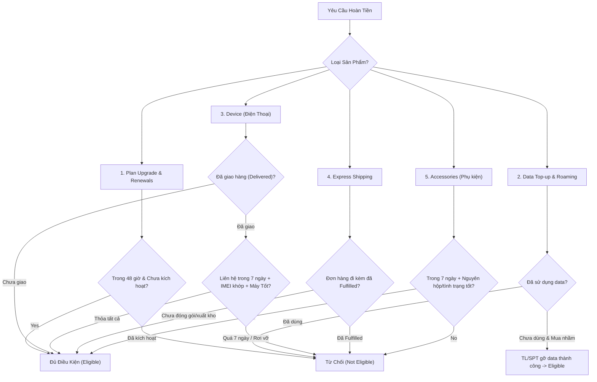

# PHÂN TÍCH CHUYÊN SÂU TOÀN BỘ NGHIỆP VỤ & SOP NỘI BỘ SOFTEL SOLUTION
*(AirTalk Wireless & TAG Mobile - Lifeline / ACP / MVNO Ecosystem)*
*Tài liệu phân tích đối chiếu 100% dựa trên 57 tài liệu SOP, Policy, Case Studies & Training nội bộ*

---

## MỤC LỤC CHI TIẾT
1. [Phân Hệ 1: CPNI Account Verification, SIM Port Protection & An Ninh Tài Khoản](#phân-hệ-1)
2. [Phân Hệ 2: SOP Spam Investigation & Đối Phó Các Hành Vi Né Tránh (V2.2 - 26/10/2026)](#phân-hệ-2)
3. [Phân Hệ 3: SOP Port-Out & Chuyển Mạng Giữ Số Chi Tiết (V2.1 - 19/10/2026)](#phân-hệ-3)
4. [Phân Hệ 4: SOP Refund Toàn Diện Cho 7 Dòng Sản Phẩm & Case Study (V3.1 - 20/10/2026)](#phân-hệ-4)
5. [Phân Hệ 5: SOP Cancellation & Retention Tier 1 / Tier 2 & MDM Buy-Out (V1.1 - 28/08/2026)](#phân-hệ-5)
6. [Phân Hệ 6: Logistics & Vận Chuyển: DCNR 3.1, Lost In Transit 2.1, RTS 1.1 & Hot Rush](#phân-hệ-6)
7. [Phân Hệ 7: Thiết Bị, Bảo Hành (15 Ngày), BYOD (Quy Tắc 365 Ngày) & PUK](#phân-hệ-7)
8. [Phân Hệ 8: Tuân Thủ Pháp Lý Lifeline: Non-Usage (30+15=45d), NUC & Recertification](#phân-hệ-8)
9. [Phân Hệ 9: Application Assistance, NLAD TRIV Fail & Quản Lý Đơn Hàng](#phân-hệ-9)
10. [Phân Hệ 10: Dịch Vụ Mạng, MDN Change ($25), eSIM & Roaming / ILD](#phân-hệ-10)

---

## 1. PHÂN HỆ 1: CPNI ACCOUNT VERIFICATION, SIM PORT-PROTECTION & AN NINH TÀI KHOẢN

### 1.1. Căn Cứ Tài Liệu:
- `Policy_Account Verification_ AirTalk & TAG_V1.1.pdf` (Effective Oct 3, 2026)
- `SOP_Account Verification Handling_AirTalk & TAG_V1.2.pdf`
- `Identity Theft.pdf` (Version 1 - Change log May 2025)
- `SIM Port Protection - CSR only.pdf`

### 1.2. Phân Tích Chuyên Sâu Quy Định Xác Minh CPNI:
- **3 Thông Tin Bắt Buộc (Mandatory PII):**
  1. **Full Name:** First Name và Last Name bắt buộc khớp đúng hồ sơ CRM. Middle Name có thể có hoặc không. Bỏ qua hậu tố *Jr., Sr., II, III, IV* nếu First + Last khớp. Chấp nhận khác biệt dấu gạch nối (*Smith-Jones* vs *Smith Jones*) và dấu nháy (*O'Brien* vs *OBrien*).
  2. **Date of Birth (DOB):** Bắt buộc khớp chính xác 100% định dạng `MM/DD/YYYY`.
  3. **Last 4 Digits of SSN (SSN4):** Bắt buộc khớp chính xác 100%.
- **Thông Tin Liên Hệ Bắt Buộc Thu Thập (Contact Info):**
  - Email Address & Callback Phone Number (MDN hoặc số thay thế).
- **Quy Tắc Xử Lý Khi Sai Thông Tin:**
  - Sai 1-2 lần: Cho khách kiểm tra lại, **tuyệt đối không mớm/tiết lộ dữ liệu đúng trên CRM**.
  - Sai quá số lần: **Dừng hỗ trợ thông tin cụ thể (Account-Specific)**, chỉ hỗ trợ thông tin chung (General Policy).
  - Không được dùng phán đoán cá nhân để approve verification khi tên không khớp.

### 1.3. Tính Năng SIM Port-Protection (Khóa Bảo Vệ SIM):
- **Cơ chế kích hoạt tự động:**
  - Khách hàng nhập sai mã xác thực đặt SIM thay thế / thiết bị quá **3 lần**.
  - Hoặc CSR nhập sai mã xác thực yêu cầu Transfer PIN quá **3 lần**.
  - Hệ thống tự động bật tính năng `SIM Port-Protection` (Khóa tài khoản trên OCS/CRM).
- **Nhận diện trên CRM:**
  - Tab Activity ghi: `"SIM - Port Protection turned on / Locks Account"`.
- **Cách mở khóa (Unlock):**
  - Khách tự mở: Đăng nhập User Portal > `Account` > `My SIM` > Bấm nút **SIM - Port Unlock**.
  - CSR kiểm tra và hướng dẫn khách tự thao tác nếu tài khoản chính chủ.

### 1.4. Quy Định Phòng Chống Đánh Cắp Danh Tính (Identity Theft):
- **Cập nhật thay đổi ngày 09/05/2025:**
  > [!CAUTION]
  > **TUYỆT ĐỐI KHÔNG ĐƯỢC ĐÍNH KÈM GIẤY TỜ TÙY THÂN CỦA KHÁCH VÀO ACTIVITY NOTE TRÊN CRM!**
  > CSR chỉ được ghi nhận mã **Ticket ID** hoặc **Chat ID** có chứa ID Proof của khách hàng vào Activity Note để bảo mật dữ liệu theo chuẩn liên bang.

---

## 2. PHÂN HỆ 2: SOP SPAM INVESTIGATION & ĐỐI PHÓ HÀNH VI NÉ TRÁNH (V2.2 - 26/10/2026)

### 2.1. Căn Cứ Tài Liệu:
- `SOP_Spam Handling_AirTalk & TAG_V2.2_Active_2026-10-26.docx` (Active Oct 26, 2026 - 1,130 Paragraphs)
- `SMS Spamming.pdf`, `SOP Spamming.drawio`

### 2.2. Phân Tích Kỹ Thuật & Quy Tắc Vận Hành:
- **Nguyên tắc cốt lõi (Rule 01 - 04):**
  - Tài khoản bị flag Spam do OCS Live Status hoặc Hotline ID sẽ chuyển vào luồng **Spam Investigation**.
  - CSR phải kiểm tra **Usage Detail 30 ngày tính ngược** từ ngày nhận cảnh báo (đối chiếu tần suất, đích đến, thời điểm, mẫu tin nhắn hàng loạt).
  - Khách hàng bắt buộc cung cấp:
    1. **Ảnh chụp cầm ID sát mặt (Selfie with ID):** Rõ mặt và rõ chữ trên giấy tờ tùy thân do chính phủ cấp.
    2. Nếu ảnh mờ/nghi ngờ: Bắt buộc yêu cầu **Video 5–10 giây** cầm ID sát mặt, đọc rõ Họ tên và Ngày sinh.
- **Quy tắc về SIM & Gọi 911 (Rule 06, 09, FAQ 1):**
  - Chức năng **New SIM Order (kèm MDN mới hoặc không)** bị vô hiệu hóa hoàn toàn trên CRM và App trong thời gian điều tra. CSR không được tự ý đặt SIM mới!
  - Cuộc gọi khẩn cấp **911** vẫn phải được đảm bảo hoạt động. Nếu hệ thống cho phép gỡ Hotline tạm để gọi ra khẩn cấp thì gỡ, nếu không thì giải thích.
- **Quy tắc Block Caller (Rule 06):**
  - CSR **không được tự bật Block Caller**. Chỉ tạo ticket High/Open escalate qua FAQ channel đến SPT/TL. Block Caller chỉ giới hạn cuộc gọi (Call), Chat và Ticket vẫn mở bình thường.

### 2.3. Bẫy Nghiệp Vụ: Nhận Diện Các Chiêu Thức Né Tránh Điều Tra (Evasion Attempts):
Tài liệu SOP V2.2 chỉ rõ khách hàng thường giả vờ gặp sự cố khác để "né" cuộc điều tra Spam:
1. Đòi chuyển mạng vào (Port-In số khác).
2. Yêu cầu đổi số điện thoại (MDN Change).
3. Đòi mua SIM mới với số mới.
4. Báo mất máy / mất SIM (Lost/Stolen).
5. Báo kiện hàng Delivered nhưng không nhận được (DCNR).
6. Báo hàng bị thất lạc (LIT).
> [!IMPORTANT]
> **HÀNH ĐỘNG CỦA CSR:** Khi tài khoản đang gắn cờ Spam Investigation, **TẤT CẢ CÁC YÊU CẦU TRÊN ĐỀU PHẢI TẠM DỪNG**. Bắt buộc thực hiện Spam Investigation trước! Không được bypass restriction!

- **Mẫu Ticket Chuẩn CRM:**
  - Nếu khách từ chối hợp tác điều tra nhưng đòi hủy/port-out: Tạo ticket `Spamming CSR Investigation – CX's Request`.

---

## 3. PHÂN HỆ 3: SOP PORT-OUT & CHUYỂN MẠNG GIỮ SỐ (V2.1 - 19/10/2026)

### 3.1. Căn Cứ Tài Liệu:
- `SOP_Port-Out_AirTalk & TAG_V2.1_Active_2026-10-19.docx` (506 Paragraphs)
- `Porting Guideline.pdf`, `Cancel Port-Out - MVNO-C.png`, `PO-GEN-P001` đến `P005.png`

### 3.2. Điều Kiện Đủ & Quy Trình Tạo Mã PIN (Rules 01 – 10):
- **4 Trạng Thái OCS Hợp Lệ (Rule 03):** MDN phải đang ở 1 trong 4 trạng thái:
  $$\text{OCS Live Status} \in \{\text{Active}, \text{Hotlined}, \text{Barred}, \text{Expired}\}$$
- **Quy Tắc Cung Cấp PIN (Rule 08, 09 & Step 3.3):**
  - Nhận qua **Email:** Khách phải đọc đúng địa chỉ Email trên hồ sơ.
  - Nhận qua **MDN (SMS):** Khách phải cung cấp đúng **ICCID** của thẻ SIM (trừ khi cuộc gọi/chat xuất phát từ chính MDN đó).
  - Khách nhập sai quá 2 lần -> Chuyển sang phương thức còn lại. Nếu cả 2 đều sai -> **Từ chối cấp PIN**.
  - **Chỉ gửi PIN qua SMS HOẶC Email**, tuyệt đối không gửi đồng thời cả hai.
  - Mã PIN có hiệu lực đúng **4 ngày calendar days**. Số tài khoản = MDN hoặc Enrollment ID.

### 3.3. Tác Động Hủy Dịch Vụ Theo Từng Carrier (Rule 07):
- **Nhà mạng AT&T:** Tài khoản sẽ bị hủy tự động sau **48 giờ** kể từ khi Cancellation CRM Ticket được tạo.
- **Nhà mạng MVNO-C:**
  - Khách hàng có **15 ngày** để hoàn tất Port-In sang nhà mạng mới.
  - Retention Team sẽ gom các ticket và thực hiện hủy tài khoản vào **cuối tháng**.
  - Nếu khách yêu cầu hủy khẩn: CSR đặt tiêu đề Ticket: `[URGENT] CANCELLATION REQUEST` (Hủy trong 48h).

---

## 4. PHÂN HỆ 4: SOP REFUND TOÀN DIỆN CHO 7 DÒNG SẢN PHẨM & CASE STUDY (V3.1 - 20/10/2026)

### 4.1. Căn Cứ Tài Liệu:
- `SOP_Refund_AirTalk&TAG_V3.1_Active_2026-10-20.pdf` (84 trang)
- `Refund-case-studies.pdf` (19 slide)

### 4.2. Điều Kiện Kích Hoạt Hoàn Tiền (Core Rules):
- **Trạng thái thanh toán:** CRM phải là `Completed` và Stripe Status phải là `Success / Succeeded`.
- **Nếu Stripe là Pending / Authorized:** Khoản tiền chỉ đang bị tạm giữ (hold) bởi ngân hàng. Giải thích cho khách: Khoản ủy quyền sẽ tự động giải tỏa (drop off) sau **7 – 10 ngày làm việc**, không có giao dịch thực tế nên không có khoản hoàn tiền ghi có (credit).
- **Quy tắc 7 ngày (Rule 1):** Đơn hàng Delivered chỉ có tối đa **07 ngày thường** kể từ ngày giao hàng để yêu cầu hoàn trả.

### 4.3. Ma Trận Thẩm Định Hoàn Tiền Theo 7 Nhóm Sản Phẩm (Step 2.1 – 2.5):

### 4.4. Hình Thức Hoàn Tiền:
- **Original Payment Method (Mặc định):** Tiền hoàn về thẻ trong **3–5 ngày làm việc** (tùy ngân hàng 5–7 ngày).
- **Refund by Voucher (Chỉ AirTalk):** Áp dụng khi lỗi thuộc về công ty và khách đồng ý nhận Voucher. Đã nhận Voucher thì không hoàn tiền mặt.

---

## 5. PHÂN HỆ 5: SOP CANCELLATION & RETENTION TIER 1 / TIER 2 & MDM BUY-OUT

### 5.1. Căn Cứ Tài Liệu:
- `Policy_Cancellation_AirTalk & TAG_V1.1.pdf` (Effective Aug 28, 2026)
- `SOP_Cancellation Handling - Tier 1_AirTalk & TAG_V1.1.pdf`
- `SOP_Cancellation Handling - Tier 2_AirTalk & TAG_V1.0.pdf`
- `Retention.pdf`

### 5.2. Quy Trình Tier 1 Tuyệt Đối Tuân Thủ:
1. **Xác minh CPNI.**
2. **Confirm Intent & Probe Reason:** Khách muốn hủy vì lý do gì (sóng yếu, máy hỏng, đổi mạng, chuyển nhà).
3. **Thực hiện Basic Retention:**
   - Đưa ra giải pháp kỹ thuật, đổi SIM, đổi máy hoặc gói cước hỗ trợ.
   - **Cảnh báo mất quyền lợi (Risk Disclosure):** Mất số điện thoại vĩnh viễn và mất trợ cấp Lifeline miễn phí hàng tháng của Chính phủ.
4. **Nếu khách vẫn kiên quyết hủy:**
   - **CSR Tier 1 KHÔNG ĐƯỢC TỰ Ý HỦY TRÊN OCS.**
   - Tạo **Cancellation CRM Ticket**, ghi chi tiết lý do vào **Activity Log**, sau đó chuyển tiếp cho **Tier 2 (Cancellation Review)** xử lý.

### 5.3. Khái Niệm Thiết Bị MDM & Quy Trình Mua Lại (MDM Buy-Out):
- **MDM-Enabled Device:** Thiết bị do AirTalk cung cấp có cài đặt phần mềm quản lý thiết bị (MDM) gắn với cam kết thời gian sử dụng.
- **Buy-Out:** Nếu khách muốn mở khóa thiết bị hoặc hủy dịch vụ trước thời hạn cam kết, khách phải thanh toán khoản tiền trợ cấp còn lại (**Remaining Device Subsidy**) để gỡ bỏ hạn chế MDM.

---

## 6. PHÂN HỆ 6: LOGISTICS & VẬN CHUYỂN: DCNR 3.1, LOST IN TRANSIT 2.1, RTS 1.1 & HOT RUSH

### 6.1. DCNR (Delivered Claimed Not Received - Version 3.1 - 52 Trang):
- **Đầu mối tiếp nhận (Assignee Update):**
  - Cập nhật ngày 13/10/2026: Chuyển toàn bộ CRM Ticket liên quan đến Shipping từ Allen Yuan sang **Khang Tran (`khangtran@hthcomm.com`)**.
- **Phân loại kịch bản DCNR:**
  1. *Khách điền sai địa chỉ khi apply (Khách chịu trách nhiệm):* Không đền máy miễn phí; hướng dẫn khách mua máy mới hoặc tặng SIM miễn phí để dùng BYOD.
  2. *FedEx giao sai địa chỉ (Lỗi đơn vị vận chuyển):* Đối chiếu ảnh chụp Proof of Delivery và GPS scan; làm thủ tục xuất máy mới.
  3. *FedEx giao đúng địa chỉ nhưng bị trộm (Theft / Porch Pirate):* Đề xuất Voucher hoặc xử lý đổi máy theo chính sách.
  4. *NUC Ticket:* Phải tạo vé NUC để khách không bị hệ thống tự động hủy số do Non-usage trong thời gian chờ bưu kiện.

### 6.2. Lost In Transit (LIT - Version 2.1 - 11 Trang):
- **Định mức giá trị thiết bị & Quy trình Accounting:**
  - **Đơn hàng =< $100 (FedEx/USPS):** Suspend line, blacklist máy, tạo Accounting Ticket:
    - Tiêu đề: `[Shipping carrier’s name] Claim under $100`
    - Assignee: Khang Tran (`khangtran@hthcomm.com`). Type: Accounting. Đính kèm Travel history.
  - **Đơn hàng > $100 (FedEx/USPS):** Hệ thống không tự reship. CSR phải:
    - Suspend line, blacklist máy.
    - Điền vào file Courtesy sheet *"LIT - free replacement request"*.
    - Escalate lên kênh **FAQ Channel**.
    - Tạo Ticket: `LIT [Shipping carrier’s name] Claim (over) $100` (Assignee: Khang Tran).

### 6.3. Return To Sender (RTS - Version 1.1) & Hot Rush Ticket:
- **RTS:** Hệ thống tự động gắn nhãn *"Address Issues: Insufficient Address / Bad Address"*. Điều kiện để tự động reship: Lifeline Active + Payment Succeeded + Cập nhật địa chỉ đúng.
- **Hot Rush Ticket (Xuất Kho Hỏa Tốc Trong 24 Giờ):**
  - Tiêu đề đơn thanh toán: `HOT RUSH – [PAID Device Model] [Order ID] [Express/Standard Shipping]`
  - Tiêu đề đơn khiếu nại pháp lý: `HOT RUSH – [FCC Complaint] [Order ID] [Express/Standard Shipping]`
  - Type: `Hot Rush - EO / CO - High Priority Fulfillment` (Assignee: Cuong Nguyen).
  - *Lưu ý: Không áp dụng Hot Rush cho Store Orders (EID bắt đầu bằng `PAT`).*

---

## 7. PHÂN HỆ 7: THIẾT BỊ, BẢO HÀNH (15 NGÀY), BYOD (QUY TẮC 365 NGÀY) & PUK

### 7.1. Căn Cứ Tài Liệu:
- `ETC Handset_ Accessory Replacement Policy_During EBB_ACP_Final.pdf`
- `Warranty replacement V1.2.pdf` (33 trang)
- `REPLACEMENTS V1.1.pdf` (22 trang)
- `Bring Your Own Device.pdf` (Change log 27/03/2026)
- `PUK Code.pdf` (10 trang)
- `Devices information - Ver 2.1.pdf`

### 7.2. Chính Sách Bảo Hành & Đổi Máy:
- **Thời hạn bảo hành Free Lifeline Phone:** Đúng **15 ngày** kể từ ngày giao hàng (`Delivery Date`).
- **Phạm vi bảo hành:** Lỗi tay nghề, phần mềm, camera, phím cứng không bấm được, màn hình điểm chết. **Loại trừ nứt vỡ, cấn móp, ngấm nước.**
- **Bắt buộc Troubleshooting:** CSR phải hướng dẫn khách khắc phục sự cố và ghi chép lại kết quả vào case note trước khi quyết định đổi máy.
- **Nhãn Return Label:** Có hiệu lực trong **07 ngày** để khách gửi máy lỗi về kho.
- **Thứ tự tư vấn đổi máy (Replacement Ladder):**
  $$\text{Ưu tiên 1: Upgrade Replacement} \longrightarrow \text{Ưu tiên 2: Standard Replacement} \longrightarrow \text{Ưu tiên 3: SIM Replacement (BYOD)}$$

### 7.3. Quy Tắc BYOD & Giới Hạn 365 Ngày (Change Log 27/03/2026):
- Khách hàng đã có tài khoản hoặc đã nhận máy miễn phí trong vòng **365 ngày gần nhất** sẽ **KHÔNG đủ điều kiện nhận thêm máy miễn phí**.
- Đơn hàng sẽ tự động được Review Team chuyển sang chế độ **BYOD (SIM-only)** hoặc yêu cầu khách chọn gói mua máy trả phí.

### 7.4. Mã PUK:
- Nhập sai mã PIN SIM 3 lần -> Bị khóa PUK.
- CSR tra cứu mã **PUK1 / PUK2** trên CRM OCS để cấp cho khách.
- Cảnh báo: **Nhập sai PUK 10 lần -> Thẻ SIM hỏng vĩnh viễn**, phải mua SIM mới.

---

## 8. PHÂN HỆ 8: TUÂN THỦ PHÁP LÝ LIFELINE: NON-USAGE (30+15=45D), NUC & RECERTIFICATION

### 8.1. Quy Định Non-Usage 30 + 15 = 45 Ngày:
- `Non-usage Guideline - ver 1.1.pdf` (Cập nhật dự án SNU & IVR Consent):
  - **Ngày 1 đến 30:** Không có cước -> Hệ thống gửi cảnh báo qua App, SMS, Email.
  - **Ngày 31 đến 45:** Thời gian ân hạn **15 ngày**. Khách có thể giải tỏa bằng cách:
    1. Thực hiện/trả lời cuộc gọi.
    2. Gửi tin nhắn SMS.
    3. Dùng data di động ngoài Wi-Fi.
    4. Nạp tiền/mua gói cước.
    5. Ký đồng ý duy trì **NUC (Non-Usage Consent)** trên App AirTalk hoặc qua hệ thống **IVR** (IVR áp dụng riêng cho TAG Mobile).
  - **Ngày 46:** Nếu không có hoạt động, hệ thống **tự động de-enroll vĩnh viễn**.

### 8.2. Xử Lý Khách Hàng Bị De-enroll Do Trượt Recertify:
- `[AirTalk] Assistance Guideline for De-enroll CXs Due to Fail Recertify.pdf` (Cập nhật ngày 16/07):
  - Khi USAC / Maximus / Solix báo de-enroll do trượt recertify, AirTalk **không ngắt số ngay lập tức**, mà giữ trạng thái hoạt động tạm thời và gửi link thông báo kết nối lại.
  - CSR có thể bấm nút trên CRM để tự động sinh **Re-apply Link cá nhân hóa** gửi cho khách.
  - Nếu khách muốn giữ lại số điện thoại cũ: Báo cáo TL / SV / Coach để xử lý ngoại lệ (kiểm tra OCS, tạo ticket IT chuyển MDN).

---

## 9. PHÂN HỆ 9: APPLICATION ASSISTANCE, NLAD TRIV FAIL & QUẢN LÝ ĐƠN HÀNG

### 9.1. Căn Cứ Tài Liệu:
- `Application Assistance Guideline.pdf`
- `Application-Assistance-Guideline-Case-Studies.pdf`
- `Customer Orders Change.pdf`

### 9.2. Các Tình Huống Nghiệp Vụ Cốt Lõi:
1. **Đơn hàng quá 30 ngày (Application > 30 days):**
   - Đơn pending quá 30 ngày không thể duyệt tiếp. CSR hướng dẫn khách để đơn tự hết hạn và apply lại, hoặc hướng dẫn upload thêm giấy tờ để gia hạn xét duyệt (theo update 17/06/2025).
2. **Xử lý lỗi NLAD TRIV Fail (Third-Party Identity Verification Fail):**
   - Lỗi do cơ sở dữ liệu quốc gia không khớp thông tin danh tính.
   - CSR chuyển hồ sơ sang **Review Team** -> Nhận hướng dẫn -> Hướng dẫn khách hàng cung cấp giấy tờ tùy thân hợp lệ trên Website hoặc upload lên CRM.
3. **Refund Incomplete (Lỗi trừ tiền tạm giữ Stripe):**
   - Khi thanh toán thất bại, đơn hàng đổi sang BYOD. Khách thắc mắc sao ngân hàng trừ tiền: Giải thích chuẩn mực rằng đây là khoản giữ tạm (authorization) sẽ tự nhả trong 7–10 ngày làm việc mà không có credit refund.
4. **Thay đổi đơn hàng (Customer Orders Change):**
   - Khách không đủ điều kiện Tribal -> Chuyển về Basic Plan, Standard Shipping, đổi máy sang backup model hoặc dòng máy **A56**.

---

## 10. PHÂN HỆ 10: DỊCH VỤ MẠNG, MDN CHANGE ($25), eSIM & ROAMING / ILD

### 10.1. Đổi Số Điện Thoại (MDN Change Guideline V1.2):
- Cập nhật ngày 25/09/2026: **Ưu tiên gói đổi số phí $25** trên hệ thống; hoặc tư vấn mua SIM mới kèm số mới.
- Khách bị quấy rối spam: Giải thích rằng số điện thoại là tài nguyên tái sử dụng (recycled numbers) nên số mới vẫn có xác suất nhận tin nhắn spam.

### 10.2. eSIM & Quản Lý Dịch Vụ Quốc Tế (ILD & Roaming):
- **eSIM:** Khách phải kết nối Wi-Fi khi quét QR code. Nếu báo lỗi *"Unable to Continue Cellular Configuration"* hoặc *"No Service"*, kiểm tra iOS/Android version và profile APN.
- **ILD (International Long Distance):**
  - AirTalk hỗ trợ gọi đến hơn 200 quốc gia, trong đó có **80 quốc gia là không giới hạn (Unlimited)**, các quốc gia còn lại có hạn mức miễn phí là **$10/tháng**.
  - Tính năng ILD tự động tắt với các tài khoản không có usage từ 6–12 tháng để tiết kiệm chi phí dịch vụ NETIP. CSR có quyền bật lại trên CRM theo yêu cầu.
